# MAD Researcher — Architecture & Decision Record

> **Status:** living document · **Scope:** the entire system (backend + frontend)
> **Audience:** anyone who has to run, extend, debug, or *argue with* this codebase.
> **Last verified against a live run:** see [§15 Verification](#15-verification-measured-not-asserted).

This document explains **what** the system does, **how** each part works, and — most
importantly — **why every non-obvious decision was made**, including the alternatives
that were rejected and the price paid for each choice. If you disagree with a decision,
every entry in [§16 The Decision Log](#16-the-decision-log) tells you what it would cost
to change it.

---

## Table of contents

1. [What this is](#1-what-this-is)
2. [Goals and explicit non-goals](#2-goals-and-explicit-non-goals)
3. [System context](#3-system-context)
4. [The MERN claim, audited](#4-the-mern-claim-audited)
5. [Stack choices and why](#5-stack-choices-and-why)
6. [Backend architecture](#6-backend-architecture)
7. [The agent pipeline](#7-the-agent-pipeline)
8. [Prompt design](#8-prompt-design)
9. [The streaming protocol (SSE)](#9-the-streaming-protocol-sse)
10. [The provider abstraction](#10-the-provider-abstraction)
11. [Search: Tavily and normalisation](#11-search-tavily-and-normalisation)
12. [Storage: the MongoDB facade](#12-storage-the-mongodb-facade)
13. [Frontend architecture](#13-frontend-architecture)
14. [Configuration and API reference](#14-configuration-and-api-reference)
15. [Verification: measured, not asserted](#15-verification-measured-not-asserted)
16. [The decision log](#16-the-decision-log)
17. [Security & robustness](#17-security--robustness)
18. [Failure modes](#18-failure-modes)
19. [Performance: where the time goes](#19-performance-where-the-time-goes)
20. [Known limitations and honest gaps](#20-known-limitations-and-honest-gaps)
21. [Glossary](#21-glossary)

---

## 1. What this is

A web application that takes a single research question and produces a **cited,
streamed, long-form analyst report** by orchestrating a six-phase pipeline of LLM "agents":

```
topic ─► PLAN ─► [ SEARCH ─► READ ─► EXTRACT ─► (GAP? ⟲) ] × N ─► DRAFT ─► CRITIQUE ─► REVISE ─► AUDIT ─► cited report
```

The distinguishing property is not that it calls a model — it's that the user
**watches the agents work**: planning, searching, reading, self-critiquing, and writing
appear in real time, every factual claim in the final report carries a numbered citation
that links to a source card, and the report is **audited for citation integrity** before it
is returned.

**One sentence of positioning:** *a transparent, self-hostable research assistant that
works with any LLM provider and degrades gracefully to a demo mode when unconfigured.*

---

## 2. Goals and explicit non-goals

### 2.1 Goals (these are the acceptance criteria)

| # | Goal | How it is met | Where |
|---|---|---|---|
| G1 | Multi-agent pipeline, not one giant prompt | 5 agent roles over 6 pipeline phases, each with its own prompt | `backend/src/agents/` |
| G2 | **Live** agent trace in the UI | Server-Sent Events, one event per unit of progress | `routes/research.js`, `useResearch.js` |
| G3 | Grounded citations | sources numbered at retrieval; claims carry `[n]` | `orchestrator.js`, `prompts.js` |
| G4 | Sources are inspectable | side panel with title, host, snippet, score | `SourcesPanel.jsx` |
| G5 | Export | copy, `.md`, print-to-PDF, `.docx` — all carrying sources | `ReportView.jsx`, `lib/export.js`, `lib/docx.js` |
| G6 | Durable, **private** persistence | MongoDB Atlas is the only store; startup fails without it | `db/mongoStore.js` |
| G7 | **No vendor lock-in** to OpenAI | OpenAI SDK used purely as a transport; any base URL | `llm.js`, `config.js` |
| G8 | Misconfiguration is loud, not silent | startup lists missing keys and `exit(1)` — no mock fallback | `config.js`, `index.js` |
| G9 | Real database | Mongoose adapter behind a facade; no file fallback | `db/mongoStore.js` |
| G10 | Real authentication, per-user data | Clerk session → `userId` scopes every read, write and delete | `app.js`, `routes/research.js`, `db/` |

### 2.2 Non-goals (deliberately out of scope)

These are **choices**, not oversights. Each is defended in the decision log.

- ❌ **Not** a multi-tenant SaaS. No auth, no per-user isolation, no billing.
- ❌ **Not** a fine-tuning or RAG-over-your-own-documents system. It searches the *open web*.
- ❌ **Not** a provider-agnostic *model* abstraction layer (no LangChain/LlamaIndex). It is
  provider-agnostic at the **protocol** level instead.
- ❌ **Not** optimised for sub-second latency. A deep research run legitimately takes tens of seconds.
- ❌ **Not** horizontally scalable as written. State lives in the process's memory during a run.

---

## 3. System context

Who talks to what. Everything outside the dashed box is a third-party service the
operator supplies.

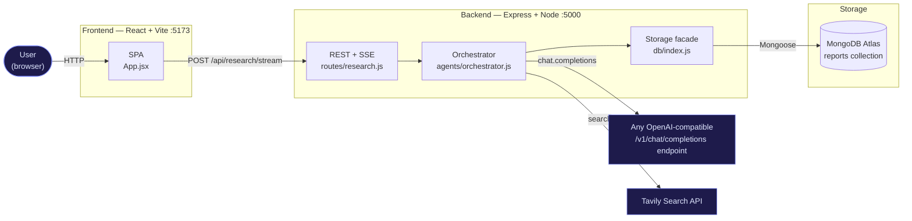

**Reading it:** the frontend never talks to the LLM or Tavily directly — **API keys never
leave the server**. That is a hard architectural rule (see [§17](#17-security--robustness)).

---

## 4. The MERN claim, audited

"MERN" is often used loosely. Here is the honest mapping:

| Letter | Claimed | Actually used here | Verdict |
|---|---|---|---|
| **M** | MongoDB | Mongoose against MongoDB Atlas — the only storage driver | ✅ |
| **E** | Express | Express 4 + `cors` + `dotenv` | ✅ |
| **R** | React | React 19 + Vite 8 SPA | ✅ |
| **N** | Node.js | Node 22, ESM (`"type": "module"`) | ✅ |

**The M is no longer partial.** MongoDB used to be an optional adapter behind a facade; it is
now the only store ([ADR-24](#adr-24-delete-mock-mode-and-the-file-store)). Reports are
durable, queryable, and — because each carries its owner — private to a user
([ADR-23](#adr-23-clerk-auth-with-owner-scoped-reports)). The facade in
[§12](#12-storage-the-mongodb-facade) remains, but its job changed: it is now the one
place that enforces owner scoping rather than the one place that picks a driver.

---

## 5. Stack choices and why

### 5.1 Backend dependencies (there are only six)

| Package | Version | Why this and not something else |
|---|---|---|
| `express` | ^4.21 | Ubiquitous, well-understood, and — critically — gives direct access to the raw response object, which is what SSE needs. A meta-framework would add indirection for zero benefit in a 4-route API. |
| `openai` | ^4.79 | Used **only** as an HTTP client for the `/v1/chat/completions` protocol. It handles streaming delta parsing, retries, and timeouts correctly. We never use an OpenAI account. See [ADR-01](#adr-01-openai-sdk-as-transport-not-vendor). |
| `@tavily/core` | ^0.5.6 | Purpose-built for LLM research: returns cleaned, snippet-ready content rather than raw SERP HTML. See [§11](#11-search-tavily-and-normalisation). |
| `mongoose` | ^8.9 | Schema validation, `findOneAndUpdate` upserts, and connection management for the optional Mongo driver. |
| `cors` | ^2.8.5 | The SPA and API are separate origins (5173 vs 5000); CORS is required and was made explicit rather than `*`. |
| `dotenv` | ^16.4 | Reads `backend/.env`. Node 22 has `--env-file`, but `dotenv` works identically regardless of how the process is launched (including `node --watch`). |

**Notably absent:** any agent framework (LangChain, LlamaIndex, CrewAI, AutoGen). See
[ADR-02](#adr-02-own-the-orchestration-no-agent-framework).

### 5.2 Frontend dependencies

| Package | Why |
|---|---|
| `react` 19 / `react-dom` | The host app; already present in the boilerplate. |
| `vite` 8 | Dev server with HMR in milliseconds; no config burden. |
| `react-markdown` 9 + `remark-gfm` 4 | Renders model output as Markdown **without `dangerouslySetInnerHTML`**. See [ADR-14](#adr-14-react-markdown-instead-of-innerhtml). |
| `tailwindcss` 4 + `@tailwindcss/vite` | Utility styling through the v4 Vite plugin — no `tailwind.config.js`, no PostCSS config. See [ADR-19](#adr-19-tailwind-v4-for-styling). |
| `mermaid` 12 | Renders the report's ` ```mermaid ` blocks to SVG. Lazily imported so the library is code-split out of the main bundle. See [ADR-18](#adr-18-client-side-mermaid-with-a-syntax-fallback). |

**Deliberately still absent:** any state library (React state is sufficient — see
[§13.1](#131-state-machine)), any HTTP client (native `fetch` streams, which `axios`
historically handled worse), and any UI kit — the four primitives in `components/ui/`
are ~80 lines in total.

---

## 6. Backend architecture

### 6.1 Module graph

Layers point downward; nothing lower imports anything higher.

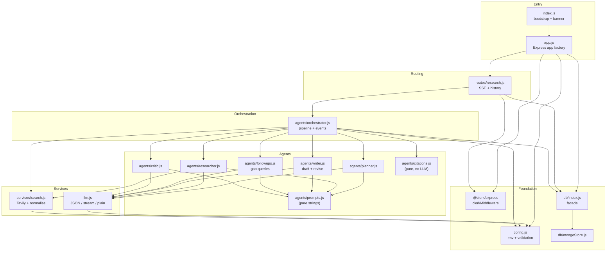

**The rules this diagram encodes:**

1. `prompts.js` contains *only strings* — no logic, no imports. The entire behavioural
   surface of the AI (the part most likely to be tuned) is one file with no side effects.
2. `index.js` is a **bootstrap, not an app** — it initialises storage and listens. The
   Express app itself is built by `app.js`'s `createApp()`, so the app can be imported and
   exercised without binding a port. See [ADR-20](#adr-20-app-factory-separate-from-bootstrap).
3. `routes/research.js` is the **only** place that reads auth state. It resolves the Clerk
   `userId` once and passes it down as `ownerId`; ownership is then enforced inside the
   storage query, so no pipeline stage can forget to scope a read.
4. `citations.js` is **pure**: it takes a report string and the source list and returns an
   audit object. It touches no network, no LLM, and no storage — which is what makes the
   citation guarantee testable (and why the audit phase costs ~2 ms, see [§7.8](#78-the-citation-audit)).

### 6.2 Why `agents/` and `services/` are separate directories

- `agents/` — components that talk to the **LLM**. They own prompts and response shapes.
- `services/` — components that talk to **other external systems** (search).

This is not cosmetic. It means "swap Tavily for Brave" is a `services/` change and
"change how findings are extracted" is an `agents/` change; they cannot accidentally
entangle. (See [ADR-03](#adr-03-layer-by-systems-touched-not-by-feature).)

### 6.3 Startup sequence

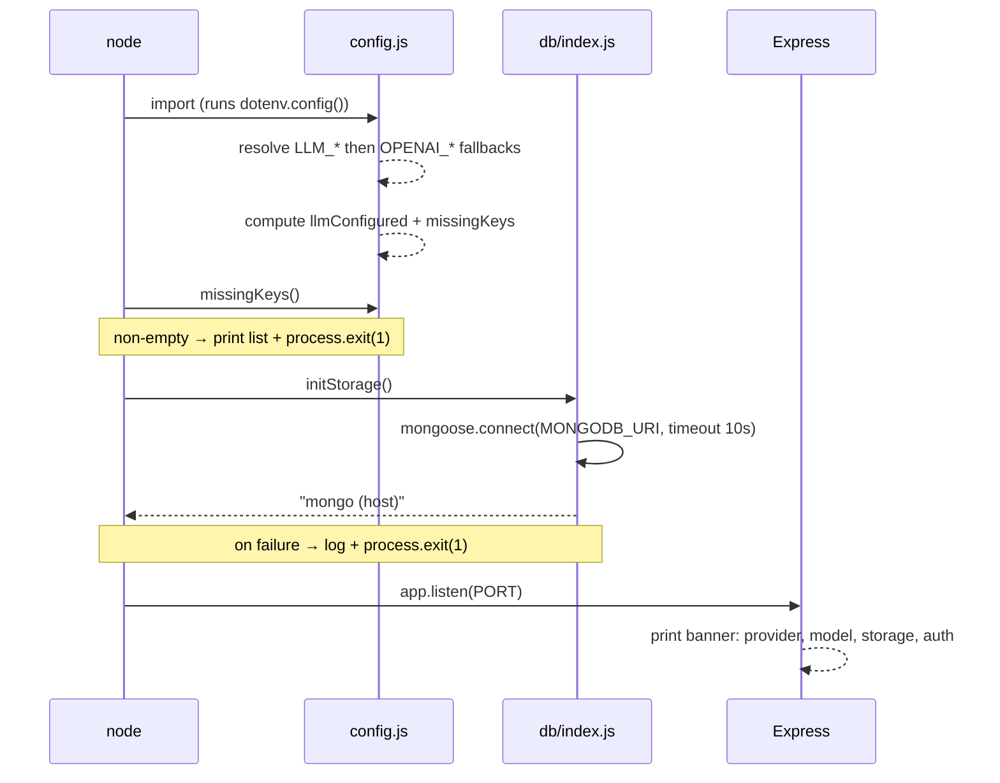

**Note the fail-fast behaviour:** if storage cannot initialise, the process **exits**
rather than silently degrading. See [ADR-10](#adr-10-fail-fast-on-storage-init-failure).

### 6.4 Why `config.js` is a single resolved object

`config.js` reads the environment **once**, at import time, and exports a frozen-shaped
object. Every other module imports `config` rather than touching `process.env`.

Consequences, all intentional:

1. **One place to audit** for every setting (there are 15).
2. **No scattered `process.env.X || 'default'`** fallbacks drifting apart.
3. **Derived values are resolved once:** `llmConfigured` and the required-key list are
   computed from a single pass over the environment, so a request can never see a
   half-configured state.
4. **Fail-fast:** `index.js` calls `missingKeys()` before doing anything else and exits
   with the list if it is non-empty — a missing key is a startup error, never a silent
   downgrade to canned data.

---

## 7. The agent pipeline

### 7.1 The pipeline, in six phases

A run is not "plan → research → write". It is a six-phase pipeline with a gap-filling loop
and a mandatory revision pass:

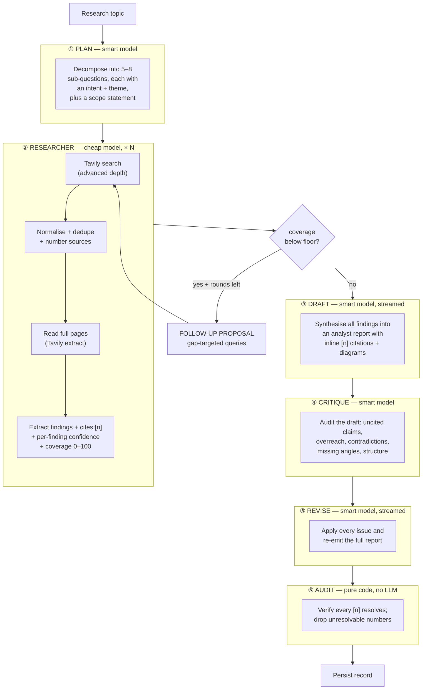

| Phase | Model tier | Calls per run | Input | Output (JSON shape) |
|---|---|---|---|---|
| **① Plan** | `LLM_MODEL_SMART` | 1 | topic + max count | `{ title, scope, subQuestions: [{question, intent, theme}] }` |
| **② Research** | `LLM_MODEL` | N (≈5) + F follow-ups | one sub-question + numbered sources (+ full page text) | `{ summary, coverage: 0–100, findings: [{point, cites[], confidence}], gaps[] }` |
| **③ Draft** | `LLM_MODEL_SMART` | 1 (streamed) | topic + plan + all findings + source list | Markdown (analyst report + Mermaid) |
| **④ Critique** | `LLM_MODEL_SMART` | 1 | the draft + the citation whitelist | `{ verdict, issues[], citationProblems[], recommendations[] }` |
| **⑤ Revise** | `LLM_MODEL_SMART` | 1 (streamed) | the draft + the critique | revised Markdown |
| **⑥ Audit** | *none* | 0 | final report + sources | `{ references, coverage, invalid[], uncited[], invalidRemoved }` |

**Total external calls per deep run:** `1 + N` to `1 + N + F` searches and `3 + N + F` to
`5 + N + F` LLM calls. With defaults (`MAX_SUBQUESTIONS=5`, `RESEARCH_MAX_ROUNDS=2`) that is
**up to 13 searches and 17 LLM calls**. The measured run in
[§15.1](#151-end-to-end-live-run) used 13 searches and 13 LLM calls for a 1,491-word report.

The phases are not merely a diagram: they are emitted as `phase` events with measured
durations, so the UI can show which stage is running and the record carries a phase
timeline ([§9.3](#93-event-taxonomy), [§19](#19-performance-where-the-time-goes)).

### 7.2 Why the model tiers are split

The researcher runs *N* times; the planner and writer run once each. Putting the expensive
model where it runs 5× would multiply cost for minimal quality gain — extraction is a
narrow "read these sources, output claims" task. The planner and writer do the reasoning
that benefits from a stronger model.

**Defence of the fallback:** `LLM_MODEL_SMART` defaults to `LLM_MODEL` when unset
(`config.js`, `smartModel`). This means a provider with only one good model still works
with a single setting — the tiering is an *optimisation*, never a *requirement*.

### 7.3 Why research runs in a bounded pool

All sub-questions are processed through
`mapConcurrent(subQuestions, RESEARCH_CONCURRENCY)` (`util/concurrency.js`). The research
phase is almost entirely network wait — Tavily searches, page extracts, and one extraction
call per sub-question — and the sub-questions are independent, so the pool overlaps that
wait instead of adding it up. This replaced an earlier fully sequential `for … of` loop.

| Consideration | Bounded pool (chosen) | Fully sequential (previous) |
|---|---|---|
| Source numbering | Unchanged — `SourceIndex` assigns each number synchronously as a result is folded in, so two workers cannot race or interleave a numbering decision | Trivial, but not actually the constraint it appeared to be |
| Rate limits | Bounded by `RESEARCH_CONCURRENCY` (default `3`); the whole run is also capped by `RUN_TIMEOUT_MS` | One request at a time |
| Gap filling | Each sub-question still owns its own `alreadyAsked` set and round loop — the pool parallelises *sub-questions*, never rounds | Each round extends its own history |
| Order | `mapConcurrent` preserves input order, so the writer still receives the plan's order | Same |
| Trace | Interleaved: several sub-questions visibly progress at once | Reads top-to-bottom |
| **Latency** | **Overlaps the wait** | **Adds it up** |

**Why the risk was lower than it looked.** The citation invariant never depended on *which*
sub-question ran first — only on the order results are *folded in*, and folding is a
synchronous operation in a single-threaded runtime. Moving numbering into one small, tested
class (`SourceIndex`, `test/sources.test.js`) made that explicit rather than implicit in a
loop body. What concurrency does change is the trace: it is no longer a top-to-bottom
narrative of one sub-question at a time, which is the visible price of the wall-clock win.

### 7.4 Source indexing — the backbone of citations

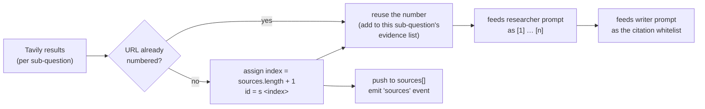

**The invariant:** a source's number is assigned **once**, at the moment it is first seen,
and never changes. That number is what appears in researcher output, in the writer's
citation whitelist, and in the UI's source cards. Deduplication by URL happens *before*
numbering, so the same page found for two sub-questions cannot occupy two slots.

**A URL seen twice is reused, not discarded.** The earlier implementation dropped a repeat
outright, which meant a sub-question whose search re-ranked a page that an *earlier*
sub-question had already found was handed a strictly smaller evidence set than Tavily
returned — its best result silently withheld, and the source later reported as "available
but never cited" by the audit. `SourceIndex.add()` returns the existing source instead
(`{ source, isNew }`), so the researcher sees it while only genuinely new URLs are emitted
to the client (`test/sources.test.js` covers both halves).

**Why this matters:** without a stable index there is no way to make `[2]` in the final
report reliably point at source card 2. Every downstream guarantee rests on this one rule.

### 7.5 The gap-filling loop (iterative depth)

One search per sub-question is a *breadth-first* strategy: it never goes back to a facet it
under-served. The researcher is therefore asked to output an honest `coverage` estimate
(0–100) alongside its findings, and the orchestrator compares that number to a floor:

```
round = 0
while round < 1 + RESEARCH_MAX_ROUNDS:
    extract(...)
    if coverage >= COVERAGE_FLOOR: break
    queries = proposeQueries(subQuestion, alreadyAsked, gaps)   # skip if empty
    if queries.empty: break
    alreadyAsked += queries
    search(queries) + extract(them)
    round += 1
```

Four deliberate properties of this loop:

1. **The model estimates its own coverage, and `coverage: 0` is the fallback for an empty
   result** — so a failed search and a genuinely thin topic both look like "gaps", which is
   what they are.
2. **Follow-up queries are deduplicated against everything already asked**
   (`alreadyAsked`), so round two cannot re-run round one's searches.
3. **An empty follow-up list is a legal answer.** The prompt explicitly permits `[]`, and
   the loop breaks on it. Iteration is bounded by evidence, not by a turn counter.
4. **The bound is `1 + RESEARCH_MAX_ROUNDS`** — `RESEARCH_MAX_ROUNDS=0` disables the loop
   entirely, giving back the original single-pass behaviour with one env var.

In the measured live run the gap loop fired **4 times** across 5 sub-questions and added 8
follow-up searches ([§15.1](#151-end-to-end-live-run)) — that is where most of the run's
~113 s research phase went.

### 7.6 Deep fetch — reading pages, not just snippets

A Tavily search result is a ~800-character snippet. That is enough to *find* a source and
occasionally enough to cite it, but it is a poor basis for a dense analyst report. When
`DEEP_FETCH=true`, the orchestrator takes the top `DEEP_FETCH_SOURCES` URLs for a
sub-question and calls Tavily's `extract` endpoint, which returns the **full page text** as
markdown:

```js
const pages = await fetchPages(urls)   // Map<url, text>, failures dropped
```

Two rules keep this from blowing up the prompt (and the bill):

| Rule | Reason |
|---|---|
| **Cap the count** (`DEEP_FETCH_SOURCES`, 0–8, default 3) | Full pages are an order of magnitude larger than snippets; reading 6 URLs per sub-question × 6 sub-questions would be enormous |
| **Cap each page** (`MAX_PAGE_CHARS = 6000`) | One 300 KB spec sheet must not crowd out every other source |

**Page text is run-scoped and never persisted.** It lives in a `Map` inside the orchestrator,
is used only to build researcher prompts, and dies with the run. This matters for two
reasons: the stored record stays small and safe to send to the client, and the raw page text
of arbitrary websites never becomes part of a durable document.

### 7.7 Critique and the always-on revision

The draft is written by the same model family that would have to notice its own mistakes, so
the pipeline inserts a **separate** critique call with a hostile-auditor prompt, then a
**revision** call that applies it. Three choices here are worth defending:

- **The critique is structural, not stylistic.** It is asked for a typed JSON list —
  `uncited`, `miscitation`, `overreach`, `contradiction`, `missing-angle`, `structure` —
  each with a severity, the offending claim, the problem, and the fix. A review that returns
  prose cannot be acted on reliably; a review that returns typed issues can.
- **Revision runs whenever `RESEARCH_CRITIQUE=true`, regardless of the verdict.** This was
  originally gated on the critic's own `verdict` field and that was a **bug**: in the first
  measured run the critic returned `verdict: "solid"` *while also reporting two issues*, and
  the gate skipped the revision pass entirely. A model's summary judgement about its own
  review is the least reliable part of the review. The verdict is now recorded as information
  for the reader; it is not a control-flow switch. ([ADR-21](#adr-21-the-critique-is-advisory-the-revision-is-unconditional))
- **The revision is guarded and has a fallback.** If the revision call throws or produces an
  implausibly short document (`wordCount < 120`), the pipeline keeps the draft and records
  `revised: false` rather than shipping a truncated report. The revision is an improvement
  step, and an improvement step must never be able to make the output worse than not running
  it.

The UI surfaces all of this honestly: the report carries the critique verdict and an
"audited" block, and the issues themselves are available in a disclosure panel. A report
that says "a critic reviewed this and here is what it found" is more trustworthy than one
that implies no flaws exist.

### 7.8 The citation audit

After revision, one **pure** function checks the report against the sources:

```js
const audit = auditCitations(report, sources)
// → { references, citedSourceCount, sourceCount, coverage,
//     invalid[], uncited[], invalidRemoved }
```

`invalid[]` is every `[n]` in the report that does not resolve to a real source. Rather than
only *reporting* these, the pipeline **sanitises** them: `sanitizeCitations` strips any
unresolvable number (while preserving legitimate comma-lists like `[1, 4]`) and then
re-audits, recording the count in `invalidRemoved`. The reason is a simple UX judgement — a
citation chip that points nowhere is worse than no chip at all, because it looks like
evidence. ([ADR-22](#adr-22-sanitise-citations-instead-of-only-reporting-them))

Unlike the critique, this step involves no model and cannot be argued with: it is a regex
pass over the final text plus a set lookup. It costs ~2 ms and removes an entire class of
silently-broken output. `coverage` (cited ÷ total sources) and `uncited[]` are reported as
is — a run that read 48 sources and cited 23 is a *fact* the reader should see, not
a number worth gaming.

---

## 8. Prompt design

Every system prompt lives in `agents/prompts.js` — a single file with no logic and no
imports. There are six: planner, researcher, follow-up proposal, writer, critic and reviser,
plus the per-format structure blocks they are composed with (see
[ADR-25](#adr-25-six-selectable-report-formats)).

### 8.1 The planner prompt

- **"smallest set of independent, non-overlapping sub-questions"** — prevents the model
  from producing five variations of the same question, which would waste searches and
  produce a repetitive report.
- **"Aim for a number of sub-questions close to the stated maximum … never exceed the
  maximum, and do not pad the plan to reach it"** — the maximum is injected per-request from
  `MAX_SUBQUESTIONS`. The prompt used to ask for "5 to 8" while the code clamped the list to
  `MAX_SUBQUESTIONS` (default 6), so a plan of 6 was truncated and a topic that only needed 4
  questions was pushed to invent a fifth. The instruction is now stated relative to the
  injected maximum, which is the only number the model is actually given.
- **`intent` and `theme` per sub-question** — `intent` says what the investigation is trying
  to establish; `theme` groups sub-questions so the writer can build thematic sections
  instead of a flat list. Both are for the *writer*, not the searcher.
- **A `scope` statement** — one sentence, carried into the report's `## Scope & method`
  section. It is what makes exclusions ("legacy lead-acid chemistry is out of scope")
  explicit instead of silent, which is the difference between a report and a dump.
- **Breadth-then-depth guidance** — encodes a research methodology (background → current
  state → trade-offs → risks → outlook) rather than hoping the model invents one.
- **"Do not write an answer. Only plan the investigation."** — stops the planner from
  answering the question itself and then having the researcher merely confirm it.

### 8.2 The researcher prompt

- **"Never invent facts, numbers, names, or quotes that are not present"** — this is the
  anti-hallucination instruction, and it is why the API accepts `includeAnswer: false`
  from Tavily: we want *raw sources*, not a pre-digested answer the model can copy.
- **"Every finding must cite the source numbers"** — makes grounding *structural* rather
  than stylistic. Findings without citations are visibly malformed.
- **A `confidence` label per finding** (`high` / `medium` / `low`) — the researcher sees the
  sources and is the only party that can say how strongly one supports a claim. The value is
  whitelisted in `researcher.js`, so a model that invents a fourth level cannot leak it
  downstream.
- **An honest `coverage` estimate (0–100)** — this is not decoration: it is the input to the
  gap-filling loop in [§7.5](#75-the-gap-filling-loop-iterative-depth). Asking the model to
  rate its own completeness is what lets the pipeline decide whether a second round is
  warranted.
- **"Prefer quantified findings — numbers, dates, named entities, magnitudes"** — a claim
  with a number in it is checkable; a claim without one is an opinion with a citation glued
  on.
- **"If the sources are thin or contradictory, say so honestly in `gaps`"** — a dedicated
  output field for uncertainty. This is what surfaces the "no sources found" case honestly.
- **When full page text is available it is passed through (`s.content`) instead of the
  snippet** — prefixed `Search snippet:` only in the fallback case, so the model can tell
  which it is looking at ([§7.6](#76-deep-fetch--reading-pages-not-just-snippets)).

### 8.3 The writer prompt and the format spec

`writer.js` and `critic.js`'s reviser step are both composed from the *same* format spec for a
given run, so the revision is guaranteed to target the structure the draft was built against.
The default format is a **long-form analyst** specification, not a summary. Each of the six
formats supplies its own section list; the analyst one is:

1. `# ` title — the report's own headline, not the raw query.
2. `## Scope & method` — what was investigated, what was deliberately excluded, how many
   sources were consulted.
3. `## Executive summary` — 4–7 bullets, each carrying citations.
4. **4–8 thematic `##` sections** with `###` sub-sections, dense prose, and **GFM tables**
   for any comparison. The single most important integrity rule here is:
   **"write \"not established\" where a source does not say"** — an explicit, honest
   placeholder instead of a plausible-looking invented cell.
5. `## Where the evidence conflicts` — contradictions between sources are presented as
   disagreements, not averaged away.
6. `## Confidence & evidence quality` — per-theme confidence ratings grounded in the
   researcher's labels.
7. `## Limitations & open questions` — what the sources could not establish. This is
   mandatory rather than optional, because a report that claims completeness is
   *misleading*, and its absence is one of the things the critic checks for.

Plus two cross-cutting rule blocks, shared by every format:

- **Citation rules (critical)** — only cite provided numbers, never invent one, and **do not
  add a reference list**. That last rule is what lets the UI own reference rendering
  entirely — see [ADR-13](#adr-13-citations-inline-no-reference-list).
- **Diagram rules (Mermaid)** — asks for one or two fenced ```` ```mermaid ```` blocks
  *where a process, comparison, cause-and-effect chain, timeline, or hierarchy is easier to
  grasp visually than in prose*. The constraints are all about **renderability**, because a
  diagram is only useful if it draws: prefer `flowchart`/`timeline`/`sequenceDiagram`, keep
  node labels short, and **quote any label containing `()`, `:`, `;` or `,`** — unquoted
  punctuation is the single most common cause of a Mermaid parse error. The measured result
  (valid diagrams in a 1,491-word report) is in
  [§15.4](#154-what-could-not-be-verified).
- **Why "where it helps" rather than "include a diagram"**: an unconditional instruction
  produces a diagram on every report, including ones where it is filler. Tying it to the
  shape of the content keeps the feature honest.

**Factoring the structure out is itself a decision:** it exists once, as a string, and both
the draft and the revision are built from it. If the two prompts each carried their own copy
of the skeleton, the revision could silently "improve" the report into a different shape than
the critic audited. The shared detail/citation/diagram rules live in a separate
`SHARED_RULES` block that every format appends, so no format can lose the citation rules.
See [ADR-25](#adr-25-six-selectable-report-formats).

The writer-specific design notes:

- **Explicit Markdown structure** (the skeleton above) — a fixed structure produces
  consistent, exportable documents regardless of provider.
- **"group and reorder the sub-questions as needed rather than listing them mechanically"**
  — prevents the classic "five headings, one per search" artifact. The reader gets a report,
  not a transcript.
- **"Where sources disagree, present the tension explicitly"** — a deliberate push against
  the averaging/hedging behaviour models default to.

### 8.4 The follow-up prompt

Used only by the gap-filling loop. Its whole job is to convert a *known deficiency* into
*new, non-repeating queries*:

- **It receives the gaps and the `alreadyAsked` list, and "never repeat a query already
  asked"** — the deduplication is enforced at the prompt level *and* re-enforced in code
  (`followups.js` filters the returned list), because prompt-only constraints are advisory.
- **An empty list is explicitly permitted** — otherwise a model asked for queries twice will
  invent filler to look useful, and the loop would run to its bound on noise.
- **The step is counted in token usage** and reported as a `usage` delta, so the cost of
  iterating is attributable rather than invisible.

### 8.5 The critic prompt

The critic is the pipeline's adversarial reviewer, and the prompt is written to make an
*empty* review the exception rather than the default:

- **It is told outright that "an empty critique is the exception, not the norm."** Models
  default to approval when asked "is this any good?"; the prompt pre-empts that by framing
  the task as *finding* problems and by listing the categories to look for.
- **Typed output** — `uncited`, `miscitation`, `overreach`, `contradiction`, `missing-angle`,
  `structure` — each with `severity`, `claim`, `problem`, `fix`. Typed issues can be applied
  mechanically by the reviser; prose review cannot.
- **It is given the citation whitelist**, so "this citation is out of range" is a check the
  model can actually perform rather than hallucinate.
- **It is given the requested format's structure specification** — the same spec the writer
  was given — so the `structure` check audits the deliverable the user asked for instead of
  judging every report as an analyst report.
- **It reads the same evidence the researcher did.** The sources the draft cites are expanded
  to their full page text (capped by `CRITIC_FULL_TEXT_SOURCES`), because auditing a draft
  against 800-character snippets produces both error types at once: an honest figure gets
  flagged as `overreach` (the snippet never contained it) and a real `miscitation` slips
  through (its support is in the article body).
- **It may conclude that a criticism is unfounded.** In the measured run the critic raised
  two issues and explicitly noted on the second that "no change needed" — because the prompt
  asks for an honest audit, not a quota of complaints. That nuance is preserved in the stored
  critique, not filtered out.

### 8.6 The reviser prompt

- **It receives the draft and every issue, and is told to apply the fixes** while keeping
  the same format structure.
- **It is told not to discuss the critique.** The revision is a replacement document, not an
  appendix — "the criticism said X, so I changed Y" is exactly the meta-commentary that would
  make the report unreadable.

The `writer.js` module owns both streamed calls (`writeDraft`, `reviseReport`); they resolve
the run's report format, share the `findingsBlock` helper and the format spec, so a revision
cannot drift structurally from the draft it is revising.

---

## 9. The streaming protocol (SSE)

This is the heart of the "live" experience, and every decision here was made against an
alternative.

### 9.1 Transport choice

| Option | Verdict | Reasoning |
|---|---|---|
| **SSE over POST** | ✅ **chosen** | Server→client only (exactly our need); plain HTTP; no handshake; trivially proxied; auto-close semantics. |
| `EventSource` over GET | ❌ | Cannot send a request body. The topic would have to go in a query string — ugly, length-limited, and it lands in server logs. |
| WebSockets | ❌ | Bidirectional, stateful, needs a separate server/upgrade path, and we already have HTTP. **Overkill for a one-way progress feed.** |
| Long-polling | ❌ | Repeated requests, duplicated latency, no natural ordering guarantees. |
| Plain JSON response | ❌ | Defeats goal **G2** — the whole product is the trace. A 42-second silent request is unacceptable UX. |

**The cost we accepted:** because we use `POST` + `fetch` instead of `EventSource`, the
browser will not auto-reconnect on drop, and we must **parse the SSE frames by hand**
(`frontend/src/api.js`). That is ~30 lines of buffer-splitting code, and it buys us a JSON
body and full `AbortController` cancellation. Judged worth it — see [ADR-04](#adr-04-post-sse-with-hand-parsing).

### 9.2 Frame format — and the `event: end` subtlety

Every progress frame is **data-only**:

```
data: {"type":"status","message":"Researching: …"}\n\n
```

The **only** frame that uses a named SSE event is the terminator:

```
event: end
data: {}
```

**Why:** our client dispatches purely on `data.type`. Adding an `event:` name to every
frame would mean two sources of truth for the same information. The `event: end` line
exists solely so a generic SSE client (curl, a test harness, a future `EventSource`
consumer) has an unambiguous, non-JSON way to detect completion.

> ⚠️ **Common misreading:** grepping a captured stream for `^event:` returns *only* `end`.
> That is not a bug — it is the design above. This exact confusion has already been hit
> once; it is documented here so it isn't hit again.

### 9.3 Event taxonomy

| Event | Emitted when | Payload highlights | UI effect |
|---|---|---|---|
| `meta` | run starts | `model`, `smartModel`, `depth`, `critique`, `deepFetch`, `maxRounds`, `reportType`, `query` | records run metadata |
| `phase` | entering a pipeline phase | `phase` (`plan`/`research`/`draft`/`critique`/`revision`/`audit`) | phase badge + phase timeline |
| `status` | phase changes | `message` | status line |
| `plan` | planner done | `title`, `scope`, `subQuestions` | plan checklist + scope note |
| `step` | agent starts/finishes | `{agent, label, detail, status}` | trace row |
| `sources` | after each search | `sources[]` (new only), `total` | appends source cards |
| `findings` | after each extraction | `extraction` | findings fed to report |
| `token` | draft or revision streaming | `text` delta | appends to report |
| `critique` | critic done | the critique object | integrity badge + disclosure panel |
| `report-reset` | revision starts | — | **clears the report** before the revision streams |
| `audit` | final citation audit | `{references, citedSourceCount, sourceCount, coverage, invalid[], uncited[], invalidRemoved}` | integrity strip + uncited dimming |
| `done` | after persist | full `record` | finalises, enables export |
| `error` | pipeline throws | `message` | error banner |

**Thirteen event types**, up from nine. The four additions are the phases that did not exist
in v1 — and one of them, `report-reset`, exists purely because the report is now written
twice:

**Why `report-reset` instead of a "replace" flag on `token`:** the client is a dumb appender
(that is deliberate, see below). Streaming a second document into a buffer that already holds
the first would corrupt it unless the client knew to clear. Rather than teach the client to
handle replacement mid-stream, the server says exactly once "drop what you have" and then
streams normally. It is a one-field event that keeps the client's `token` handling unchanged
and makes the revision boundary explicit in the trace. The measured run delivered the report
in **2 streams** with this event in between ([§15.1](#151-end-to-end-live-run)).

**Why `phase` carries a duration only on exit:** the event fires when a phase *starts* (so
the UI can label it) and again when it ends, carrying `ms`. The orchestrator accumulates
`phases: [{phase, ms}]` onto the record, which is what produces the timings in
[§19](#19-performance-where-the-time-goes) — the performance table is generated from the
same data the user sees, not from a separate benchmark harness.

**Why `sources` sends only *new* sources:** the orchestration emits `fresh` (deduped) rather
than the running array, so the client appends without re-rendering or de-duplicating.
`total` is carried for display. This keeps the client dumb and the server authoritative.

### 9.4 Full request lifecycle

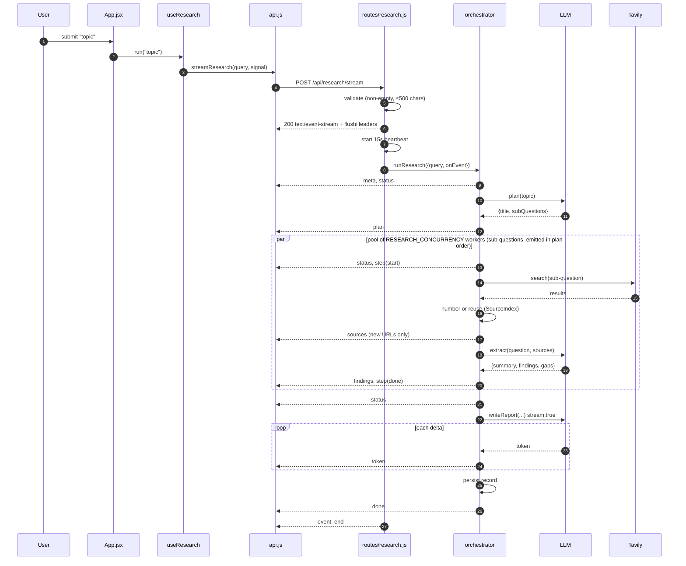

### 9.5 Heartbeat and dead-socket handling

```js
const heartbeat = setInterval(() => { if (!closed) res.write(': ping\n\n') }, 15_000)
res.on('close', () => { closed = true; clearInterval(heartbeat) })
```

Two problems are solved by four lines:

1. **Idle connections get killed.** A measured run takes **42 seconds**, with gaps of many
   seconds between frames while a model thinks. Reverse proxies, load balancers, and some
   corporate networks drop connections idle for ~30–60 s. A `: ping` comment frame (legal
   SSE, ignored by our parser) keeps the socket warm.
2. **Writing to a dead socket.** If the user closes the tab, `res.write` on a closed socket
   would throw. The `closed` flag is checked in both the heartbeat and `send()`, so a
   disconnected client simply stops the run's output rather than crashing the server.

Also set: `X-Accel-Buffering: no` (defeats nginx response buffering, which would otherwise
collapse the entire stream into one lump delivered at the end) and
`Cache-Control: no-cache, no-transform`.

---

## 10. The provider abstraction

**This is the decision the user cared about most, so it gets the most detail.**

### 10.1 The rule

> The OpenAI SDK is a **transport**, not a vendor. We use it to speak the
> `/v1/chat/completions` protocol to *whatever endpoint you point it at*. No OpenAI account,
> key, or model is required or assumed.

### 10.2 How the environment resolves

`config.js` line by line:

```js
const env = (neutral, legacy) => process.env[neutral] ?? process.env[legacy] ?? ''
```

Every setting is looked up **neutral-name-first, legacy-name-second**:

| Neutral (preferred) | Legacy fallback | Effective rule |
|---|---|---|
| `LLM_API_KEY` | `OPENAI_API_KEY` | neutral wins if set |
| `LLM_BASE_URL` | `OPENAI_BASE_URL` | neutral wins if set |
| `LLM_MODEL` | `OPENAI_MODEL` | neutral wins if set |
| `LLM_MODEL_SMART` | `OPENAI_MODEL_SMART` | neutral wins if set |
| `LLM_JSON_MODE` | `OPENAI_JSON_MODE` | `LLM_*` read first with `??` |

**Why keep the legacy names at all:** an existing `.env` written before the rename keeps
working, and a user copying an OpenAI-compatible snippet from any provider's docs doesn't
have to translate it. **Why `??` and not `||`:** `??` only falls through on `null`/`undefined`.
This matters because an explicitly empty `OPENAI_MODEL=` would otherwise defeat a set
`LLM_MODEL` — with `??`, the neutral value is honoured correctly. The only place `||` is
used is where an empty string should genuinely mean "apply the default" (the model names).

### 10.3 Configuration matrix

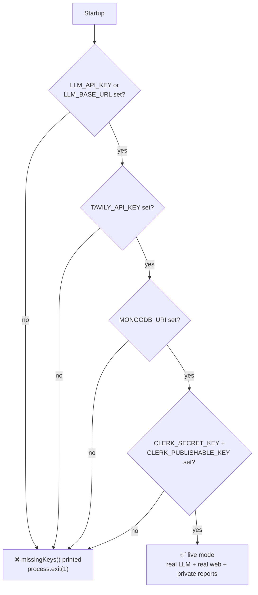

`llmConfigured = Boolean(apiKey || baseUrl)` — **either** is enough. This is what makes
local servers (Ollama, LM Studio, vLLM) work: they need no key, only a base URL.

### 10.4 The two call styles

`llm.js` exposes exactly two functions, matching the two shapes of work:

| Function | `stream` | `response_format` | Temperature | Used by |
|---|---|---|---|---|
| `chatJSON` | false | `json_object` (if `jsonMode`) | 0.1–0.4 | planner, researcher, followups, critic |
| `chatStream` | **true** | none | 0.35–0.5 | writer (draft + revision) |

**Why `chatStream` never asks for JSON mode:** the writer produces Markdown prose, and
`json_object` would force it to wrap the report in a JSON string — destroying the
incremental token stream that the UI depends on.

### 10.5 JSON mode: defended with a fallback

```js
...(config.llm.jsonMode ? { response_format: { type: 'json_object' } } : {}),
```

| If we always sent `json_object` | If we never sent it |
|---|---|
| Some providers/local models return **400/500** and the run dies | Models occasionally wrap JSON in prose or a ```json fence |

The chosen approach: **send it when enabled (the default, because it works on the
overwhelming majority), and recover when it isn't.** If JSON parsing fails,
`chatJSON` salvages the first balanced `{…}` block via regex before giving up:

```js
const match = text.match(/\{[\s\S]*\}/)
if (!match) throw new Error('Model did not return valid JSON')
return { data: JSON.parse(match[0]), usage }
```

**Verified live:** the Gemini endpoint was probed with
`response_format: {type:"json_object"}` and returned clean JSON, confirming
`LLM_JSON_MODE=true` is safe there (see [§15.3](#153-provider-json-mode-verification)).

### 10.6 Provider matrix (all speak the same protocol)

| Provider | `LLM_BASE_URL` | Example model |
|---|---|---|
| **Google Gemini** | `https://generativelanguage.googleapis.com/v1beta/openai/` | `gemini-3.5-flash-lite` |
| Groq | `https://api.groq.com/openai/v1` | `llama-3.3-70b-versatile` |
| OpenRouter | `https://openrouter.ai/api/v1` | `anthropic/claude-3.5-sonnet` |
| Together | `https://api.together.xyz/v1` | `meta-llama/Llama-3.3-70B-Instruct-Turbo` |
| DeepSeek | `https://api.deepseek.com/v1` | `deepseek-chat` |
| Mistral | `https://api.mistral.ai/v1` | `mistral-large-latest` |
| Ollama (local) | `http://localhost:11434/v1` | `llama3.1` |
| LM Studio (local) | `http://localhost:1234/v1` | your loaded model |
| vLLM (local) | `http://localhost:8000/v1` | your served model |
| OpenAI (optional) | `https://api.openai.com/v1` | `gpt-4o-mini` |

> **Model names are the provider's, not ours.** There is no allow-list, no mapping table,
> no normalisation — the string in `LLM_MODEL` is passed through verbatim. This is
> intentional: any mapping layer would go stale the moment a provider renames a model, and
> would silently hide typos. The trade-off is that a typo surfaces as a 404 from the
> provider rather than a friendly startup warning — see [§15.2](#152-the-model-id-incident-the-reason-this-trade-off-gets-a-whole-section).

---

## 11. Search: Tavily and normalisation

### 11.1 Why Tavily

| Requirement | Tavily | Raw SERP scraping | Google CSE | Bing |
|---|---|---|---|---|
| LLM-ready snippets | ✅ cleaned content, ~800 char chunks | ❌ raw HTML | ⚠️ description only | ⚠️ description only |
| Single API call | ✅ | ❌ scrape + parse | ✅ | ✅ |
| Search depth control | ✅ `basic`/`advanced` | — | ❌ | ❌ |
| Relevance scores | ✅ per result | ❌ | ❌ | ❌ |
| **Full-page extraction** | ✅ `extract()` → markdown | ❌ scrape yourself | ❌ | ❌ |
| Purpose-built for RAG | ✅ | ❌ | ❌ | ❌ |

Tavily is designed for exactly this use case and returns `content` that is already the
right granularity to paste into an LLM prompt — and, uniquely among these, it also offers a
second call that returns **whole pages as markdown** ([§7.6](#76-deep-fetch--reading-pages-not-just-snippets)).

### 11.2 The normalisation layer

```js
return (res.results || []).map((r) => ({
  title:   r.title || 'Untitled source',
  url:     r.url,
  snippet: (r.content || '').replace(/\s+/g, ' ').slice(0, 800),
  score:   r.score ?? null,
}))
```

**Why normalise at all** — three concrete protections:

1. **`|| 'Untitled source'`** — a missing title would otherwise render an empty, unclickable card.
2. **`.replace(/\s+/g, ' ')`** — collapses newlines/tabs, so snippets occupy predictable
   vertical space in the UI and don't blow up the prompt token count.
3. **`.slice(0, 800)`** — hard cap. Without it, one verbose page could dominate the
   researcher prompt for that sub-question and crowd out the other four sources.

**The contract this creates:** everything above `webSearch` deals with
`{title, url, snippet, score}` and *nothing else*. Swapping Tavily for Brave is one file,
one function, and the agent layer never notices. (See [ADR-08](#adr-08-tavily-behind-a-normalising-wrapper).)

### 11.3 Depth control

```js
searchDepth: config.research.depth === 'deep' ? 'advanced' : 'basic'
```

`RESEARCH_DEPTH` changes two things at once: Tavily's depth **and** the per-search result
count (deep uses `TAVILY_MAX_RESULTS`; quick caps at 3 in `orchestrator.js`). This gives a
single user-facing knob for the cost/quality trade-off rather than two knobs that can be
set into a contradictory state.

### 11.4 The second call: `fetchPages`

Search finds sources; `fetchPages` reads them. It is deliberately a *separate* function
returning a *different* shape, because the two results are used for different things:

```js
// search.js —— one Map, keyed by the URL that was already numbered
fetchPages(urls) → Map<url, text>
```

| Property | Why it is this way |
|---|---|
| **Returns a `Map`, not an array** | Sources are already numbered and identified by URL; the caller looks up text by the URL it already has. No index correlation to get wrong. |
| **Failures are dropped, not thrown** | `extract()` returns `{results, failedResults}`. A paywalled or dead page must degrade to "we only have the snippet", never fail the run ([§18](#18-failure-modes)). |
| **Text is truncated to `MAX_PAGE_CHARS = 6000`** | Mirrors the snippet cap in [§11.2](#112-the-normalisation-layer): one huge page must not crowd out the others. |
| **Never persisted** | The `Map` is run-scoped in the orchestrator. Raw page text does not enter the stored record or the SSE stream. |

---

## 12. Storage: the MongoDB facade

### 12.1 The interface

`db/index.js` is the one place the store is chosen, and it re-exports owner-scoped
wrappers so no caller ever touches the driver directly:

```js
export const save   = (record)         => mongoStore.save(record)
export const list   = (ownerId)        => mongoStore.list(ownerId)
export const get    = (id, ownerId)    => mongoStore.get(id, ownerId)
export const remove = (id, ownerId)    => mongoStore.remove(id, ownerId)
export async function initStorage() { … }
```

**The contract every driver must satisfy:**

| Function | Contract |
|---|---|
| `connect()` | connect to MongoDB; return a human-readable location for the banner |
| `save(record)` | upsert by `record.id`; rejects a record with no `ownerId` |
| `list(ownerId)` | **summaries only** (no `report`, no `steps`), newest first, owner-scoped |
| `get(id, ownerId)` | full record or `null` — only if the owner matches |
| `remove(id, ownerId)` | boolean — whether anything was deleted |

### 12.2 Why a facade at all

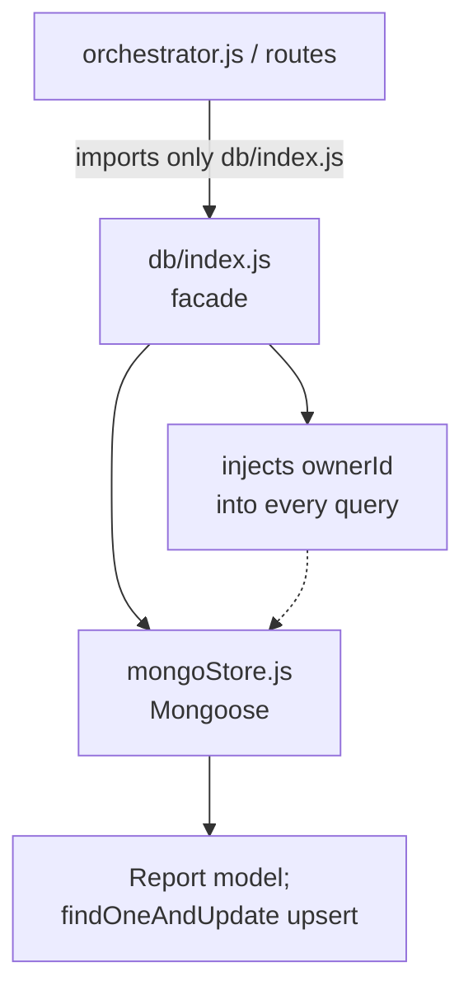

Without the facade, `orchestrator.js` and every route would `import mongoStore` directly, and
the `ownerId` filter would have to be remembered at each call site — exactly the kind of
invariant that gets forgotten in a new endpoint. With the facade, scoping happens once and is
impossible to skip ([ADR-11](#adr-11-storage-facade)).

### 12.3 Why `list()` projects instead of fetching everything

`mongoStore.list()` runs an **aggregation** that projects exactly the summary fields and computes
the source count server-side (`sourceCount: { $size: { $ifNull: ['$sources', []] } }`), capped at
100. A plain `find` would still have to transfer every source's title, URL and snippet just so the
sidebar could show a number; `$size` keeps that off the wire, and the limit bounds the payload for
a user with a long history.

### 12.4 The stored record

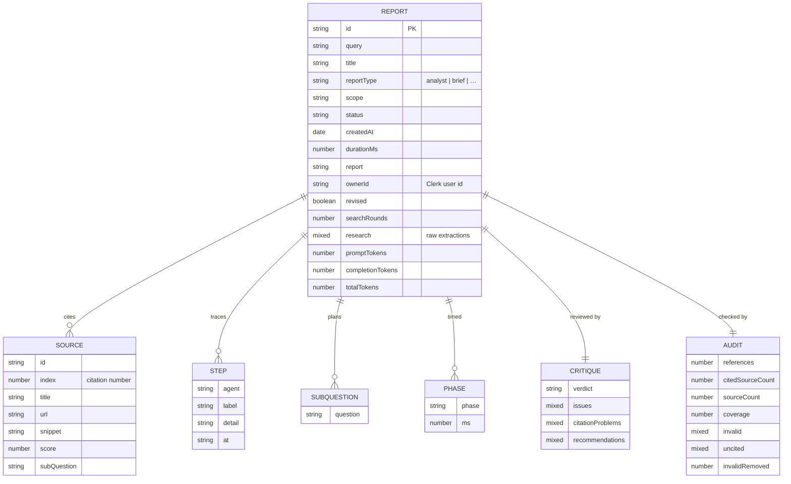

**Why `research`, `critique`, and `audit` are `Mixed` rather than fully modelled:** they are
*display-only* payloads. The history list and the report view render them ("3 uncited
sources", "verdict: solid", "8 issues"), but nothing queries inside them — no filter, no
sort, no join. Giving them full sub-schemas would be schema churn for shape validation the
application never relies on. The fields that *are* modelled — `revised`, `searchRounds`,
`sources.index`, `themes`, `phases` — are the ones the UI branches on.

**Why `searchRounds` is stored even though it is derivable:** it is a research-effort
signal (how many gap rounds fired) that the reader should be able to see without replaying
the step trace, and it is cheap to carry.

**Why `subQuestions` is flattened to `[String]` in the record** while the live `plan` event
carries objects: the persisted shape is what the *history list and report view* need, and
it's what the Mongo schema validates. The `intent` field is useful to the writer at
generation time but not to a reader six months later. Keeping the stored document narrow
means the schema is stable and indexable. [ADR-12](#adr-12-flatten-plan-into-subquestions-on-persist)
has the full argument, including the moment this looked like a bug and wasn't.

---

## 13. Frontend architecture

### 13.1 State machine

All run state lives in one hook, `useResearch.js`. It is an explicit four-state machine:

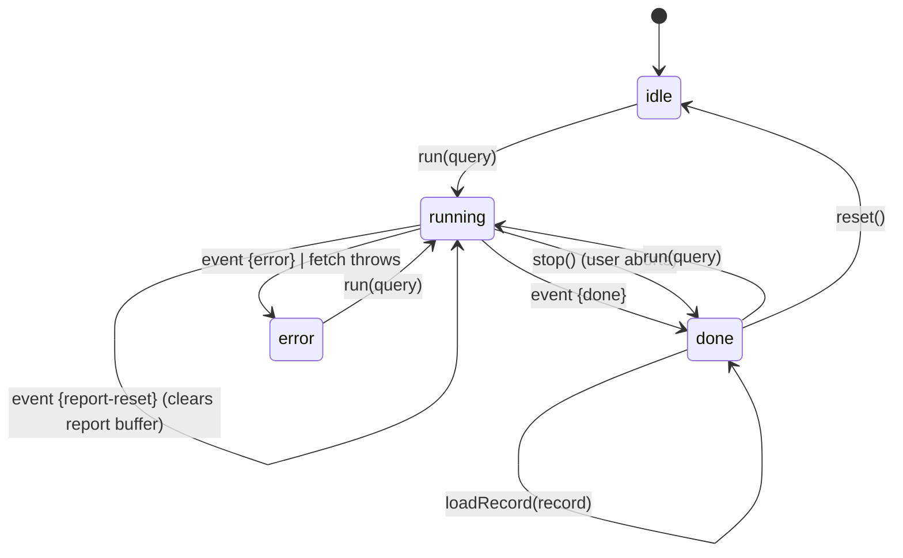

- **`idle`** — nothing yet.
- **`running`** — request in flight; `AbortController` held in a ref.
- **`done`** — either the `done` event arrived, or the user aborted. A stopped run keeps the
  partial report *and* sets `stopped`, so the view labels it a partial draft (the critique and
  the citation audit never ran) instead of presenting it as finished.
- **`error`** — fetch threw or an `error` event arrived.

**Why one reducer-style `apply(event)` and not per-event handlers:** every event is folded
through a single `switch` in a `setState` updater (`useResearch.js`). This makes the event
vocabulary of the backend and the state transitions of the frontend visibly 1:1 — to add an
event type you add one `case`. It also means React can't tear state across events, because
functional updates are serialised.

**Why `AbortController` and not a "cancel" flag:** aborting propagates down to the `fetch`,
which closes the TCP connection, which fires `res.on('close')` in the route, which aborts the
pipeline's own `AbortController` — so the model and search calls in flight are cancelled
instead of completing for a client that has gone away, and the next checkpoint
(`throwIfAborted`) stops the run. One mechanism, both ends. See
[§9.5](#95-heartbeat-and-dead-socket-handling).

### 13.2 Component tree

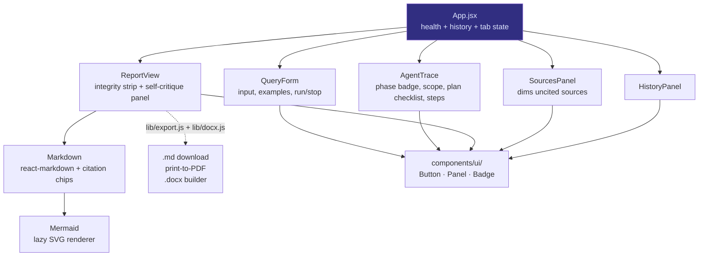

**Why no state library:** the entire shared state is one hook instance in `App.jsx` plus
two `useState` values (`health`, `history`). Redux/Zustand would add a dependency to manage
*a single object*. If the app grew a second view or optimistic multi-run support, that
calculus would change.

### 13.3 The SSE parser (and why we wrote it)

`api.js` reads `res.body` with a `ReadableStream` reader and splits on `\n\n`:

```js
const frames = buffer.split('\n\n')
buffer = frames.pop() ?? ''   // keep the trailing partial frame
```

**The subtle part is `buffer.pop()`.** TCP/HTTP chunks do not respect SSE frame boundaries —
a single `read()` can deliver half a frame, or three frames at once. Keeping the trailing
partial in `buffer` (and prepending it to the next chunk) is what makes the parser correct
under arbitrary chunking. Getting this wrong produces the classic "occasionally a token or a
source goes missing" bug that only reproduces on slow networks.

**Malformed frames are swallowed, not fatal:**
```js
try { onEvent?.(JSON.parse(raw)) } catch { /* ignore malformed frames */ }
```
One bad frame must not kill a 42-second research run. This is a deliberate resilience choice.

### 13.4 Citation chips — the interesting trick

The writer emits `[2]` in Markdown. We want that to be a clickable chip that scrolls to
source 2. Three ways to do it, and the reasoning:

| Approach | Cost | Chosen? |
|---|---|---|
| Write a `remark` plugin to reparse text nodes into elements | Correct but heavy; API surface, plugin ordering, edge cases | ❌ |
| Replace `[2]` with raw HTML `<button>` | Breaks if `react-markdown` sanitises it; mixes concerns | ❌ |
| **Rewrite `[2]` → `[2](#source-2)` and intercept the anchor in a custom `a` component** | ~20 lines, uses the Markdown parser we already have | ✅ |

```js
text.replace(/\[(\d+(?:\s*,\s*\d+)*)\](?!\()/g, (m, g) =>
  g.split(',').map((n) => `[${n}](#source-${n})`).join(''))
```

The negative lookahead `(?!\()` is what prevents mangling an existing Markdown link
`[text](url)`. The `> 6 citations` guard prevents turning a genuinely long bracket list into
a wall of buttons. The custom `a` renderer only hijacks hrefs matching `^#source-(\d+)$` —
every other link is rendered normally with `target="_blank" rel="noreferrer"`.

Then `scrollToSource` does `scrollIntoView({block:'center'})` and adds a `flash` class for
1200 ms so the user can see *which* card was targeted. The whole interaction is defensive:
if the element isn't found, it silently does nothing rather than throwing.

### 13.5 Export

| Format | How | Why |
|---|---|---|
| **Copy** | `navigator.clipboard.writeText` | Silent failure if blocked (insecure context) — no crash |
| **`.md`** | `Blob` + object URL + synthetic anchor click | Pure client-side, no server round-trip, filename slugged from the title |
| **PDF** | Open a new window, write styled HTML, `win.print()` | Uses the browser's native print-to-PDF — no jsPDF/html2canvas dependency, real selectable text, no extra 100 kB |
| **`.docx`** | `docx` (lazy) + a Markdown→OOXML converter, `Packer.toBlob` | Real Word styles and tables, and diagrams rasterised to PNG so they survive into Word |

The PDF path **inline-styles the print document** rather than reusing app CSS, because the
app's dark theme and layout would print badly. It's a small, isolated duplication in exchange
for a print output that looks like a document, not a screenshot of a dashboard.

**Citations in exports.** A citation used to render as a `<button onClick>` with no `href`,
and the print window never included the sources list — so `[n]` in a saved PDF pointed at
nothing. Citations are now real `<a href="#source-n">` elements (the click is still
intercepted in-app so it scrolls the source panel instead of jumping), and both the print
document and the DOCX append a **Sources** appendix carrying the same `#source-n` ids. Source
titles and URLs are untrusted web text and are HTML-escaped before being interpolated into the
print window, which shares this origin.

The `docx` builder is deliberately a small hand-written converter over the subset the writer
actually emits (headings, paragraphs, lists, GFM tables, blockquotes, fenced code, Mermaid)
rather than a general Markdown engine — a general one would pull far more code than this
report format can produce. `docx` is imported lazily, so its ~467 kB lands in its own chunk
and is never fetched unless someone exports.

### 13.6 Mermaid diagrams in the report

The writer agent is instructed ([§8.3](#83-the-writer-prompt-and-the-format-spec)) to emit one or two
```` ```mermaid ```` blocks. Rendering them is the interesting part, because the report is
**streamed token by token** — at any given moment the Markdown is a partial document.

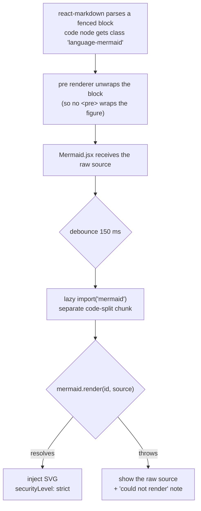

Four decisions, each with a reason:

| Decision | Alternative | Why this one |
|---|---|---|
| **Detect the fence in the `code`/`pre` renderers** | A `remark` plugin, or `rehype-mermaid` | Zero new parser plumbing; the class name is already there. `rehype-mermaid` would also pull in a headless browser at build time. |
| **Render client-side in an effect** | Server-side render to SVG at write time and store the SVG | The write path is *already* 42 s; adding a rendering step and a large Mermaid install to the backend makes the critical path longer and couples the server to a charting library it otherwise doesn't need. |
| **Debounce 150 ms** | Render on every token | An unclosed fence is still a valid code block to CommonMark, so without debouncing we'd kick off a `mermaid.render` for nearly every streamed token, each one failing until the fence closes. The debounce collapses that to one attempt per quiet period. |
| **`securityLevel: 'strict'`** | Default/`loose` | Mermaid's strict mode sanitises labels and disables click handlers and HTML labels. The diagram text is indirectly model-authored from scraped pages, so it sits on the same untrusted boundary as [ADR-14](#adr-14-react-markdown-instead-of-innerhtml). |

**The fallback is the point.** A diagram that fails to parse does not blank the report or
throw a React error — it renders the raw source with a small note, so the report degrades to
"here's the definition" rather than breaking. Every diagram in the live verification report was
parsed with the real Mermaid v12 parser ([§15.4](#154-what-could-not-be-verified)).

**Bundle cost, measured:** `mermaid` is reached only via a dynamic `import()`, so it lands in
its own chunks (plus one per diagram type). The main app bundle grew from 389.7 kB to
399.7 kB (123.9 kB gzip); the diagram chunks are fetched only when a report contains one.

### 13.7 Styling: Tailwind v4

The UI moved from ~700 lines of hand-written CSS (`index.css` + `App.css`) to Tailwind v4
utilities, with the theme expressed as tokens rather than duplicated values:

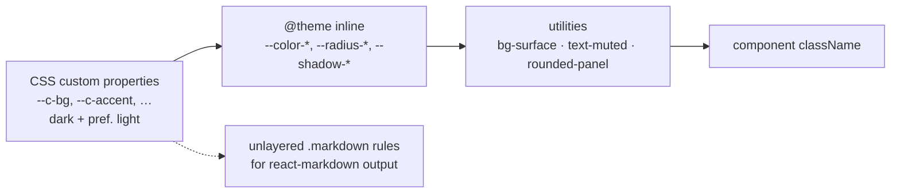

- **No `tailwind.config.js` and no PostCSS config.** v4's Vite plugin scans sources and reads
the `@theme` block directly, so configuration is one `@import 'tailwindcss'` plus a token map.
- **Tokens stay in `:root` as `--c-*` custom properties**, and `@theme inline` maps them to
`--color-*`. `inline` means the generated utility references `var(--c-accent)` rather than a
copied literal, which is what makes the `prefers-color-scheme: light` palette work with no
`dark:` variants anywhere in the markup.
- **The rendered report keeps a small stylesheet.** `react-markdown` output cannot carry
utility classes on every element, so `.markdown` rules remain — but they are written with
`@apply`, live in one block, and are the only place that styles Markdown.
- **One real gotcha, found by reading the emitted CSS:** the `.source-card.flash` highlight
was first written inside `@layer components`, where Tailwind's utilities layer always wins —
the flash would silently never appear. It is now intentionally **unlayered**, which is what
lets it override the card's `border-line-soft` / `bg-inset` utilities. Verified by grepping
the built CSS for the emitted rule.

### 13.8 Honesty in the UI: the integrity strip and the self-critique panel

The pipeline produces evidence about its *own* quality — citation coverage, uncited sources,
a critique verdict, and a list of issues. The frontend's job is to show that evidence rather
than hide it behind a confident-looking document:

| Signal | Where it appears | Why it is surfaced |
|---|---|---|
| Phase badge | `AgentTrace` header | makes "still reading sources" legible instead of looking hung |
| Citation count, cited/total sources | `ReportView` integrity strip | a report citing 23 of 48 sources is a *fact*; burying it would overstate the work |
| Broke-citation count removed | `ReportView` integrity strip | shows the audit did something, or that it found nothing to fix |
| Critique verdict + issue list | `ReportView` `<details>` disclosure | the reviewer's findings are available on demand, not presented as a badge of shame |
| Uncited sources dimmed | `SourcesPanel` | shows *which* sources went unused, which is where a reader would look for the missing angle |
| Phase-aware placeholder | `ReportView` before first token | the draft phase is slow; a placeholder that names the phase is honest about what's happening |

**The design rule:** every integrity number the backend computes is rendered somewhere the
user can see, and nothing is styled as an error when it is merely a *limitation*. A report
that admits "the evidence conflicts here, and these sources went unused" is more useful than
one that presents false completeness — and the earlier the UI makes that visible, the harder
it is for the pipeline to quietly regress.

---

## 14. Configuration and API reference

### 14.1 Every backend setting

| Variable | Default | Purpose | Failure mode if wrong |
|---|---|---|---|
| `PORT` | `5000` | HTTP port | EADDRINUSE at boot |
| `CLIENT_ORIGIN` | `http://localhost:5173` | CORS allow-list | browser blocks all requests |
| `LLM_API_KEY` | — | provider key (placeholder ok for local) | **exit(1)** at boot |
| `LLM_BASE_URL` | *(empty)* | any OpenAI-compatible endpoint | points at api.openai.com |
| `LLM_MODEL` | `gpt-4o-mini` | researcher tier | provider 404 |
| `LLM_MODEL_SMART` | falls back to `LLM_MODEL` | planner + writer tier | provider 404 |
| `LLM_JSON_MODE` | `true` | send `response_format=json_object` | 400s on strict local models |
| `LLM_TIMEOUT_MS` | `120000` | hard ceiling on one model request, **clamped 5 s–10 min** | too low truncates slow models; the SDK default (10 min) is what let a stall look like a hang |
| `LLM_MAX_RETRIES` | `2` | retries after a timeout/5xx, **clamped 0–3** | worst case ≈ `(retries + 1) × LLM_TIMEOUT_MS` |
| `LLM_STREAM_IDLE_TIMEOUT_MS` | `60000` | how long a streamed answer may send nothing before it is cut off, **clamped 5 s–10 min** | a slow *thinking* model can trip this; raise it for one |
| `TAVILY_API_KEY` | — | required for search + full-page extraction | **exit(1)** at boot |
| `TAVILY_MAX_RESULTS` | `6` | sources per sub-question, **clamped 1–12** | out-of-range silently clamped |
| `MAX_SUBQUESTIONS` | `6` | planner breadth, **clamped 1–8** | out-of-range silently clamped |
| `RESEARCH_DEPTH` | `deep` | `deep`=advanced+more · `quick`=basic+≤3 | unknown values fall back to `deep` |
| `RESEARCH_MAX_ROUNDS` | `2` | extra gap-filling rounds per sub-question, **clamped 0–3** (0 disables the loop) | 0 = shallow single pass |
| `COVERAGE_FLOOR` | `60` | self-rated coverage (%) below which a gap round fires, **clamped 0–100** | 100 = iterate on nearly every question (slow) |
| `MAX_FOLLOWUP_QUERIES` | `2` | new queries a gap round may add, **clamped 0–4** | 0 = gap rounds fire but search nothing |
| `DEEP_FETCH` | `true` | read full pages via Tavily `extract` | snippets only = thinner report |
| `DEEP_FETCH_SOURCES` | `3` | pages read per sub-question, **clamped 0–8** | higher = much larger prompts and slower |
| `RESEARCH_CRITIQUE` | `true` | run the critic + revision phases | off = no revision pass, faster |
| `CRITIC_FULL_TEXT_SOURCES` | `8` | cited sources the critic reads in full, **clamped 0–16** | 0 = snippets only, which is what causes both false `overreach` flags and missed miscitations |
| `RESEARCH_CONCURRENCY` | `3` | sub-questions researched in parallel, **clamped 1–6** | high values can trip provider/Tavily rate limits |
| `RUN_TIMEOUT_MS` | `900000` | hard ceiling on one run, **clamped 1 min–1 h** | the aborted run is reported, not silently truncated |
| `MONGODB_URI` | — | MongoDB Atlas connection string (**required**) | **exit(1)** at boot |
| `CLERK_SECRET_KEY` | — | Clerk secret key; verifies sessions (**required**, server-only) | **exit(1)** at boot |
| `CLERK_PUBLISHABLE_KEY` | — | Clerk publishable key (**required**) | **exit(1)** at boot |

**Frontend:** `VITE_API_URL` (default `http://localhost:5000`) and
`VITE_CLERK_PUBLISHABLE_KEY` (required — the same publishable key as the backend).

### 14.2 HTTP API

| Method | Route | Request | Response |
|---|---|---|---|
| `POST` | `/api/research/stream` | `{ "query": "…", "reportType": "analyst" }` | `text/event-stream` of the 13 event types |
| `GET` | `/api/research/types` | — | `{ types: [{id,label,blurb}…] }` — metadata only, no prompt text |
| `GET` | `/api/research` | — | `{ reports: [summary…] }`, newest first |
| `GET` | `/api/research/:id` | — | full record, or `404` |
| `DELETE` | `/api/research/:id` | — | `{ removed: boolean }`, `404` if absent |
| `GET` | `/api/health` | — | mode, storage, models, provider, `jsonMode`, `missingKeys`, `depth`, `research` |

Every `/api/research*` route requires a Clerk session (`Authorization: Bearer <token>`) and
is scoped to the caller's `userId`; `GET /api/health` is the only public route.

**`/api/health` is the operator's diagnostic** and is what the frontend badge reads:

```json
{
  "ok": true,
  "storage": "mongo",
  "models": { "default": "gemini-3.5-flash-lite", "smart": "gemini-3.5-flash-lite" },
  "llmProvider": "https://generativelanguage.googleapis.com/v1beta/openai/",
  "jsonMode": true,
  "missingKeys": [],
  "depth": "deep",
  "research": {
    "maxSubQuestions": 5,
    "maxRounds": 2,
    "coverageFloor": 60,
    "deepFetch": true,
    "critique": true
  }
}
```

The nested `research` block exposes the **depth knobs actually in effect** — the same ones
that decide whether a gap round fires, whether pages are read in full, and whether the
revision pass runs. Before it existed, "why did this run take four minutes?" required
reading the orchestrator source; now the answer is one `curl`.

**This endpoint exists so that "which model am I actually talking to?" never requires
guessing.** It was added after the incident in [§15.2](#152-the-model-id-incident-the-reason-this-trade-off-gets-a-whole-section).

---

## 15. Verification: measured, not asserted

Everything below was executed against the real Gemini endpoint and the real Tavily API, using
the storage driver that existed at the time. No part of this section is inferred.

> **Note:** these measurements predate the auth / MongoDB-only / mock-removal change. The
> pipeline phases, timings and token counts are unaffected by it, but a line naming
> `STORAGE=file` or mock mode describes the code as it was when the run was captured.

### 15.1 End-to-end live run

Health after boot confirmed **live** mode with no missing keys (the JSON above). A real query
(`"How do solid-state batteries compare to lithium-ion in 2026?"`) was streamed through
`POST /api/research/stream` against the real Gemini endpoint and the real Tavily API, with the
then-current file store. **All six phases ran, all thirteen event types fired, and there were
zero `error` frames.**

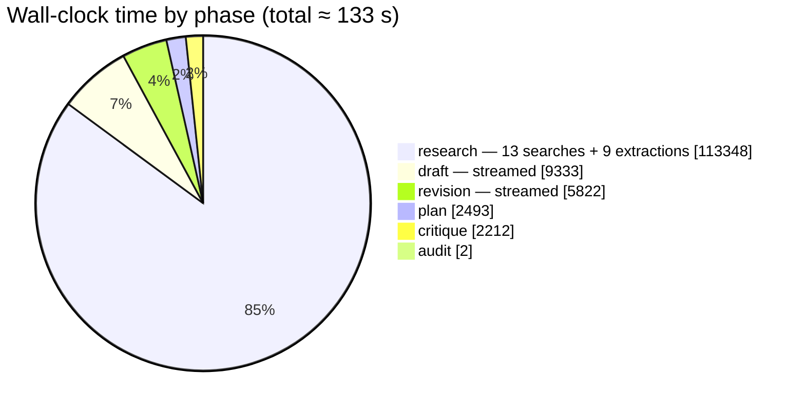

| Claim | Evidence |
|---|---|
| **All six phases execute, in order** | `phases: [plan, research, draft, critique, revision, audit]` with per-phase `ms` on the record |
| **The revision actually ran** | `revised: true`, and the report arrived in **2 streams** with a `report-reset` frame between them |
| **The critic found real problems and they were fixed** | verdict `solid` **with 2 issues**; one was an uncited fast-charging claim in a comparison table, and the shipped table carries `Not established in sources` for that cell — the revision applied it |
| **Gap-filling fires** | 5 base searches + **8 follow-up searches**, **4 gap rounds**, **9 extractions** for 5 sub-questions |
| **Full pages are read, not just snippets** | **26 pages** fetched in full across the run (`Full pages read` steps) |
| **The report is a long-form analyst document** | 1,491 words, 11 `##` sections, 2 `###`, a comparison table, and all five required sections present (`missingSections: []`) |
| **Diagrams still render** | 1 ```` ```mermaid ```` block, parsed clean with the real **Mermaid v12** parser |
| **Citations are inline and audited** | 72 references, 23 of 48 sources cited (coverage 48 %), `invalid: []`, `invalidRemoved: 0` |
| Streaming works on Gemini | 205 `token` deltas across the draft and the revision |
| JSON mode works on Gemini | planner, 9 researcher, follow-up, and critic calls all returned parseable JSON |
| Real web search works | 48 deduped source URLs |
| Persistence works | record written to `backend/data/reports.json`, newest-first |
| No silent failures | zero `"type":"error"` frames in the captured stream |

**The cost of depth, measured:** 133 s wall-clock and 105,937 tokens (100,434 prompt /
5,503 completion) versus the ~42 s / ~7-call v1 pipeline. The user explicitly accepted this
trade — see [§19](#19-performance-where-the-time-goes). Note that **prompt tokens dominate
by ~18:1**: the depth comes overwhelmingly from *reading more source text*, not from asking
the model to think longer, which is the cheaper and more grounded way to buy quality.

### 15.2 The model-id incident (the reason this trade-off gets a whole section)

The provider matrix in [§10.6](#106-provider-matrix-all-speak-the-same-protocol) says model
names are passed through verbatim with no validation. Here is the real cost of that choice.

The operator's `.env` contained:

```env
LLM_MODEL=google__gemini_3_5_flash_lite
```

That is an **aggregator-style slug**, not a Google model id. Directly querying the endpoint's
own catalogue settled it:

```bash
curl -H "Authorization: Bearer $KEY" \
  https://generativelanguage.googleapis.com/v1beta/openai/models
```

The real id is **`gemini-3.5-flash-lite`**. The bogus slug produced:

```json
[{"error":{"code":404,"message":"models/google__gemini_3_5_flash_lite is not found for
 API version v1main … Call ModelService.ListModels to see the list of available models."}}]
```

**The verdict on the trade-off:** passing names through verbatim is still correct — but it
means a typo fails at *request* time with a provider 404, not at *boot* time. That is why
`/api/health` reports the resolved `models` and `llmProvider`, and why the startup banner
prints them. **We kept the pass-through design and added observability instead of adding a
validation layer** that would go stale. See [ADR-06](#adr-06-pass-model-names-through-unvalidated).

### 15.3 Provider JSON-mode verification

Two direct probes against the OpenAI-compatible endpoint, independently of the app:

| Probe | Result |
|---|---|
| Plain message | HTTP 200, `choices[0].message.content == "OK"` |
| `response_format: {type:"json_object"}` | HTTP 200, valid JSON: `{"title":"Exploring the Moon","subQuestions":[…]} ` |

**Conclusion:** `LLM_JSON_MODE=true` is safe on this endpoint. This is what converts the
"JSON mode might break things" risk from speculation into a tested fact.

### 15.4 What could **not** be verified

Stated plainly rather than glossed. First, what *was* verified **without a browser** when the
diagram and styling work was added:

| Check | Method | Result |
|---|---|---|
| **The full six-phase pipeline runs live** | Live SSE run against the real provider: all 6 phases, 13 event types, 0 `error` frames | ✅ |
| **The revision path executes live** | `revised: true`, 2 `token` streams separated by a `report-reset` frame | ✅ |
| **Every required report section is emitted** | Parsed the live report for the five mandated `##` sections — `missingSections: []` | ✅ |
| The report really contains diagrams | The writer emitted a ```` ```mermaid ```` block in the live 1,491-word report | ✅ |
| Those diagrams are valid Mermaid | Every block extracted from the live report parsed with the real **Mermaid v12** parser under jsdom (`mermaid.parse`) | ✅ 1/1 |
| **Mock mode is gone** | `grep -ri mock backend/src frontend/src` finds no code (only explanatory comments); `agents/mock.js` and `db/fileStore.js` deleted | ✅ |
| **Missing config fails fast** | `node src/index.js` with no `MONGODB_URI`/`CLERK_*`: printed the three missing keys and exited `1` | ✅ |
| **Unauthenticated requests are rejected** | `createApp()` imported directly (no Mongo needed, format-valid placeholder Clerk keys): `GET /api/health` → `200`, `GET /api/research` → `401`, `POST /api/research/stream` → `401` | ✅ |
| **PDF citations resolve** | Built the print document into a stub window and asserted the citation `href="#source-1"` and a matching `id="source-1"` target both land in it, the report H1 is deduped, and hostile source titles/URLs come out escaped | ✅ 11/11 |
| **DOCX is a real Word file** | Built a document and read `word/document.xml` back out of the produced OOXML zip: title, headings, table header/body cells, list items, blockquote, code, citations (`[2, 3]`) and the sources appendix all present | ✅ 21/21 |
| **The chosen format changes the deliverable** | Live run with `reportType=brief`: 561 words (vs ~1,491 for the analyst format), H2 sections exactly `Bottom line · Key findings · What to watch · Limitations`, no analyst methodology section, and `reportType` present on both the `meta` event and the stored record | ✅ |
| Markdown → Mermaid wiring | SSR smoke render of `Markdown.jsx` asserting the fence becomes `Mermaid`, the source does **not** leak into markup, citations become chips, code fences survive, GFM tables render | ✅ 8/8 |
| Tailwind tokens actually emitted | Grepped the built CSS for `rounded-panel`, `rounded-control`, `shadow-panel`, `bg-inset`, `text-muted`, `text-planner`, `bg-researcher`, `text-critic`, and the unlayered `.source-card.flash` rule | ✅ |
| Lint + build | `eslint` clean (exit 0), `vite build` successful (exit 0), with `pipefail` + explicit status capture | ✅ |
| Backend syntax | `node --check` on all 14 changed/created backend modules | ✅ |

And what still cannot be verified here:

| Not verified | Why | Risk |
|---|---|---|
| UI rendering, layout, HMR | **No browser available in this environment** | Visual regressions undetected by automated checks |
| Mermaid **pixels** | Needs a browser | Parser-valid is not the same as legible; a diagram can parse and still lay out awkwardly |
| Citation-chip scroll & flash | Needs a browser | Interaction could be subtly wrong — the CSS layer-precedence bug found by reading the built CSS is exactly this class of risk |
| Tailwind's visual result | Needs a browser | Layout/spacing regressions are invisible to `lint` and `build` |
| **The integrity strip, phase badge, self-critique `<details>` panel** | Needs a browser | The data is verified to be present on the wire (`critique` + `audit` frames captured); only its *presentation* is unproven |
| Export buttons (copy/.md/PDF/DOCX) and the landing page | Needs a browser | Untested |
| MongoDB driver at runtime | No `MONGODB_URI` provided ("still no db") | `mongoStore.js` is written and type-consistent but never executed |
| Multiple providers simultaneously | Only Gemini was available | Other base URLs unproven in practice |

The frontend was checked by `eslint`, `vite build`, an SSR render of the Markdown path, and a
parser pass over the generated diagrams — **but none of that is the same as a person looking
at the page, and this document does not claim otherwise.**

---

## 16. The decision log

Each entry: the decision, what was rejected, why, and what it costs.

### ADR-01: OpenAI SDK as transport, not vendor

- **Decision:** use `openai` npm purely as an HTTP client for `/v1/chat/completions`, pointed at `LLM_BASE_URL`.
- **Rejected:** Writing raw `fetch` calls; or assuming an OpenAI account.
- **Why:** the SDK correctly handles streaming delta accumulation, retries, and error shapes — genuinely non-trivial code we don't want to own. The protocol is a de-facto standard.
- **Cost:** a package named "openai" appears in `package.json`. This is cosmetic: `config.js` never requires an OpenAI key or default model. **Explicitly stated because it caused friction** — see the provider-neutral naming in [§10.2](#102-how-the-environment-resolves).

### ADR-02: Own the orchestration, no agent framework

- **Decision:** hand-write the planner/researcher/writer loop.
- **Rejected:** LangChain, LlamaIndex, CrewAI, AutoGen.
- **Why:** the pipeline is a `for` loop over sub-questions plus three prompt calls. A framework would add hundreds of transitive dependencies, obscure the exact request/response shapes, make streaming-through-SSE harder to control, and introduce its own version churn — all to replace ~60 lines we fully understand.
- **Cost:** we implement retries/telemetry ourselves if we want them later.

### ADR-03: Layer by systems touched, not by feature

- **Decision:** `agents/` (LLM) and `services/` (external APIs) are separate; `prompts.js` holds only strings.
- **Rejected:** grouping by feature (e.g. `research/planner-with-search.js`).
- **Why:** the two axes of change are "which model/prompt" and "which data source". Separating them means each change is local and the blast radius is obvious.
- **Cost:** slightly more files than a single-module design.

### ADR-04: POST SSE with hand parsing

- **Decision:** stream over a POST response body and parse `data:` frames in `api.js`.
- **Rejected:** `EventSource` + GET (no body); WebSockets (bidirectional, overkill); polling.
- **Why:** we need one-way progress with a JSON request body and cancellability. Full detail in [§9.1](#91-transport-choice).
- **Cost:** no browser auto-reconnect; ~30 lines of buffer-splitting that must respect chunk boundaries.

### ADR-05: A nine-event vocabulary rather than raw text only

- **Decision:** emit typed events (`meta/status/plan/step/sources/findings/token/done/error`) alongside tokens.
- **Rejected:** streaming only the report text.
- **Why:** the product's differentiator is *transparency*. Typed events let the UI render a plan checklist, a per-source panel, and an agent trace — none of which is derivable from report text alone.
- **Cost:** a wider contract between backend and frontend; every new event type needs a client `case`.

### ADR-06: Pass model names through unvalidated

- **Decision:** `LLM_MODEL` goes verbatim to the provider.
- **Rejected:** a validation/mapping table of known model names.
- **Why:** any such table is stale within weeks, and it would silently rewrite names instead of surfacing typos. Providers are the source of truth.
- **Cost:** demonstrated by the 404 incident in [§15.2](#152-the-model-id-incident-the-reason-this-trade-off-gets-a-whole-section). Mitigated by reporting resolved models in `/api/health` and the boot banner.

### ADR-07: Two model tiers with an implicit fallback

- **Decision:** `LLM_MODEL` (researcher) and `LLM_MODEL_SMART` (planner/writer), the latter defaulting to the former.
- **Rejected:** one model everywhere; or a mandatory second setting.
- **Why:** cost scales with call count — the researcher is called N times. Defaulting keeps single-model providers working.
- **Cost:** operators must understand which agent uses which tier (documented in the README table and [§7.1](#71-the-pipeline-in-six-phases)).

### ADR-08: Tavily behind a normalising wrapper

- **Decision:** `services/search.js` exposes `webSearch()` returning a fixed `{title,url,snippet,score}` shape.
- **Rejected:** calling Tavily directly from the researcher agent.
- **Why:** normalisation protects against missing titles, whitespace blowup, and prompt-flooding; it also makes the search provider swappable in one file.
- **Cost:** any Tavily field we don't map is unavailable upstream (intentional).

### ADR-09: File store as default; database optional

> **Superseded by [ADR-24](#adr-24-delete-mock-mode-and-the-file-store).** The reasoning was
> right for a single-operator demo and wrong once reports belong to accounts.

- **Decision:** ship a JSON file store as default; provide a full Mongo adapter one env var away.
- **Rejected:** requiring MongoDB to start.
- **Why:** zero-setup onboarding (goal **G6**). A developer must be able to clone, `npm install`, `npm run dev` and see the product work — no cloud account, no connection string.
- **Cost:** the "MERN" claim is only true in the configured sense. Fully mitigated by the facade ([ADR-11](#adr-11-storage-facade)). The file store also rewrites the whole document on each save — fine for a single user, not for scale ([§20](#20-known-limitations-and-honest-gaps)).

### ADR-10: Fail fast on storage init failure

- **Decision:** if `initStorage()` throws, log and `process.exit(1)`.
- **Rejected:** falling back to a local store (or to canned data) when Mongo is unreachable.
- **Why:** silent fallback is a data-integrity trap — the connection fails and the app quietly writes reports somewhere the operator will never look. This now applies to *every* required key, not just storage ([ADR-24](#adr-24-delete-mock-mode-and-the-file-store)). A loud failure is the honest behaviour.
- **Cost:** no automatic resilience; the operator must fix `MONGODB_URI`.

### ADR-11: Storage facade

- **Decision:** all consumers import `db/index.js`; it owns the Mongoose store and the owner-scoping.
- **Rejected:** importing the concrete store at each call site.
- **Why:** the facade is now the single place that enforces `ownerId` scoping, so no route can accidentally query across users ([ADR-23](#adr-23-clerk-auth-with-owner-scoped-reports)). It previously also made the driver swappable; with the file store gone ([ADR-24](#adr-24-delete-mock-mode-and-the-file-store)) that benefit is moot, but the scoping benefit is larger.
- **Cost:** one indirection layer.

### ADR-12: Flatten plan into `subQuestions` on persist

- **Decision:** the stored record contains `subQuestions: [String]`, not the live `plan` object.
- **Rejected:** persisting the full `{title, subQuestions:[{question,intent}]}` plan.
- **Why:** the persisted document should be narrow and stable. `intent` guides the writer at generation time and is not needed to re-render a history entry. Arrays of strings index and validate cleanly in Mongo.
- **Cost:** *this was briefly mistaken for a bug* during verification — reading `record.plan` returned `{}` because the field is named `subQuestions`. Documented here so the next person doesn't "fix" a non-bug. The frontend maps it back: `(record.subQuestions ?? []).map(q => ({ question: q }))`.

### ADR-13: Citations inline; no reference list

- **Decision:** the writer emits `[n]` inline and is explicitly told not to append a references section.
- **Rejected:** letting the model produce its own bibliography.
- **Why:** the UI renders a canonical, always-correct source list from the actual retrieved data. A model-authored bibliography would duplicate it, could drift from the real sources, and would waste output tokens.
- **Cost:** the report is only self-contained inside this app; a raw copy-paste loses the reference list. Acceptable — the `.md` export is a *report*, and the sources panel is the source of truth.

### ADR-14: `react-markdown` instead of `innerHTML`

- **Decision:** render model output with `react-markdown` + `remark-gfm`.
- **Rejected:** `dangerouslySetInnerHTML` with a Markdown→HTML converter.
- **Why:** the rendered content is **untrusted** — it is model output that describes **third-party web content**. Injecting that as raw HTML is a direct XSS vector. `react-markdown` builds React elements and never executes markup.
- **Cost:** one dependency; some HTML in Markdown isn't rendered. Worth it — this is the security boundary of the app.

### ADR-15: Registration-free, single-user, global history

> **Superseded by [ADR-23](#adr-23-clerk-auth-with-owner-scoped-reports).** Auth is now required.

- **Decision:** no authentication.
- **Rejected:** accounts, sessions, per-user scoping.
- **Why:** scoped explicitly as a local/single-operator tool. Auth would dominate the codebase and the setup instructions for no benefit to the stated use case.
- **Cost:** history is global and the API is open. **Do not expose this to the public internet as-is** — stated in [§17](#17-security--robustness) and [§20](#20-known-limitations-and-honest-gaps).

### ADR-16: Automatic mock mode

> **Superseded by [ADR-24](#adr-24-delete-mock-mode-and-the-file-store).** Mock mode is removed.

- **Decision:** when the LLM or Tavily is unconfigured, run the *real* pipeline with canned data.
- **Rejected:** refusing to start, or returning an error.
- **Why:** it makes the product demonstrable in seconds, gives the frontend a stable fixture, and doubles as a test harness. The mock streams through the same SSE path, so it exercises the whole stack.
- **Cost:** a user could mistake mock output for research — mitigated by the `Mock mode` badge, the in-report warning banner, and `[mock]` source titles.

### ADR-17: Heartbeat + closed flag

- **Decision:** `: ping` every 15 s; a `closed` flag guarding all writes.
- **Rejected:** relying on the connection staying open.
- **Why:** measured runs exceed 40 s with multi-second gaps ([§19](#19-performance-where-the-time-goes)); idle proxies would drop them. And writing to a client that navigated away would throw.
- **Cost:** one interval timer per active run — negligible.

### ADR-18: Client-side Mermaid with a syntax fallback

- **Decision:** render ```` ```mermaid ```` blocks in the browser, debounced, with a hard fallback to the raw source when parsing fails.
- **Rejected:** `rehype-mermaid` (needs a headless browser at build time), server-side pre-rendering to SVG (adds latency and a charting dependency to the write path), and skipping diagrams entirely.
- **Why:** it leaves the ~42 s critical path unchanged, keeps the backend free of a charting library, and the fallback turns a bad diagram into a cosmetic problem instead of a blank report.
- **Cost:** a few kB of wiring plus Mermaid's own lazily-fetched chunks. See [§13.6](#136-mermaid-diagrams-in-the-report).

### ADR-19: Tailwind v4 for styling

- **Decision:** replace `App.css` and most of `index.css` with Tailwind v4 utilities, with the theme expressed as `@theme inline` tokens.
- **Rejected:** hand-written CSS (already drifting), a component kit such as MUI or Chakra (a large dependency for six components), CSS modules (more files, no token system).
- **Why:** utility classes remove dead CSS by construction, and routing the existing `--c-*` palette through `@theme inline` preserves the dark/light theming that was already there.
- **Cost:** class-heavy JSX, plus one unlayered `.markdown` stylesheet for `react-markdown` output. See [§13.7](#137-styling-tailwind-v4).

### ADR-20: App factory separate from bootstrap

- **Decision:** `app.js` exports `createApp()`; `index.js` initialises storage, builds the app, and listens.
- **Rejected:** the single `index.js` this started as.
- **Why:** importing a module must not bind a port or touch storage as a side effect. The factory makes the app importable and testable, and keeps the storage-failure exit ([ADR-10](#adr-10-fail-fast-on-storage-init-failure)) in the bootstrap where it belongs.
- **Cost:** one extra file and one extra hop when tracing startup — a good trade.

### ADR-21: The critique is advisory; the revision is unconditional

- **Decision:** when `RESEARCH_CRITIQUE=true`, the revision pass runs **regardless of the
  critic's `verdict`**. The verdict is stored and displayed, but it does not gate the revision.
- **Rejected:** the original design, which skipped revision when `verdict === 'solid'` unless
  the critique contained a high-severity issue.
- **Why:** the gate was **wrong in practice, not merely in theory.** In the first measured
  live run the critic returned `verdict: "solid"` *and* two issues, one of them a real uncited
  claim — and the pipeline skipped the revision entirely because of the verdict. A model's
  one-word summary of its own review is the least trustworthy part of that review; the typed
  issue list is the trustworthy part, and it is right there to act on. Skipping work to save
  two seconds of a four-minute run was a false economy.
- **Cost:** the revision's ~6 s and its tokens on every run, plus a second streamed report
  that the client must be told to clear (`report-reset`). Both accepted: the user explicitly
  prioritised depth and verified integrity over latency.
- **Safety net:** if the revision call fails or returns `< 120` words, the draft is kept and
  `revised: false` is recorded — an improvement step may never make the output worse.

### ADR-22: Sanitise citations instead of only reporting them

- **Decision:** `auditCitations` finds unresolvable `[n]` references, and `sanitizeCitations`
  **removes** them (preserving valid comma-lists), then the report is re-audited to record
  how many were removed.
- **Rejected:** reporting `invalid[]` to the UI and leaving the text untouched.
- **Why:** a citation chip that points nowhere is worse than plain text, because it *looks
  like evidence* and survives export to Markdown/PDF where the UI that would have revealed it
  is gone. The audit is a pure function with no model in the loop, so there is no downside to
  acting on its finding rather than merely displaying it.
- **Cost:** the sanitised report differs slightly from what the model wrote — a `[37]` that
  pointed at nothing becomes nothing. This is deliberate and is why `invalidRemoved` is
  surfaced in the integrity strip rather than hidden.

### ADR-23: Clerk auth with owner-scoped reports

- **Decision:** authenticate with Clerk. `clerkMiddleware()` verifies a session on every
  request; every `/api/research*` route requires one; each saved report carries the owner's
  Clerk `userId`, and every read, list and delete filters on it.
- **Rejected:** rolling our own sessions (password hashing, reset flows, token rotation —
  a large security surface for no product benefit); leaving the tool single-user (ADR-15).
- **Why:** reports are private user data, and "private" has to be enforced in the query, not
  the UI. Scoping in `db/index.js` means a whole class of bug — forgetting to filter — cannot
  happen at a call site. Clerk also gives us a maintained sign-in UI and the server-side
  verification path for free.
- **Why not session cookies:** the UI (`:5173`) and API (`:5000`) are different origins, so a
  cookie would need `SameSite`/credentials gymnastics. A short-lived bearer token from
  `getToken()` is simpler and works identically in dev and production.
- **Cost:** two more required secrets, a third-party dependency on the critical path, and a
  real deployment step (claim the Clerk app, switch to production keys). Requests without a
  valid session now fail with `401` rather than returning global data.

### ADR-24: Delete mock mode and the file store

- **Decision:** remove mock mode and the JSON file store entirely. Missing configuration is a
  **startup failure** (`missingKeys()` → print → `exit(1)`), not a degraded run.
- **Rejected:** keeping mock mode as a demo/offline path; keeping the file store as a dev
  fallback.
- **Why:** mock mode was a *liability* once auth and private reports landed. Canned data has no
  owner, so it can't satisfy the ownership invariant — and its presence made "is this real?"
  a question the code had to keep answering (badges, warning banners, `mock` fields in the
  event stream, the health payload, and the stored record). Deleting it removes a whole
  parallel code path from the orchestrator, the search service, the LLM client, the config and
  the UI. The file store had the same problem: a silent second store is a data-integrity trap,
  and it cannot represent per-user ownership cleanly.
- **Cost:** there is no zero-config demo any more. Cloning the repo now means creating a Clerk
  app and an Atlas cluster before the server will boot. That is a real loss and is bought back
  deliberately: the failure message names exactly what is missing, so the fix is one command
  away, and the product never lies about whether output is real research.

### ADR-25: Six selectable report formats

- **Decision:** the user picks the deliverable before running — analyst report, executive
  brief, comparison, timeline, risk assessment, or evidence review. Each format is a distinct
  section structure *and* a distinct writing stance, and it drives the writer and revisor
  prompts for the run. The choice is stored on the report so it can be labelled on reload.
- **Rejected:** one universal report with a "length" or "tone" knob; and letting the user
  supply a free-form format prompt.
- **Why:** the questions people actually ask are not all the same shape. "Which of these two
  is better?" wants a comparison table and a verdict; "what happened, in what order?" wants a
  chronology with dated entries. Forcing either into the analyst template answers the question
  badly, and no amount of tuning on one template fixes that — the *structure* is the problem,
  not the prose. A small closed set keeps output predictable and lets each format be tuned and
  tested on its own. Free-form format prompts were rejected because they make the output
  impossible to reason about and hand unbounded text a privileged position in the prompt.
- **How it holds together:** `prompts.js` stays string-only — the per-format structures are
  plain exports, and the writer/revisor system prompts became functions that interpolate one.
  The shared detail/citation/diagram rules are factored into `SHARED_RULES` so every format
  inherits them; a format cannot silently drop the citation rules. Only `{id,label,blurb}`
  crosses to the browser — the prompt text never leaves the server. An unknown or absent id
  resolves to the default rather than reaching a prompt as `undefined`, and an explicitly
  invalid id in the API body is rejected with `400`.
- **Cost:** six structures to keep in sync with what the critic expects, and the critic's
  `structure` check remains format-agnostic — it can tell that a required section is missing,
  but it does not know which sections the *chosen* format requires. Noted in
  [§20](#20-known-limitations-and-honest-gaps).

---

## 17. Security & robustness

| Concern | Mitigation | Where |
|---|---|---|
| **XSS from model/web content** | `react-markdown` element rendering; never `innerHTML` | `Markdown.jsx` (ADR-14) |
| **Unauthenticated access** | `clerkMiddleware()` verifies every request; `/api/research*` returns `401` without a session | `app.js`, `routes/research.js` (ADR-23) |
| **Cross-user data access** | Every storage query filters on `ownerId`; another user's report id returns `404` | `db/index.js`, `mongoStore.js` (ADR-23) |
| **API key leakage** | Keys live only in the backend process; the browser never receives them | architecture ([§3](#3-system-context)) |
| **CORS** | Explicit `CLIENT_ORIGIN` allow-list, not `*` | `index.js` |
| **Oversized request bodies** | `express.json({ limit: '1mb' })` | `index.js` |
| **Prompt abuse / cost run-away** | Query capped at 500 chars; sub-questions, rounds, results, follow-ups, and deep-fetch counts all clamped in `config.js`; snippets truncated to 800 chars and full pages to 6,000 chars; follow-up loops bounded by `RESEARCH_MAX_ROUNDS` | `routes/research.js`, `config.js`, `search.js` |
| **Prompt injection from web pages** | Partial only: the researcher is instructed to extract, not obey, the writer only sees structured findings, and the critic audits for overreach. **Not a hard guarantee.** | `prompts.js`, `critic.js` |
| **Raw page text leaking into storage or the client** | Full page text lives in a run-scoped `Map` and is never persisted, never put on the SSE stream | `orchestrator.js` |
| **Unresolvable citations surviving into an export** | The audit removes them before the report is persisted, not merely flags them | `citations.js` (ADR-22) |
| **Open API** | None — acceptable for local use only (ADR-15) | [§20](#20-known-limitations-and-honest-gaps) |
| **Broken stream on client disconnect** | `closed` flag + `AbortController` propagation | `routes/research.js` |

**On prompt injection:** this is the honest weak spot of any web-reading agent. A malicious
page could contain text like "ignore your instructions". Our mitigations are (a) the
researcher's system prompt fixes its task to extraction with citations, (b) the writer never
sees raw page text — only the researcher's structured findings, and (c) the final output is
rendered as safe Markdown, so an injection cannot execute code. It *could* still skew a
report's content. This is flagged as a real limitation, not a solved problem.

---

## 18. Failure modes

### 18.1 What happens when each layer fails

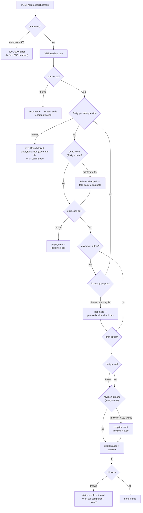

Four tiers of failure handling, each deliberate:

1. **Per-search failure is survivable.** `webSearch` is wrapped in `try/catch`; a failed
   search logs a step and falls through to `emptyExtraction`, which records an honest gap
   instead of aborting the run. One flaky search should not lose four good ones.
2. **Save failure is non-fatal.** If persistence throws, the pipeline emits a `status`
   warning and *still* emits `done` with the record in hand. The user gets their report even
   if the database is down — the report was already streamed to them anyway.
3. **Every *added* phase is individually survivable.** Deep-fetch failures drop to snippets;
   an empty or failed follow-up proposal ends the gap loop instead of the run; a failed
   critique skips straight to revision; a failed or degenerate revision keeps the draft. Each
   guard exists because the phase is an *enhancement* — the pipeline must still produce a
   cited report if any of them misbehave.
4. **Pipeline failure is terminal but clean.** Any other throw is caught in the route,
   emitted as an `error` frame, and the stream is closed. Missing API keys surface here.

**Why 400 errors are sent *before* the SSE headers:** once `writeHead(200, text/event-stream)`
is called you can no longer send a status code. Validation must happen first, which is why
the query checks sit at the top of the handler.

### 18.2 Configuration is validated at startup, not per request

There is no mock mode any more ([ADR-24](#adr-24-delete-mock-mode-and-the-file-store)). Before
`initStorage()` runs, `index.js` calls `missingKeys()`; if anything required is absent it
prints the list and exits `1`. This is deliberately the *first* thing that happens, so a
misconfigured deployment fails in milliseconds with an actionable message rather than at the
first model call, half a minute into a research run, in front of a user.

---

## 19. Performance: where the time goes

Measured on a real live run ("How do solid-state batteries compare to lithium-ion in 2026?",
`RESEARCH_DEPTH=deep`, `MAX_SUBQUESTIONS=5`, Gemini 3.5 Flash Lite, all depth knobs at their
defaults):

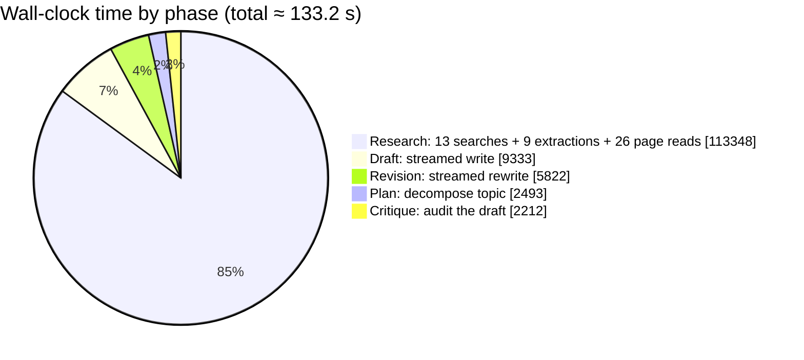

| Phase | Time | Share | Notes |
|---|---|---|---|
| Plan | 2.5 s | 2 % | one `chatJSON` call |
| **Research** | **113.3 s** | **85 %** | 13 searches, 9 extractions, 26 full pages, 4 gap rounds |
| Draft | 9.3 s | 7 % | streamed; **first token at 117 s** |
| Critique | 2.2 s | 2 % | one `chatJSON` call |
| Revision | 5.8 s | 4 % | streamed; **first token at 128.6 s** |
| Audit | 0.002 s | 0 % | pure regex + set lookup, no model |
| **Total** | **133.2 s** | 100 % | ~314 SSE events, 13 LLM calls, 13 searches, 105,937 tokens |

### Where the time and money actually go

**Research is still ~85 % of the run — and that is now the *point*.** The v1 pipeline spent
~35 s on 5 searches and 5 extractions. This one spends ~113 s on 13 searches, 9 extractions,
and **26 full pages read**. The extra ~78 s buys: gap-targeted rounds on the sub-questions
the researcher rated least complete, and whole-page text instead of ~800-character snippets.

**The token split is the interesting number: 100,434 prompt vs 5,503 completion (~18:1).**
That ratio says the depth is bought almost entirely with *input context* — reading more of the
actual sources — rather than with longer reasoning or longer output. For a research task that
is the right way round: more evidence in, same-shaped answer out.

### The latency fix: bounded concurrency in the research phase

**Research was the only phase worth optimising**, and it now runs as a bounded pool
([§7.3](#73-why-research-runs-in-a-bounded-pool)) instead of a sequential loop. Measured on
a later live run ("Grid-scale battery storage costs and deployment trends",
`RESEARCH_CONCURRENCY=3`, `MAX_SUBQUESTIONS=4`, `RESEARCH_MAX_ROUNDS=1`,
`DEEP_FETCH_SOURCES=2`, Gemini 3.5 Flash / Flash Lite):

| Phase | Time | Share | Notes |
|---|---|---|---|
| Plan | 2.7 s | 5 % | one `chatJSON` call |
| **Research** | **24.8 s** | **49 %** | **4 sub-questions in parallel**, 6 search rounds, 38 sources, 8 full pages |
| Draft | 6.8 s | 13 % | streamed |
| Critique | 1.5 s | 3 % | one `chatJSON` call |
| Revision | 4.6 s | 9 % | streamed |
| Audit | 0.004 s | 0 % | pure regex + set lookup, no model |
| **Total** | **50.5 s** | 100 % | 38 sources, 47 references, 13 cited, `invalid: []`, 1,165-word risk assessment |

The research phase alone was ~113 s while sequential (measured above, but with *different*
knobs — 5 sub-questions, `RESEARCH_MAX_ROUNDS=2`, `DEEP_FETCH_SOURCES=3` — so the two runs are
not a like-for-like speed-up claim; the point is that the phase now overlaps its own network
wait instead of accumulating it). Across the concurrent runs observed while making this
change, research landed between **16 s and 25 s** for 4 sub-questions, and it remains the
dominant phase at roughly half the run.

**What is still not fixed:** the pool width is a constant. It cannot back off when a provider
rate-limits the run, and it does not adapt to how many sub-questions the planner produced.
That is [limitation #1](#20-known-limitations-and-honest-gaps).

**The explicit trade accepted here:** the user was asked how to spend the budget and chose
*"don't care about latency — prefer maximum depth and verification, even 3–5 minutes."* That
is why the depth knobs default to values that produce a ~2–5 minute run rather than a ~40 s
one. The dial exists (`RESEARCH_MAX_ROUNDS=0`, `DEEP_FETCH=false`, `RESEARCH_CRITIQUE=false`
returns roughly v1 behaviour) but it is deliberately turned up.

### The perceived-latency mitigation

Two minutes — or fifty seconds with the concurrent research phase — is acceptable *because it
is streamed and legible*. Using the measured phase timings
([§15.1](#151-end-to-end-live-run)), the user has feedback almost immediately:

- `meta` + first `status` → within ~1 s
- `plan` (the checklist, with scope and themes) → at ~2.5 s
- first `sources` → within a few seconds after that
- 48 source cards and 57 trace rows → accumulate continuously for ~115 s
- first draft `token` → ~117 s; first revision `token` → ~129 s

An equivalent non-streaming implementation would show a spinner for 133 seconds. This is
exactly why the **`phase` event was added**: during a two-minute research phase the old UI
could only say "researching…", which is indistinguishable from "hung". Now the badge names
the phase and the trace shows each search, page read, and gap round as it happens. The
protocol choice ([ADR-04](#adr-04-post-sse-with-hand-parsing)) is what converts a latency
problem into a legible process — and the longer the pipeline gets, the more load-bearing
that choice becomes.

---

## 20. Known limitations and honest gaps

Ordered by how much they'd matter if this became more than a local tool.

| # | Limitation | Impact | Sketch of the fix |
|---|---|---|---|
| 1 | **The research pool width is fixed** (`RESEARCH_CONCURRENCY`) | It cannot adapt to a provider's rate limits, and a value that is too high trips them instead of going faster | Scale the width to the remaining sub-questions and back off on a `429`/`retry-after` |
| 2 | **Auth is login-only** | No roles, sharing, teams or org scoping | Clerk Organizations + an `orgId` alongside `ownerId` |
| 3 | **No local/offline mode** | A missing key means the server will not boot | Deliberate ([ADR-24](#adr-24-delete-mock-mode-and-the-file-store)); a documented demo mode could return behind an explicit flag |
| 4 | **Prompt injection from web content** | A hostile page could skew a report | Source allow-listing, injection classifiers, output review — all partial |
| 5 | **Mongo driver never runtime-verified** | Unknown-unknowns in the adapter | Point `MONGODB_URI` at a cluster and run the same script |
| 6 | **`list()` capped at 100** | Silent truncation for a user with a long history | Add pagination; make the cap explicit in the UI |
| 7 | **Session tokens are the only auth signal** | A leaked token is valid until it expires | Short token lifetime is Clerk's default; add audience/org claims if this API is ever shared |
| 8 | **No reconnecting SSE** | A dropped connection ends the run | Persist partial progress and offer `GET /api/research/:id` resume |
| 9 | **Search quality unseen** | A run with no results still "succeeds" | Surface `gaps` prominently in the UI; warn when `gaps` is non-empty |
| 10 | **Tests cover the pure logic, not the pipeline** | `npm test` (39 tests) covers the citation audit and sanitiser, the source index, finding validation, the concurrency pool, critique normalisation and stall detection — but the network paths are only exercised by a live run | Stub `services/search.js` and `llm.js` behind a seam and drive `runResearch` against them |
| 11 | **Report diagrams are LLM-authored** | A malformed ```` ```mermaid ```` block shows the "could not render" fallback instead of a diagram | The fallback and the prompt constraints already contain it; a server-side `mermaid.parse` guard could reject bad blocks before persisting |
| 12 | **The critic is the same model family as the writer** | A shared blind spot can survive an adversarial review | The critique is one prompt in one file; pointing it at a *different* provider is a small, high-value change |
| 13 | **Deep fetch reads only the top-N ranked URLs** | A lower-ranked source with the best primary data is never read in full | Make `DEEP_FETCH_SOURCES` adaptive (e.g. read more when coverage is low) or rank by something other than Tavily's score |
| 14 | **The revision is unconditional, so it always costs ~6 s + tokens** | Slightly wasteful on an already-clean draft | ADR-21 explains why this was accepted; a cheap gate would need a trustworthy signal, which the `verdict` field demonstrably was not |
| 15 | **The critic's full-text expansion is capped** (`CRITIC_FULL_TEXT_SOURCES`, default 8) | Beyond the cap it reviews snippets, so a miscitation whose support lives in the body of an uncapped source can still pass | Raise the cap, or expand exactly the sources behind the claims flagged as `overreach` in a second pass |
| 16 | **A stopped run is not persisted** | Stop a run and the partial draft is on screen but absent from history; the work is unrecoverable | Persist a `status: "cancelled"` record with the partial report and mark it in the library |
| 17 | **One retry is the whole JSON-repair strategy** | A provider that consistently answers in prose (rather than JSON) fails the run twice and gives up | Prompt-level enforcement is already the primary defence; a stricter repair turn or a schema validator would catch the rest |

---

## 21. Glossary

| Term | Meaning here |
|---|---|
| **Agent** | An LLM call with a fixed role, a system prompt, and an expected output shape. We have five (planner, researcher, follow-up, critic, writer/reviser). |
| **Phase** | One of the six stages a run passes through: `plan`, `research`, `draft`, `critique`, `revision`, `audit`. Emitted as `phase` events and timed onto the record. |
| **Sub-question** | One searchable facet of the topic, produced by the planner — with an `intent` and a `theme`. |
| **Source** | A web result, deduped by URL and assigned a permanent citation number. |
| **Finding** | A single factual claim with a list of source numbers it came from, plus a confidence label. |
| **Extraction** | The researcher's full output for one sub-question: summary + findings + gaps + a `coverage` estimate. |
| **Coverage** | The researcher's own 0–100 estimate of how completely it answered a sub-question. Drives the gap-filling loop. |
| **Gap round** | An extra search-and-extract pass triggered because `coverage` fell below `COVERAGE_FLOOR`. |
| **Deep fetch** | Reading full page text (Tavily `extract`) rather than the ~800-char search snippet. |
| **Critique** | A typed, adversarial audit of the draft, produced by a separate LLM call. |
| **Revision** | The streamed rewrite that applies the critique. Replaces the draft; never appended to it. |
| **Citation audit** | A pure, model-free pass that verifies and sanitises every `[n]` in the final report. |
| **Integrity strip** | The UI row showing citation coverage, uncited count, removed citations, and the critique verdict. |
| **SSE** | Server-Sent Events — a one-way `text/event-stream` HTTP response. |
| **Frame** | One `data: …\n\n` unit in the SSE stream. |
| **Owner** | The Clerk `userId` a report belongs to. Stored as `ownerId`; every query filters on it. |
| **Session token** | The short-lived JWT the frontend gets from `getToken()` and sends as `Authorization: Bearer …`. |
| **Fail-fast** | Refusing to start when a required key is missing, instead of degrading to canned data. |
| **Neutral env var** | An `LLM_*` variable, as opposed to the legacy `OPENAI_*` fallbacks. |

---

## Appendix A — File map

```
backend/
  .env.example                     every setting, documented, incl. the depth/integrity block
  package.json                     6 dependencies, ESM, node --watch dev
  src/
    index.js                       bootstrap: validate config → connect Mongo → listen
    app.js                         Express app factory (Clerk middleware, CORS, routes, health)
    config.js                      env resolution, required-key validation, derived flags
    llm.js                         OpenAI-SDK transport: chatJSON / chatStream
    agents/
      orchestrator.js              the 6-phase pipeline; emits all 13 SSE event types;
                                   owns the gap loop, deep fetch, page-text Map
      planner.js                   topic → scope + themed sub-questions + title
      researcher.js                sub-question + sources → cited findings,
                                   coverage, confidence; needsFollowUp()
      followups.js                 gaps → new gap-targeted queries (dedupes alreadyAsked)
      critic.js                    draft → typed critique; hasMaterialIssues()
      citations.js                 pure: auditCitations() + sanitizeCitations()
      normalize.js                 shared asText()/asStrings() coercions for model JSON
      writer.js                    everything → streamed draft (writeDraft),
                                   draft + critique → streamed revision (reviseReport)
      prompts.js                   all prompt text (systems + per-format structures); zero logic
      reportTypes.js               the six selectable formats + resolveReportType()
    services/
      search.js                    Tavily + normalisation + full-page extract
    routes/
      research.js                  auth guard; POST /stream (SSE), owner-scoped CRUD
    db/
      index.js                     storage facade; owner-scoped reads/writes
      mongoStore.js                Mongoose adapter (only store)
frontend/
  vite.config.js                   react + @tailwindcss/vite plugins
  src/
    api.js                         SSE POST-stream parser + REST helpers (Bearer token)
    index.css                      Tailwind import, theme tokens, .markdown styles
    hooks/useResearch.js           run lifecycle state machine
    App.jsx                        signed-out → Landing; signed-in shell, tabs, format state
    lib/
      cn.js                        class-name join helper
      export.js                    .md download + print-to-PDF (with sources appendix)
      docx.js                      Markdown → .docx (headings/tables/images/sources)
      format.js                    hostOf / timeAgo / slugify / wordCount
    components/
      ui/                          Button, Panel (+PanelHead), Badge
      QueryForm.jsx                input, examples, run/stop
      AgentTrace.jsx               phase badge, scope note, plan checklist, step trace
      Landing.jsx                  signed-out marketing page
      ReportView.jsx               meta, toolbar (copy/.md/PDF/DOCX),
                                   integrity strip, self-critique disclosure
      SourcesPanel.jsx             numbered source cards (#source-n anchors), dims uncited
      HistoryPanel.jsx             saved reports, open/delete
      Markdown.jsx                 GFM rendering + citation chips + mermaid hook
      Mermaid.jsx                  lazy SVG renderer with source fallback
```

## Appendix B — Quick reference

```bash
# backend
cd backend && cp .env.example .env    # then fill CLERK_*, MONGODB_URI, LLM_*, TAVILY_API_KEY
npm install && npm run dev            # http://localhost:5000

# frontend
cd frontend && npm install && npm run dev   # http://localhost:5173
```

```bash
curl -s localhost:5000/api/health | jq          # public
# research routes need a Clerk session token:
curl -sN -X POST localhost:5000/api/research/stream \
  -H "Authorization: Bearer $CLERK_SESSION_TOKEN" \
  -H 'Content-Type: application/json' \
  -d '{"query":"your topic"}' | head -40
```

---

*Every measured figure in this document came from live runs against a real LLM endpoint and
the real Tavily API. Claims that could not be verified in this environment are listed as such
in [§15.4](#154-what-could-not-be-verified). If you change a decision in
[§16](#16-the-decision-log), update the entry rather than deleting it — the reasoning is the
asset.*
