# Deep Research — Architecture & Decision Record

> **Status:** living document · **Scope:** the entire system (backend + frontend)
> **Audience:** anyone who has to run, extend, debug, or *argue with* this codebase.
> **Last verified against a live run:** see [§15 Verification](#15-verification-measured-not-asserted).

This document explains **what** the system does, **how** each part works, and — most
importantly — **why every non-obvious decision was made**, including the alternatives
that were rejected and the price paid for each choice. If you disagree with a decision,
every entry in [§16 The Decision Log](#16-the-decision-log) tells you what it would cost
to change it.

---

## Table of contents

1. [What this is](#1-what-this-is)
2. [Goals and explicit non-goals](#2-goals-and-explicit-non-goals)
3. [System context](#3-system-context)
4. [The MERN claim, audited](#4-the-mern-claim-audited)
5. [Stack choices and why](#5-stack-choices-and-why)
6. [Backend architecture](#6-backend-architecture)
7. [The agent pipeline](#7-the-agent-pipeline)
8. [Prompt design](#8-prompt-design)
9. [The streaming protocol (SSE)](#9-the-streaming-protocol-sse)
10. [The provider abstraction](#10-the-provider-abstraction)
11. [Search: Tavily and normalisation](#11-search-tavily-and-normalisation)
12. [Storage: a facade over two drivers](#12-storage-a-facade-over-two-drivers)
13. [Frontend architecture](#13-frontend-architecture)
14. [Configuration and API reference](#14-configuration-and-api-reference)
15. [Verification: measured, not asserted](#15-verification-measured-not-asserted)
16. [The decision log](#16-the-decision-log)
17. [Security & robustness](#17-security--robustness)
18. [Failure modes](#18-failure-modes)
19. [Performance: where the time goes](#19-performance-where-the-time-goes)
20. [Known limitations and honest gaps](#20-known-limitations-and-honest-gaps)
21. [Glossary](#21-glossary)

---

## 1. What this is

A web application that takes a single research question and produces a **cited,
streamed Markdown report** by orchestrating a small pipeline of LLM "agents":

```
topic  ─►  PLAN  ─►  SEARCH + EXTRACT (× N)  ─►  SYNTHESISE  ─►  cited report
```

The distinguishing property is not that it calls a model — it's that the user
**watches the agents work**: planning, searching, reading, and writing appear in
real time, and every factual claim in the final report carries a numbered citation
that links to a source card.

**One sentence of positioning:** *a transparent, self-hostable research assistant that
works with any LLM provider and degrades gracefully to a demo mode when unconfigured.*

---

## 2. Goals and explicit non-goals

### 2.1 Goals (these are the acceptance criteria)

| # | Goal | How it is met | Where |
|---|---|---|---|
| G1 | Multi-agent pipeline, not one giant prompt | 3 distinct agent roles with separate prompts | `backend/src/agents/` |
| G2 | **Live** agent trace in the UI | Server-Sent Events, one event per unit of progress | `routes/research.js`, `useResearch.js` |
| G3 | Grounded citations | sources numbered at retrieval; claims carry `[n]` | `orchestrator.js`, `prompts.js` |
| G4 | Sources are inspectable | side panel with title, host, snippet, score | `SourcesPanel.jsx` |
| G5 | Export | copy, `.md` download, print-to-PDF | `ReportView.jsx` |
| G6 | Persistence with **zero setup** | file store by default | `db/fileStore.js` |
| G7 | **No vendor lock-in** to OpenAI | OpenAI SDK used purely as a transport; any base URL | `llm.js`, `config.js` |
| G8 | Runs before you configure anything | automatic mock mode | `config.js` |
| G9 | Optional real database | Mongoose adapter behind a facade, one env var | `db/mongoStore.js` |
| G10 | No authentication complexity | single-user tool, history is global | documented, [§20](#20-known-limitations-and-honest-gaps) |

### 2.2 Non-goals (deliberately out of scope)

These are **choices**, not oversights. Each is defended in the decision log.

- ❌ **Not** a multi-tenant SaaS. No auth, no per-user isolation, no billing.
- ❌ **Not** a fine-tuning or RAG-over-your-own-documents system. It searches the *open web*.
- ❌ **Not** a provider-agnostic *model* abstraction layer (no LangChain/LlamaIndex). It is
  provider-agnostic at the **protocol** level instead.
- ❌ **Not** optimised for sub-second latency. A deep research run legitimately takes tens of seconds.
- ❌ **Not** horizontally scalable as written. State lives in the process's memory during a run.

---

## 3. System context

Who talks to what. Everything outside the dashed box is a third-party service the
operator supplies.

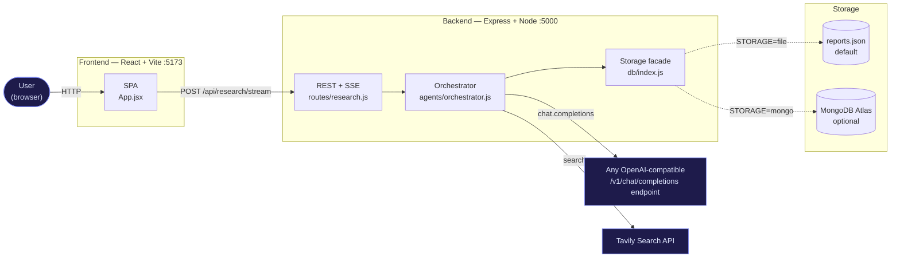

**Reading it:** the frontend never talks to the LLM or Tavily directly — **API keys never
leave the server**. That is a hard architectural rule (see [§17](#17-security--robustness)).

---

## 4. The MERN claim, audited

"MERN" is often used loosely. Here is the honest mapping:

| Letter | Claimed | Actually used here | Verdict |
|---|---|---|---|
| **M** | MongoDB | Mongoose adapter written and switchable, **but the default driver is a JSON file** | ⚠️ *Partial — by design* |
| **E** | Express | Express 4 + `cors` + `dotenv` | ✅ |
| **R** | React | React 19 + Vite 8 SPA | ✅ |
| **N** | Node.js | Node 22, ESM (`"type": "module"`) | ✅ |

**Why we claim MERN anyway, and why MongoDB is optional by default:** the M of MERN is
present as a *first-class, fully-implemented, one-env-var-away* capability. Making it
mandatory would break goal **G6** (zero-setup) — a developer evaluating the project
should be able to `npm install && npm run dev` and see the product work without
provisioning a database or a cloud account. The facade in
[§12](#12-storage-a-facade-over-two-drivers) makes that a configuration decision rather
than a code decision, which is what actually matters.

> **Defence:** If the requirement is interpreted strictly ("must use MongoDB in the
> running default"), the fix is one line of `.env`: `STORAGE=mongo`. That is the entire
> cost of the ambiguity. See [ADR-09](#adr-09-file-store-as-default-database-optional).

---

## 5. Stack choices and why

### 5.1 Backend dependencies (there are only six)

| Package | Version | Why this and not something else |
|---|---|---|
| `express` | ^4.21 | Ubiquitous, well-understood, and — critically — gives direct access to the raw response object, which is what SSE needs. A meta-framework would add indirection for zero benefit in a 4-route API. |
| `openai` | ^4.79 | Used **only** as an HTTP client for the `/v1/chat/completions` protocol. It handles streaming delta parsing, retries, and timeouts correctly. We never use an OpenAI account. See [ADR-01](#adr-01-openai-sdk-as-transport-not-vendor). |
| `@tavily/core` | ^0.5.6 | Purpose-built for LLM research: returns cleaned, snippet-ready content rather than raw SERP HTML. See [§11](#11-search-tavily-and-normalisation). |
| `mongoose` | ^8.9 | Schema validation, `findOneAndUpdate` upserts, and connection management for the optional Mongo driver. |
| `cors` | ^2.8.5 | The SPA and API are separate origins (5173 vs 5000); CORS is required and was made explicit rather than `*`. |
| `dotenv` | ^16.4 | Reads `backend/.env`. Node 22 has `--env-file`, but `dotenv` works identically regardless of how the process is launched (including `node --watch`). |

**Notably absent:** any agent framework (LangChain, LlamaIndex, CrewAI, AutoGen). See
[ADR-02](#adr-02-own-the-orchestration-no-agent-framework).

### 5.2 Frontend dependencies

| Package | Why |
|---|---|
| `react` 19 / `react-dom` | The host app; already present in the boilerplate. |
| `vite` 8 | Dev server with HMR in milliseconds; no config burden. |
| `react-markdown` 9 + `remark-gfm` 4 | Renders model output as Markdown **without `dangerouslySetInnerHTML`**. See [ADR-14](#adr-14-react-markdown-instead-of-innerhtml). |
| `tailwindcss` 4 + `@tailwindcss/vite` | Utility styling through the v4 Vite plugin — no `tailwind.config.js`, no PostCSS config. See [ADR-19](#adr-19-tailwind-v4-for-styling). |
| `mermaid` 12 | Renders the report's ` ```mermaid ` blocks to SVG. Lazily imported so the library is code-split out of the main bundle. See [ADR-18](#adr-18-client-side-mermaid-with-a-syntax-fallback). |

**Deliberately still absent:** any state library (React state is sufficient — see
[§13.1](#131-state-machine)), any HTTP client (native `fetch` streams, which `axios`
historically handled worse), and any UI kit — the four primitives in `components/ui/`
are ~80 lines in total.

---

## 6. Backend architecture

### 6.1 Module graph

Layers point downward; nothing lower imports anything higher.

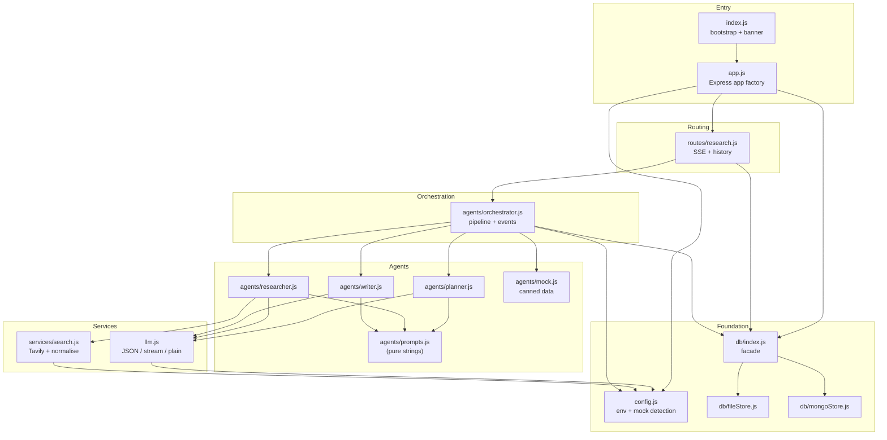

**The rules this diagram encodes:**

1. `prompts.js` contains *only strings* — no logic, no imports. The entire behavioural
   surface of the AI (the part most likely to be tuned) is one file with no side effects.
2. `index.js` is a **bootstrap, not an app** — it initialises storage and listens. The
   Express app itself is built by `app.js`'s `createApp()`, so the app can be imported and
   exercised without binding a port. See [ADR-20](#adr-20-app-factory-separate-from-bootstrap).
3. `mock.js` is a leaf that only orchestrator imports. Canned data never leaks into the live
   path, and the orchestrator stays about *flow* rather than fixtures.

### 6.2 Why `agents/` and `services/` are separate directories

- `agents/` — components that talk to the **LLM**. They own prompts and response shapes.
- `services/` — components that talk to **other external systems** (search).

This is not cosmetic. It means "swap Tavily for Brave" is a `services/` change and
"change how findings are extracted" is an `agents/` change; they cannot accidentally
entangle. (See [ADR-03](#adr-03-layer-by-systems-touched-not-by-feature).)

### 6.3 Startup sequence

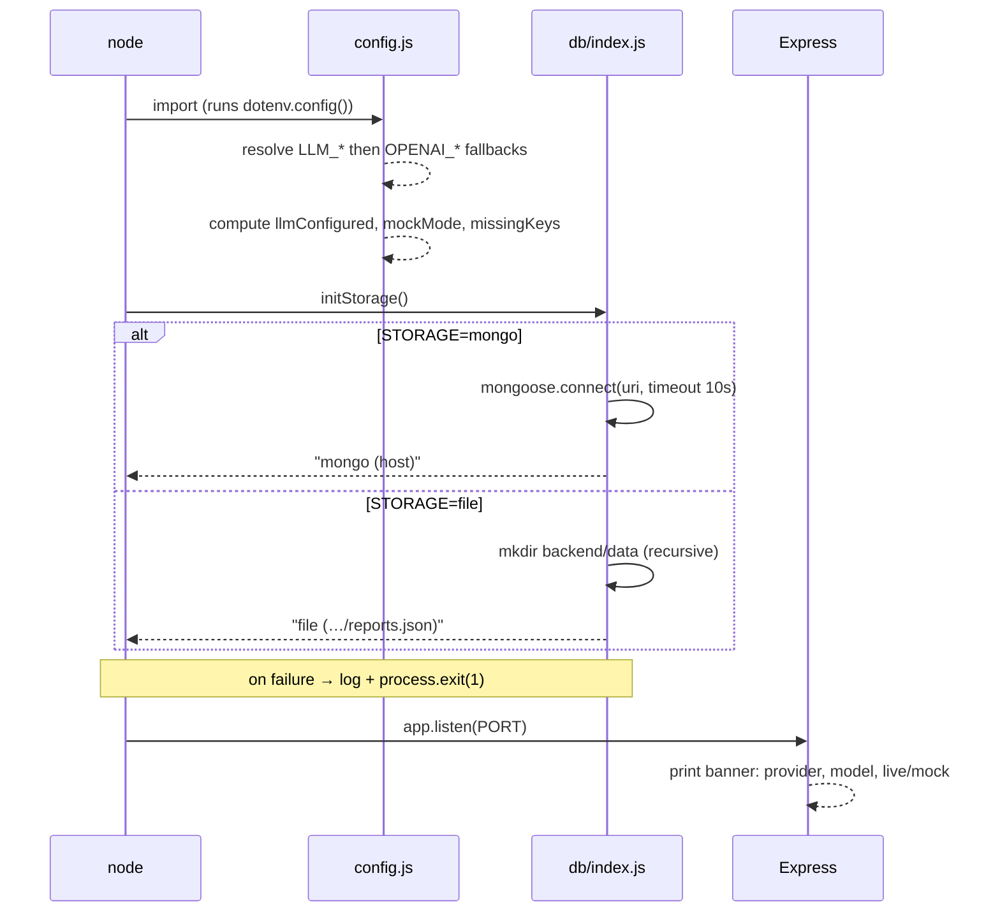

**Note the fail-fast behaviour:** if storage cannot initialise, the process **exits**
rather than silently degrading. See [ADR-10](#adr-10-fail-fast-on-storage-init-failure).

### 6.4 Why `config.js` is a single resolved object

`config.js` reads the environment **once**, at import time, and exports a frozen-shaped
object. Every other module imports `config` rather than touching `process.env`.

Consequences, all intentional:

1. **One place to audit** for every setting (there are 15).
2. **No scattered `process.env.X || 'default'`** fallbacks drifting apart.
3. **Derived values are computed once:** `llmConfigured` and `mockMode` are not
   re-evaluated per request, so a request can never see a half-configured state.
4. **Testable:** setting `MOCK_MODE=true` in the environment deterministically forces
   the mock path [§18.2](#182-mock-mode-as-a-feature).

---

## 7. The agent pipeline

### 7.1 The three agents

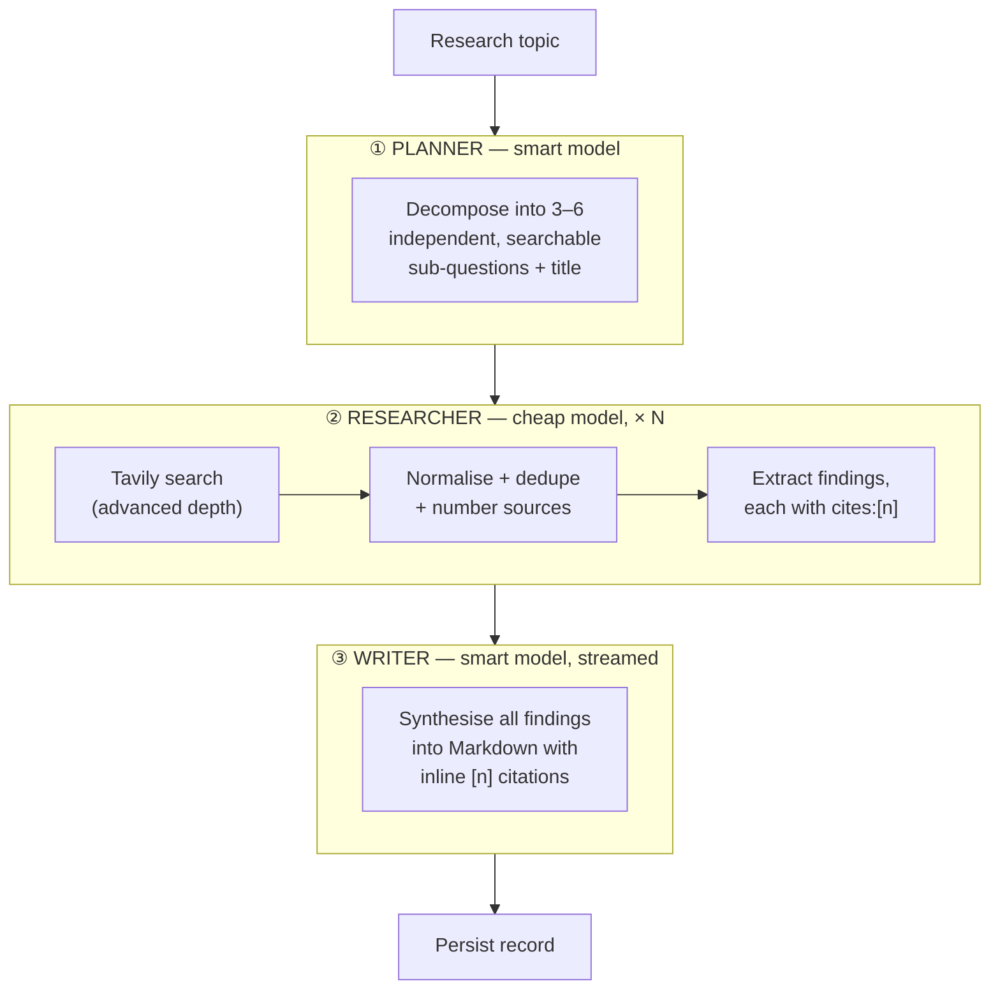

| Agent | Model tier | Calls per run | Input | Output (JSON shape) |
|---|---|---|---|---|
| **Planner** | `LLM_MODEL_SMART` | 1 | topic + max count | `{ title, subQuestions: [{question, intent}] }` |
| **Researcher** | `LLM_MODEL` | N (≈5) | one sub-question + numbered sources | `{ summary, findings: [{point, cites[]}], gaps[] }` |
| **Writer** | `LLM_MODEL_SMART` | 1 (streamed) | topic + plan + all findings + source list | Markdown text |

**Total external calls per deep run:** 1 search + 1 LLM call per sub-question, plus 2 LLM
calls. With defaults (`MAX_SUBQUESTIONS=5`): **5 searches + 7 LLM calls**.

### 7.2 Why the model tiers are split

The researcher runs *N* times; the planner and writer run once each. Putting the expensive
model where it runs 5× would multiply cost for minimal quality gain — extraction is a
narrow "read these sources, output claims" task. The planner and writer do the reasoning
that benefits from a stronger model.

**Defence of the fallback:** `LLM_MODEL_SMART` defaults to `LLM_MODEL` when unset
(`config.js`, `smartModel`). This means a provider with only one good model still works
with a single setting — the tiering is an *optimisation*, never a *requirement*.

### 7.3 Why research is sequential, not parallel

All sub-questions are processed in a `for … of` loop. This is deliberate:

| Consideration | Sequential (chosen) | Parallel (rejected for v1) |
|---|---|---|
| Source numbering | Trivial — sources are numbered in the order found | Race conditions; numbering becomes non-deterministic, breaking citation chips |
| Rate limits | One request at a time | Can trip Tavily/provider limits instantly |
| Debuggability | The trace reads top-to-bottom | Interleaved, confusing trace |
| Memory | One extraction in flight | All extractions buffered |
| **Latency** | **Slower** (34.8 s measured) | Faster |

**This is the single biggest performance trade-off in the system**, and it is the one most
worth revisiting. It is called out explicitly in [§19](#19-performance-where-the-time-goes)
and [§20](#20-known-limitations-and-honest-gaps) rather than hidden. The reason it's
acceptable for v1: the pipeline is *streamed*, so the user sees progress immediately —
latency is visible and legible rather than a frozen screen, which is the actual UX problem.

### 7.4 Source indexing — the backbone of citations

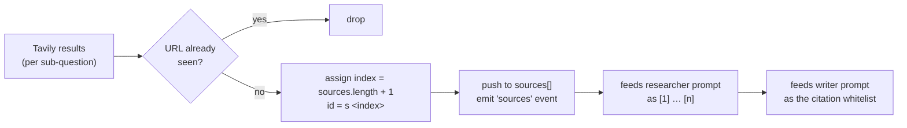

**The invariant:** a source's number is assigned **once**, at the moment it is first seen,
and never changes. That number is what appears in researcher output, in the writer's
citation whitelist, and in the UI's source cards. Deduplication by URL happens *before*
numbering, so the same page found for two sub-questions cannot occupy two slots.

**Why this matters:** without a stable index there is no way to make `[2]` in the final
report reliably point at source card 2. Every downstream guarantee rests on this one rule.

---

## 8. Prompt design

All three system prompts live in `agents/prompts.js`. The design decisions inside them:

### 8.1 The planner prompt

- **"smallest set of independent, non-overlapping sub-questions"** — prevents the model
  from producing five variations of the same question, which would waste searches and
  produce a repetitive report.
- **"Prefer 3 to 6 … Never exceed the stated maximum"** — the count is injected per-request
  from `MAX_SUBQUESTIONS`, so the prompt and the code can't disagree.
- **Breadth-then-depth guidance** — encodes a research methodology (background → current
  state → trade-offs → risks → outlook) rather than hoping the model invents one.
- **"Do not write an answer. Only plan the investigation."** — stops the planner from
  answering the question itself and then having the researcher merely confirm it.

### 8.2 The researcher prompt

- **"Never invent facts, numbers, names, or quotes that are not present"** — this is the
  anti-hallucination instruction, and it is why the API accepts `includeAnswer: false`
  from Tavily: we want *raw sources*, not a pre-digested answer the model can copy.
- **"Every finding must cite the source numbers"** — makes grounding *structural* rather
  than stylistic. Findings without citations are visibly malformed.
- **"If the sources are thin or contradictory, say so honestly in `gaps`"** — a dedicated
  output field for uncertainty. This is what surfaces the "no sources found" case honestly.

### 8.3 The writer prompt

- **Explicit Markdown structure** (H1 → Executive Summary → H2 sections → Limitations) —
  a fixed skeleton produces consistent, exportable documents regardless of provider.
- **"group and reorder the sub-questions as needed rather than listing them mechanically"**
  — prevents the classic "five headings, one per search" artifact. The reader gets a report,
  not a transcript.
- **"Where sources disagree, present the tension explicitly"** — a deliberate push against
  the averaging/hedging behaviour models default to.
- **Citation rules are marked "(critical)"**: only cite provided numbers, never invent one,
  and **do not add a reference list**. That last rule is what lets the UI own reference
  rendering entirely — see [ADR-13](#adr-13-citations-inline-no-reference-list).
- **A "Diagram rules (Mermaid)" block** asks for one or two fenced ```` ```mermaid ```` blocks
  *where a process, comparison, cause-and-effect chain, timeline, or hierarchy is easier to
  grasp visually than in prose*. The constraints are all about **renderability**, because a
  diagram is only useful if it draws: prefer `flowchart`/`timeline`/`sequenceDiagram`, keep
  node labels short, and **quote any label containing `()`, `:`, `;` or `,`** — unquoted
  punctuation is the single most common cause of a Mermaid parse error. The measured result
  (2 valid diagrams in a 721-word report) is in [§15.4](#154-what-could-not-be-verified).
- **Why "where it helps" rather than "include a diagram"**: an unconditional instruction
  produces a diagram on every report, including ones where it is filler. Tying it to the
  shape of the content keeps the feature honest.

---

## 9. The streaming protocol (SSE)

This is the heart of the "live" experience, and every decision here was made against an
alternative.

### 9.1 Transport choice

| Option | Verdict | Reasoning |
|---|---|---|
| **SSE over POST** | ✅ **chosen** | Server→client only (exactly our need); plain HTTP; no handshake; trivially proxied; auto-close semantics. |
| `EventSource` over GET | ❌ | Cannot send a request body. The topic would have to go in a query string — ugly, length-limited, and it lands in server logs. |
| WebSockets | ❌ | Bidirectional, stateful, needs a separate server/upgrade path, and we already have HTTP. **Overkill for a one-way progress feed.** |
| Long-polling | ❌ | Repeated requests, duplicated latency, no natural ordering guarantees. |
| Plain JSON response | ❌ | Defeats goal **G2** — the whole product is the trace. A 42-second silent request is unacceptable UX. |

**The cost we accepted:** because we use `POST` + `fetch` instead of `EventSource`, the
browser will not auto-reconnect on drop, and we must **parse the SSE frames by hand**
(`frontend/src/api.js`). That is ~30 lines of buffer-splitting code, and it buys us a JSON
body and full `AbortController` cancellation. Judged worth it — see [ADR-04](#adr-04-post-sse-with-hand-parsing).

### 9.2 Frame format — and the `event: end` subtlety

Every progress frame is **data-only**:

```
data: {"type":"status","message":"Researching: …"}\n\n
```

The **only** frame that uses a named SSE event is the terminator:

```
event: end
data: {}
```

**Why:** our client dispatches purely on `data.type`. Adding an `event:` name to every
frame would mean two sources of truth for the same information. The `event: end` line
exists solely so a generic SSE client (curl, a test harness, a future `EventSource`
consumer) has an unambiguous, non-JSON way to detect completion.

> ⚠️ **Common misreading:** grepping a captured stream for `^event:` returns *only* `end`.
> That is not a bug — it is the design above. This exact confusion has already been hit
> once; it is documented here so it isn't hit again.

### 9.3 Event taxonomy

| Event | Emitted when | Payload highlights | UI effect |
|---|---|---|---|
| `meta` | run starts | `mock`, `model`, `smartModel`, `depth`, `query` | records run metadata |
| `status` | phase changes | `message` | status line |
| `plan` | planner done | `title`, `subQuestions` | plan checklist |
| `step` | agent starts/finishes | `{agent, label, detail, status}` | trace row |
| `sources` | after each search | `sources[]` (new only), `total` | appends source cards |
| `findings` | after each extraction | `extraction` | findings fed to report |
| `token` | writer streaming | `text` delta | appends to report |
| `done` | after persist | full `record` | finalises, enables export |
| `error` | pipeline throws | `message` | error banner |

**Why `sources` sends only *new* sources:** the orchestration emits `fresh` (deduped) rather
than the running array, so the client appends without re-rendering or de-duplicating.
`total` is carried for display. This keeps the client dumb and the server authoritative.

### 9.4 Full request lifecycle

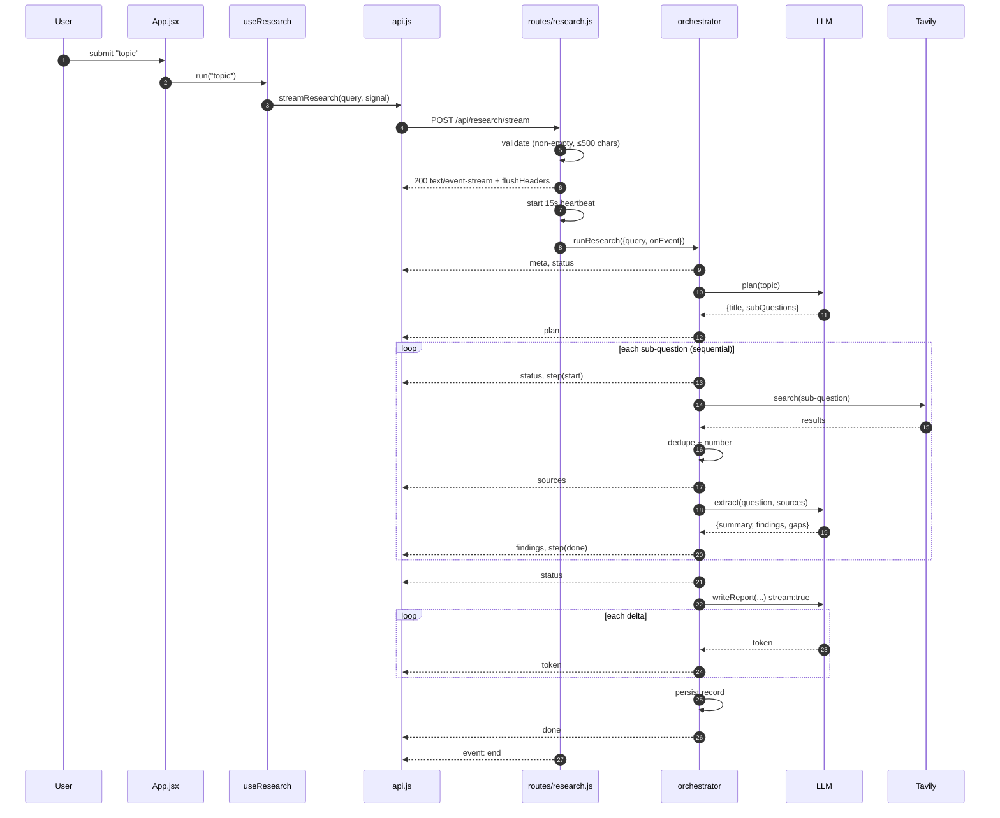

### 9.5 Heartbeat and dead-socket handling

```js
const heartbeat = setInterval(() => { if (!closed) res.write(': ping\n\n') }, 15_000)
res.on('close', () => { closed = true; clearInterval(heartbeat) })
```

Two problems are solved by four lines:

1. **Idle connections get killed.** A measured run takes **42 seconds**, with gaps of many
   seconds between frames while a model thinks. Reverse proxies, load balancers, and some
   corporate networks drop connections idle for ~30–60 s. A `: ping` comment frame (legal
   SSE, ignored by our parser) keeps the socket warm.
2. **Writing to a dead socket.** If the user closes the tab, `res.write` on a closed socket
   would throw. The `closed` flag is checked in both the heartbeat and `send()`, so a
   disconnected client simply stops the run's output rather than crashing the server.

Also set: `X-Accel-Buffering: no` (defeats nginx response buffering, which would otherwise
collapse the entire stream into one lump delivered at the end) and
`Cache-Control: no-cache, no-transform`.

---

## 10. The provider abstraction

**This is the decision the user cared about most, so it gets the most detail.**

### 10.1 The rule

> The OpenAI SDK is a **transport**, not a vendor. We use it to speak the
> `/v1/chat/completions` protocol to *whatever endpoint you point it at*. No OpenAI account,
> key, or model is required or assumed.

### 10.2 How the environment resolves

`config.js` line by line:

```js
const env = (neutral, legacy) => process.env[neutral] ?? process.env[legacy] ?? ''
```

Every setting is looked up **neutral-name-first, legacy-name-second**:

| Neutral (preferred) | Legacy fallback | Effective rule |
|---|---|---|
| `LLM_API_KEY` | `OPENAI_API_KEY` | neutral wins if set |
| `LLM_BASE_URL` | `OPENAI_BASE_URL` | neutral wins if set |
| `LLM_MODEL` | `OPENAI_MODEL` | neutral wins if set |
| `LLM_MODEL_SMART` | `OPENAI_MODEL_SMART` | neutral wins if set |
| `LLM_JSON_MODE` | `OPENAI_JSON_MODE` | `LLM_*` read first with `??` |

**Why keep the legacy names at all:** an existing `.env` written before the rename keeps
working, and a user copying an OpenAI-compatible snippet from any provider's docs doesn't
have to translate it. **Why `??` and not `||`:** `??` only falls through on `null`/`undefined`.
This matters because an explicitly empty `OPENAI_MODEL=` would otherwise defeat a set
`LLM_MODEL` — with `??`, the neutral value is honoured correctly. The only place `||` is
used is where an empty string should genuinely mean "apply the default" (the model names).

### 10.3 Configuration matrix

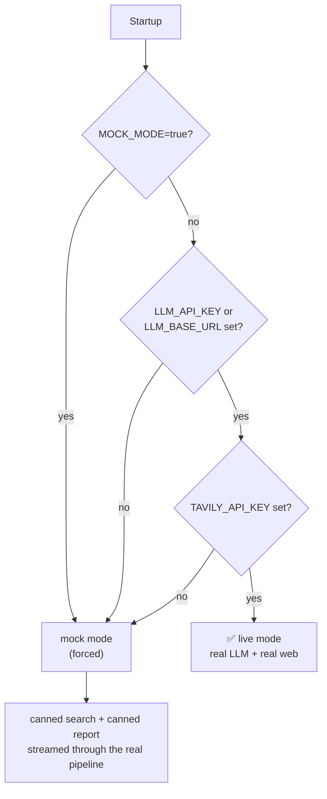

`llmConfigured = Boolean(apiKey || baseUrl)` — **either** is enough. This is what makes
local servers (Ollama, LM Studio, vLLM) work: they need no key, only a base URL.

### 10.4 The three call styles

`llm.js` exposes exactly three functions, matching the three shapes of work:

| Function | `stream` | `response_format` | Temperature | Used by |
|---|---|---|---|---|
| `chatJSON` | false | `json_object` (if `jsonMode`) | 0.2–0.3 | planner, researcher |
| `chatStream` | **true** | none | 0.4–0.5 | writer |
| `chat` | false | none | 0.3 | (reserved: polish passes) |

**Why `chatStream` never asks for JSON mode:** the writer produces Markdown prose, and
`json_object` would force it to wrap the report in a JSON string — destroying the
incremental token stream that the UI depends on.

### 10.5 JSON mode: defended with a fallback

```js
...(config.llm.jsonMode ? { response_format: { type: 'json_object' } } : {}),
```

| If we always sent `json_object` | If we never sent it |
|---|---|
| Some providers/local models return **400/500** and the run dies | Models occasionally wrap JSON in prose or a ```json fence |

The chosen approach: **send it when enabled (the default, because it works on the
overwhelming majority), and recover when it isn't.** If JSON parsing fails,
`chatJSON` salvages the first balanced `{…}` block via regex before giving up:

```js
const match = text.match(/\{[\s\S]*\}/)
if (!match) throw new Error('Model did not return valid JSON')
return { data: JSON.parse(match[0]), usage }
```

**Verified live:** the Gemini endpoint was probed with
`response_format: {type:"json_object"}` and returned clean JSON, confirming
`LLM_JSON_MODE=true` is safe there (see [§15.3](#153-provider-json-mode-verification)).

### 10.6 Provider matrix (all speak the same protocol)

| Provider | `LLM_BASE_URL` | Example model |
|---|---|---|
| **Google Gemini** | `https://generativelanguage.googleapis.com/v1beta/openai/` | `gemini-3.5-flash-lite` |
| Groq | `https://api.groq.com/openai/v1` | `llama-3.3-70b-versatile` |
| OpenRouter | `https://openrouter.ai/api/v1` | `anthropic/claude-3.5-sonnet` |
| Together | `https://api.together.xyz/v1` | `meta-llama/Llama-3.3-70B-Instruct-Turbo` |
| DeepSeek | `https://api.deepseek.com/v1` | `deepseek-chat` |
| Mistral | `https://api.mistral.ai/v1` | `mistral-large-latest` |
| Ollama (local) | `http://localhost:11434/v1` | `llama3.1` |
| LM Studio (local) | `http://localhost:1234/v1` | your loaded model |
| vLLM (local) | `http://localhost:8000/v1` | your served model |
| OpenAI (optional) | `https://api.openai.com/v1` | `gpt-4o-mini` |

> **Model names are the provider's, not ours.** There is no allow-list, no mapping table,
> no normalisation — the string in `LLM_MODEL` is passed through verbatim. This is
> intentional: any mapping layer would go stale the moment a provider renames a model, and
> would silently hide typos. The trade-off is that a typo surfaces as a 404 from the
> provider rather than a friendly startup warning — see [§15.2](#152-the-model-id-incident-the-reason-this-trade-off-gets-a-whole-section).

---

## 11. Search: Tavily and normalisation

### 11.1 Why Tavily

| Requirement | Tavily | Raw SERP scraping | Google CSE | Bing |
|---|---|---|---|---|
| LLM-ready snippets | ✅ cleaned content, ~800 char chunks | ❌ raw HTML | ⚠️ description only | ⚠️ description only |
| Single API call | ✅ | ❌ scrape + parse | ✅ | ✅ |
| Search depth control | ✅ `basic`/`advanced` | — | ❌ | ❌ |
| Relevance scores | ✅ per result | ❌ | ❌ | ❌ |
| Purpose-built for RAG | ✅ | ❌ | ❌ | ❌ |

Tavily is designed for exactly this use case and returns `content` that is already the
right granularity to paste into an LLM prompt.

### 11.2 The normalisation layer

```js
return (res.results || []).map((r) => ({
  title:   r.title || 'Untitled source',
  url:     r.url,
  snippet: (r.content || '').replace(/\s+/g, ' ').slice(0, 800),
  score:   r.score ?? null,
}))
```

**Why normalise at all** — three concrete protections:

1. **`|| 'Untitled source'`** — a missing title would otherwise render an empty, unclickable card.
2. **`.replace(/\s+/g, ' ')`** — collapses newlines/tabs, so snippets occupy predictable
   vertical space in the UI and don't blow up the prompt token count.
3. **`.slice(0, 800)`** — hard cap. Without it, one verbose page could dominate the
   researcher prompt for that sub-question and crowd out the other four sources.

**The contract this creates:** everything above `webSearch` deals with
`{title, url, snippet, score}` and *nothing else*. Swapping Tavily for Brave is one file,
one function, and the agent layer never notices. (See [ADR-08](#adr-08-tavily-behind-a-normalising-wrapper).)

### 11.3 Depth control

```js
searchDepth: config.research.depth === 'deep' ? 'advanced' : 'basic'
```

`RESEARCH_DEPTH` changes two things at once: Tavily's depth **and** the per-search result
count (deep uses `TAVILY_MAX_RESULTS`; quick caps at 3 in `orchestrator.js`). This gives a
single user-facing knob for the cost/quality trade-off rather than two knobs that can be
set into a contradictory state.

---

## 12. Storage: a facade over two drivers

### 12.1 The interface

`db/index.js` picks a driver once, at import, and re-exports the same five functions for both:

```js
export const save   = (record)      => store.save(record)
export const list   = ()            => store.list()
export const get    = (id)          => store.get(id)
export const remove = (id)          => store.remove(id)
export async function initStorage() { … }
```

**The contract every driver must satisfy:**

| Function | Contract |
|---|---|
| `connect()` | initialise; return a human-readable location for the banner |
| `save(record)` | upsert by `record.id`; return the record |
| `list()` | **summaries only** (no `report`, no `steps`), newest first |
| `get(id)` | full record or `null` |
| `remove(id)` | boolean — whether anything was deleted |

### 12.2 Why a facade at all

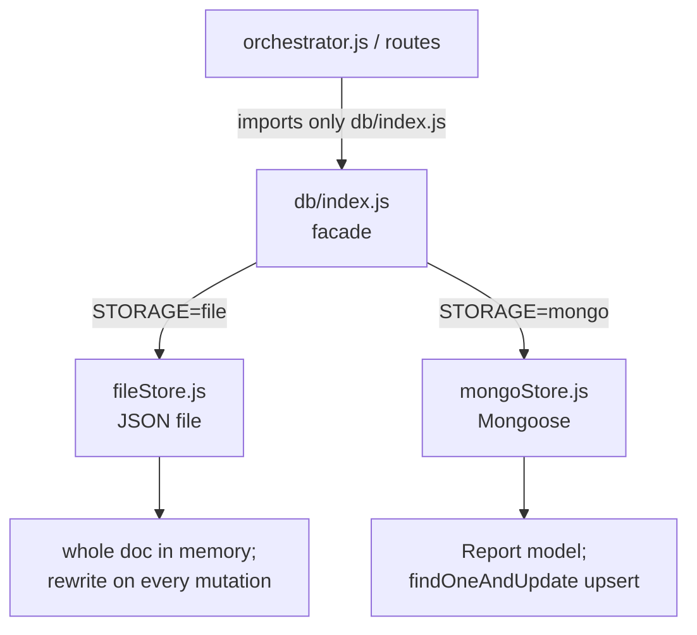

Without the facade, `orchestrator.js` would `import mongoStore`, and switching to the file
store would mean editing the pipeline. With it, the switch is `STORAGE=file` and **zero
lines of code change** — which is the only way [ADR-09](#adr-09-file-store-as-default-database-optional)
can be honest about MongoDB being "one env var away".

### 12.3 The `list()` asymmetry is deliberate

`fileStore.list()` strips the record down to summary fields *in JavaScript*. `mongoStore.list()`
does it with a **projection** (`{ report: 0, steps: 0 }`) and a `.limit(100)`.

Same output shape; different mechanism, each idiomatic for its backend. The Mongo side
avoids transferring megabytes of report text just to render a history sidebar. The
interface contract is what matters, not that the implementations look alike.

### 12.4 The stored record

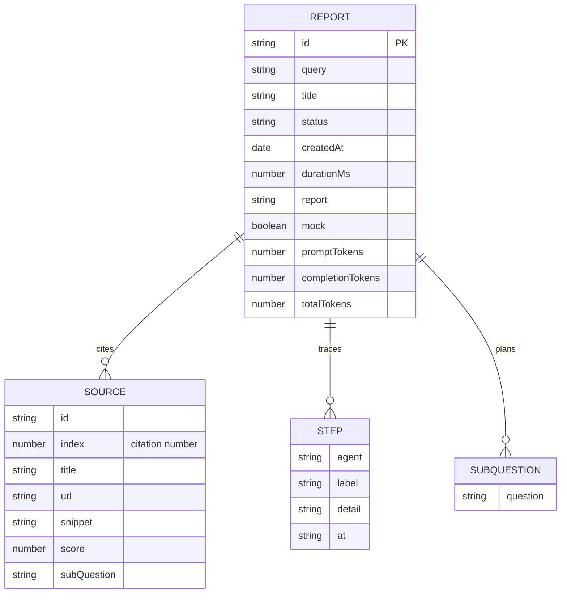

**Why `subQuestions` is flattened to `[String]` in the record** while the live `plan` event
carries objects: the persisted shape is what the *history list and report view* need, and
it's what the Mongo schema validates. The `intent` field is useful to the writer at
generation time but not to a reader six months later. Keeping the stored document narrow
means the schema is stable and indexable. [ADR-12](#adr-12-flatten-plan-into-subquestions-on-persist)
has the full argument, including the moment this looked like a bug and wasn't.

---

## 13. Frontend architecture

### 13.1 State machine

All run state lives in one hook, `useResearch.js`. It is an explicit four-state machine:

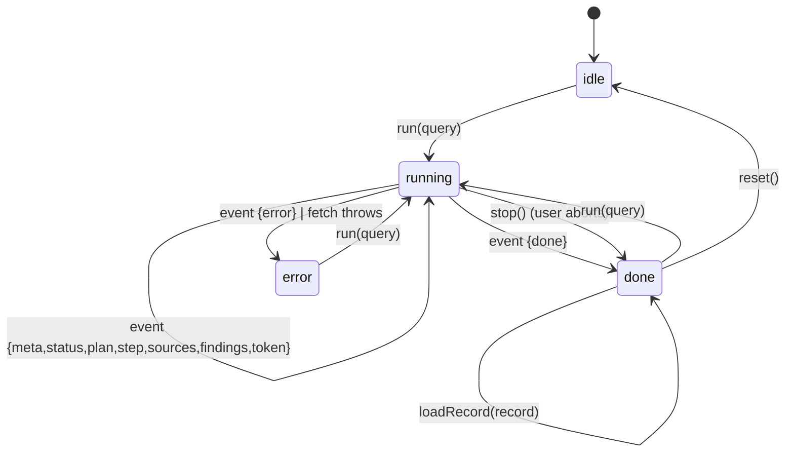

- **`idle`** — nothing yet.
- **`running`** — request in flight; `AbortController` held in a ref.
- **`done`** — either the `done` event arrived, or the user aborted (partial report kept).
- **`error`** — fetch threw or an `error` event arrived.

**Why one reducer-style `apply(event)` and not per-event handlers:** every event is folded
through a single `switch` in a `setState` updater (`useResearch.js`). This makes the event
vocabulary of the backend and the state transitions of the frontend visibly 1:1 — to add an
event type you add one `case`. It also means React can't tear state across events, because
functional updates are serialised.

**Why `AbortController` and not a "cancel" flag:** aborting propagates down to the
`fetch`, which closes the TCP connection, which fires `res.on('close')` on the server and
stops the run's output. One mechanism, both ends. See [§9.5](#95-heartbeat-and-dead-socket-handling).

### 13.2 Component tree

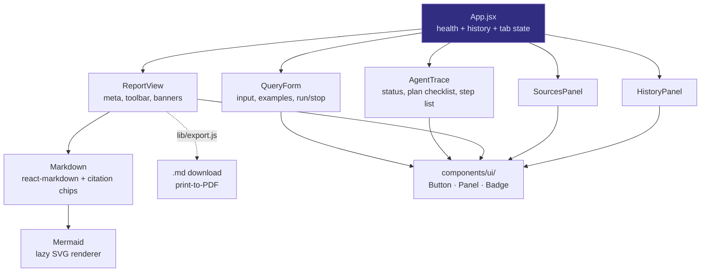

**Why no state library:** the entire shared state is one hook instance in `App.jsx` plus
two `useState` values (`health`, `history`). Redux/Zustand would add a dependency to manage
*a single object*. If the app grew a second view or optimistic multi-run support, that
calculus would change.

### 13.3 The SSE parser (and why we wrote it)

`api.js` reads `res.body` with a `ReadableStream` reader and splits on `\n\n`:

```js
const frames = buffer.split('\n\n')
buffer = frames.pop() ?? ''   // keep the trailing partial frame
```

**The subtle part is `buffer.pop()`.** TCP/HTTP chunks do not respect SSE frame boundaries —
a single `read()` can deliver half a frame, or three frames at once. Keeping the trailing
partial in `buffer` (and prepending it to the next chunk) is what makes the parser correct
under arbitrary chunking. Getting this wrong produces the classic "occasionally a token or a
source goes missing" bug that only reproduces on slow networks.

**Malformed frames are swallowed, not fatal:**
```js
try { onEvent?.(JSON.parse(raw)) } catch { /* ignore malformed frames */ }
```
One bad frame must not kill a 42-second research run. This is a deliberate resilience choice.

### 13.4 Citation chips — the interesting trick

The writer emits `[2]` in Markdown. We want that to be a clickable chip that scrolls to
source 2. Three ways to do it, and the reasoning:

| Approach | Cost | Chosen? |
|---|---|---|
| Write a `remark` plugin to reparse text nodes into elements | Correct but heavy; API surface, plugin ordering, edge cases | ❌ |
| Replace `[2]` with raw HTML `<button>` | Breaks if `react-markdown` sanitises it; mixes concerns | ❌ |
| **Rewrite `[2]` → `[2](#source-2)` and intercept the anchor in a custom `a` component** | ~20 lines, uses the Markdown parser we already have | ✅ |

```js
text.replace(/\[(\d+(?:\s*,\s*\d+)*)\](?!\()/g, (m, g) =>
  g.split(',').map((n) => `[${n}](#source-${n})`).join(''))
```

The negative lookahead `(?!\()` is what prevents mangling an existing Markdown link
`[text](url)`. The `> 6 citations` guard prevents turning a genuinely long bracket list into
a wall of buttons. The custom `a` renderer only hijacks hrefs matching `^#source-(\d+)$` —
every other link is rendered normally with `target="_blank" rel="noreferrer"`.

Then `scrollToSource` does `scrollIntoView({block:'center'})` and adds a `flash` class for
1200 ms so the user can see *which* card was targeted. The whole interaction is defensive:
if the element isn't found, it silently does nothing rather than throwing.

### 13.5 Export

| Format | How | Why |
|---|---|---|
| **Copy** | `navigator.clipboard.writeText` | Silent failure if blocked (insecure context) — no crash |
| **`.md`** | `Blob` + object URL + synthetic anchor click | Pure client-side, no server round-trip, filename slugged from the title |
| **PDF** | Open a new window, write styled HTML, `win.print()` | Uses the browser's native print-to-PDF — no jsPDF/html2canvas dependency, real selectable text, no extra 100 kB |

The PDF path **inline-styles the print document** rather than reusing app CSS, because the
app's dark theme and layout would print badly. It's a small, isolated duplication in exchange
for a print output that looks like a document, not a screenshot of a dashboard.

### 13.6 Mermaid diagrams in the report

The writer agent is instructed ([§8.3](#83-the-writer-prompt)) to emit one or two
```` ```mermaid ```` blocks. Rendering them is the interesting part, because the report is
**streamed token by token** — at any given moment the Markdown is a partial document.

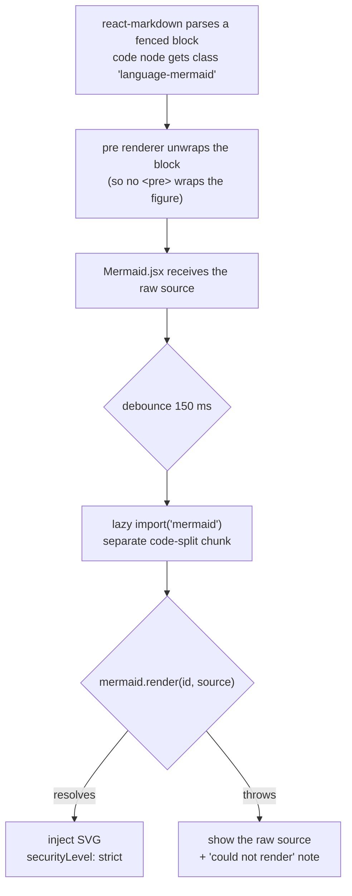

Four decisions, each with a reason:

| Decision | Alternative | Why this one |
|---|---|---|
| **Detect the fence in the `code`/`pre` renderers** | A `remark` plugin, or `rehype-mermaid` | Zero new parser plumbing; the class name is already there. `rehype-mermaid` would also pull in a headless browser at build time. |
| **Render client-side in an effect** | Server-side render to SVG at write time and store the SVG | The write path is *already* 42 s; adding a rendering step and a large Mermaid install to the backend makes the critical path longer and couples the server to a charting library it otherwise doesn't need. |
| **Debounce 150 ms** | Render on every token | An unclosed fence is still a valid code block to CommonMark, so without debouncing we'd kick off a `mermaid.render` for nearly every streamed token, each one failing until the fence closes. The debounce collapses that to one attempt per quiet period. |
| **`securityLevel: 'strict'`** | Default/`loose` | Mermaid's strict mode sanitises labels and disables click handlers and HTML labels. The diagram text is indirectly model-authored from scraped pages, so it sits on the same untrusted boundary as [ADR-14](#adr-14-react-markdown-instead-of-innerhtml). |

**The fallback is the point.** A diagram that fails to parse does not blank the report or
throw a React error — it renders the raw source with a small note, so the report degrades to
"here's the definition" rather than breaking. Every diagram in the shipped mock report and in
the live verification run was parsed with the real Mermaid v12 parser ([§15.4](#154-what-could-not-be-verified)).

**Bundle cost, measured:** `mermaid` is reached only via a dynamic `import()`, so it lands in
its own chunks (plus one per diagram type). The main app bundle grew from 389.7 kB to
399.7 kB (123.9 kB gzip); the diagram chunks are fetched only when a report contains one.

### 13.7 Styling: Tailwind v4

The UI moved from ~700 lines of hand-written CSS (`index.css` + `App.css`) to Tailwind v4
utilities, with the theme expressed as tokens rather than duplicated values:

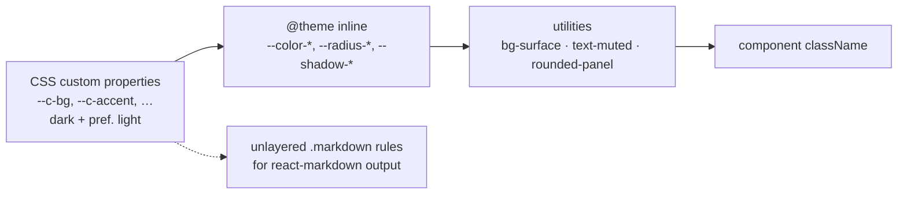

- **No `tailwind.config.js` and no PostCSS config.** v4's Vite plugin scans sources and reads
the `@theme` block directly, so configuration is one `@import 'tailwindcss'` plus a token map.
- **Tokens stay in `:root` as `--c-*` custom properties**, and `@theme inline` maps them to
`--color-*`. `inline` means the generated utility references `var(--c-accent)` rather than a
copied literal, which is what makes the `prefers-color-scheme: light` palette work with no
`dark:` variants anywhere in the markup.
- **The rendered report keeps a small stylesheet.** `react-markdown` output cannot carry
utility classes on every element, so `.markdown` rules remain — but they are written with
`@apply`, live in one block, and are the only place that styles Markdown.
- **One real gotcha, found by reading the emitted CSS:** the `.source-card.flash` highlight
was first written inside `@layer components`, where Tailwind's utilities layer always wins —
the flash would silently never appear. It is now intentionally **unlayered**, which is what
lets it override the card's `border-line-soft` / `bg-inset` utilities. Verified by grepping
the built CSS for the emitted rule.

---

## 14. Configuration and API reference

### 14.1 Every backend setting

| Variable | Default | Purpose | Failure mode if wrong |
|---|---|---|---|
| `PORT` | `5000` | HTTP port | EADDRINUSE at boot |
| `CLIENT_ORIGIN` | `http://localhost:5173` | CORS allow-list | browser blocks all requests |
| `LLM_API_KEY` | — | provider key (placeholder ok for local) | mock mode |
| `LLM_BASE_URL` | *(empty)* | any OpenAI-compatible endpoint | points at api.openai.com |
| `LLM_MODEL` | `gpt-4o-mini` | researcher tier | provider 404 |
| `LLM_MODEL_SMART` | falls back to `LLM_MODEL` | planner + writer tier | provider 404 |
| `LLM_JSON_MODE` | `true` | send `response_format=json_object` | 400s on strict local models |
| `TAVILY_API_KEY` | — | required for live search | mock mode |
| `TAVILY_MAX_RESULTS` | `5` | sources per sub-question | more = slower/richer |
| `MAX_SUBQUESTIONS` | `5` | planner breadth, **clamped 1–8** | out-of-range silently clamped |
| `RESEARCH_DEPTH` | `deep` | `deep`=advanced+more · `quick`=basic+≤3 | unknown values fall back to `deep` |
| `STORAGE` | `file` | `file` or `mongo` | unknown → `file` |
| `MONGODB_URI` | — | required when `STORAGE=mongo` | **exit(1)** at boot |
| `MOCK_MODE` | `false` | force canned mode with keys present | hides real behaviour |

**Frontend:** exactly one variable, `VITE_API_URL` (default `http://localhost:5000`).

### 14.2 HTTP API

| Method | Route | Request | Response |
|---|---|---|---|
| `POST` | `/api/research/stream` | `{ "query": "…" }` | `text/event-stream` of the 9 event types |
| `GET` | `/api/research` | — | `{ reports: [summary…] }`, newest first |
| `GET` | `/api/research/:id` | — | full record, or `404` |
| `DELETE` | `/api/research/:id` | — | `{ removed: boolean }`, `404` if absent |
| `GET` | `/api/health` | — | mode, storage, models, provider, `jsonMode`, `missingKeys`, `depth` |

**`/api/health` is the operator's diagnostic** and is what the frontend badge reads:

```json
{
  "ok": true,
  "mock": false,
  "storage": "file",
  "models": { "default": "gemini-3.5-flash-lite", "smart": "gemini-3.5-flash-lite" },
  "llmProvider": "https://generativelanguage.googleapis.com/v1beta/openai/",
  "jsonMode": true,
  "missingKeys": [],
  "depth": "deep"
}
```

**This endpoint exists so that "which model am I actually talking to?" never requires
guessing.** It was added after the incident in [§15.2](#152-the-model-id-incident-the-reason-this-trade-off-gets-a-whole-section).

---

## 15. Verification: measured, not asserted

Everything below was executed against the real Gemini endpoint and the real Tavily API,
with `STORAGE=file` (no database). No part of this section is inferred.

### 15.1 End-to-end live run

Health after boot confirmed **live** mode with no missing keys (the JSON above). A real query
was streamed through `POST /api/research/stream`. **Every one of the nine event types fired,
and there were zero `error` frames.**

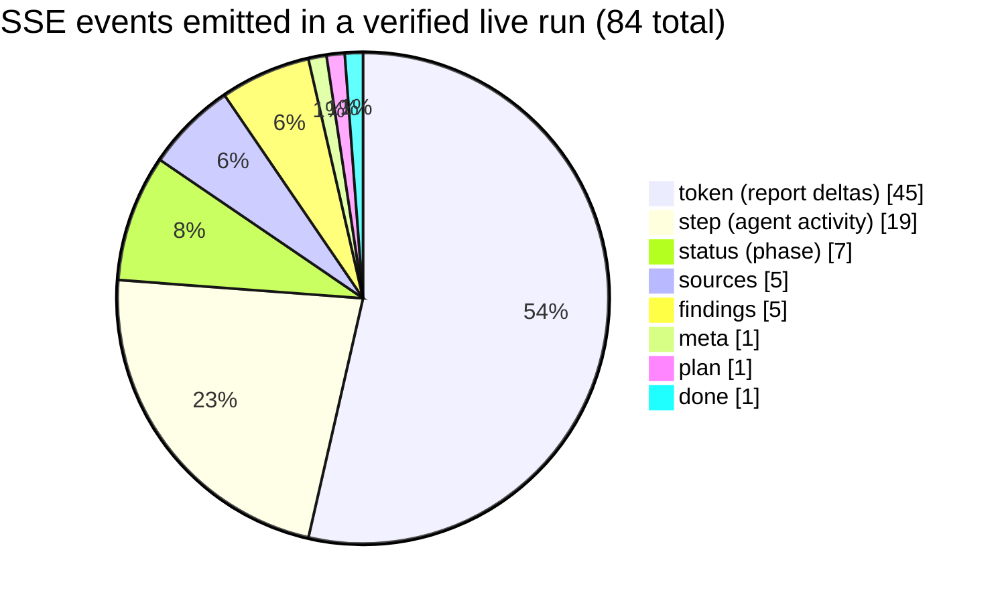

| Claim | Evidence |
|---|---|
| Streaming works on Gemini | 45 `token` deltas arrived incrementally over the writer call |
| JSON mode works on Gemini | planner + 5 researcher calls returned parseable JSON |
| Real web search works | 21 deduped source URLs from real domains (yahoo, aps.org, kth.diva-portal.org, …) |
| Report is grounded | 905-word Markdown containing inline `[n]` citations |
| Persistence works | record written to `backend/data/reports.json`, newest-first, 5 sub-questions |
| No silent failures | zero `"type":"error"` frames in the captured stream |

### 15.2 The model-id incident (the reason this trade-off gets a whole section)

The provider matrix in [§10.6](#106-provider-matrix-all-speak-the-same-protocol) says model
names are passed through verbatim with no validation. Here is the real cost of that choice.

The operator's `.env` contained:

```env
LLM_MODEL=google__gemini_3_5_flash_lite
```

That is an **aggregator-style slug**, not a Google model id. Directly querying the endpoint's
own catalogue settled it:

```bash
curl -H "Authorization: Bearer $KEY" \
  https://generativelanguage.googleapis.com/v1beta/openai/models
```

The real id is **`gemini-3.5-flash-lite`**. The bogus slug produced:

```json
[{"error":{"code":404,"message":"models/google__gemini_3_5_flash_lite is not found for
 API version v1main … Call ModelService.ListModels to see the list of available models."}}]
```

**The verdict on the trade-off:** passing names through verbatim is still correct — but it
means a typo fails at *request* time with a provider 404, not at *boot* time. That is why
`/api/health` reports the resolved `models` and `llmProvider`, and why the startup banner
prints them. **We kept the pass-through design and added observability instead of adding a
validation layer** that would go stale. See [ADR-06](#adr-06-pass-model-names-through-unvalidated).

### 15.3 Provider JSON-mode verification

Two direct probes against the OpenAI-compatible endpoint, independently of the app:

| Probe | Result |
|---|---|
| Plain message | HTTP 200, `choices[0].message.content == "OK"` |
| `response_format: {type:"json_object"}` | HTTP 200, valid JSON: `{"title":"Exploring the Moon","subQuestions":[…]} ` |

**Conclusion:** `LLM_JSON_MODE=true` is safe on this endpoint. This is what converts the
"JSON mode might break things" risk from speculation into a tested fact.

### 15.4 What could **not** be verified

Stated plainly rather than glossed. First, what *was* verified **without a browser** when the
diagram and styling work was added:

| Check | Method | Result |
|---|---|---|
| The report really contains diagrams | Live SSE run against the real provider — the writer emitted **2** ```` ```mermaid ```` blocks in a 721-word report | ✅ |
| Those diagrams are valid Mermaid | Every block extracted from the live report parsed with the real **Mermaid v12** parser under jsdom (`mermaid.parse`) | ✅ 2/2 |
| Markdown → Mermaid wiring | SSR smoke render of `Markdown.jsx` asserting the fence becomes `Mermaid`, the source does **not** leak into markup, citations become chips, code fences survive, GFM tables render | ✅ 8/8 |
| Tailwind tokens actually emitted | Grepped the built CSS for `rounded-panel`, `rounded-control`, `shadow-panel`, `bg-inset`, `text-muted`, `text-planner`, `bg-researcher`, and the unlayered `.source-card.flash` rule | ✅ |
| Lint + build | `eslint` clean, `vite build` successful | ✅ |

And what still cannot be verified here:

| Not verified | Why | Risk |
|---|---|---|
| UI rendering, layout, HMR | **No browser available in this environment** | Visual regressions undetected by automated checks |
| Mermaid **pixels** | Needs a browser | Parser-valid is not the same as legible; a diagram can parse and still lay out awkwardly |
| Citation-chip scroll & flash | Needs a browser | Interaction could be subtly wrong — the CSS layer-precedence bug found by reading the built CSS is exactly this class of risk |
| Tailwind's visual result | Needs a browser | Layout/spacing regressions are invisible to `lint` and `build` |
| Export buttons (copy/.md/PDF) | Needs a browser | Untested |
| MongoDB driver at runtime | No `MONGODB_URI` provided ("still no db") | `mongoStore.js` is written and type-consistent but never executed |
| Multiple providers simultaneously | Only Gemini was available | Other base URLs unproven in practice |

The frontend was checked by `eslint`, `vite build`, an SSR render of the Markdown path, and a
parser pass over the generated diagrams — **but none of that is the same as a person looking
at the page, and this document does not claim otherwise.**

---

## 16. The decision log

Each entry: the decision, what was rejected, why, and what it costs.

### ADR-01: OpenAI SDK as transport, not vendor

- **Decision:** use `openai` npm purely as an HTTP client for `/v1/chat/completions`, pointed at `LLM_BASE_URL`.
- **Rejected:** Writing raw `fetch` calls; or assuming an OpenAI account.
- **Why:** the SDK correctly handles streaming delta accumulation, retries, and error shapes — genuinely non-trivial code we don't want to own. The protocol is a de-facto standard.
- **Cost:** a package named "openai" appears in `package.json`. This is cosmetic: `config.js` never requires an OpenAI key or default model. **Explicitly stated because it caused friction** — see the provider-neutral naming in [§10.2](#102-how-the-environment-resolves).

### ADR-02: Own the orchestration, no agent framework

- **Decision:** hand-write the planner/researcher/writer loop.
- **Rejected:** LangChain, LlamaIndex, CrewAI, AutoGen.
- **Why:** the pipeline is a `for` loop over sub-questions plus three prompt calls. A framework would add hundreds of transitive dependencies, obscure the exact request/response shapes, make streaming-through-SSE harder to control, and introduce its own version churn — all to replace ~60 lines we fully understand.
- **Cost:** we implement retries/telemetry ourselves if we want them later.

### ADR-03: Layer by systems touched, not by feature

- **Decision:** `agents/` (LLM) and `services/` (external APIs) are separate; `prompts.js` holds only strings.
- **Rejected:** grouping by feature (e.g. `research/planner-with-search.js`).
- **Why:** the two axes of change are "which model/prompt" and "which data source". Separating them means each change is local and the blast radius is obvious.
- **Cost:** slightly more files than a single-module design.

### ADR-04: POST SSE with hand parsing

- **Decision:** stream over a POST response body and parse `data:` frames in `api.js`.
- **Rejected:** `EventSource` + GET (no body); WebSockets (bidirectional, overkill); polling.
- **Why:** we need one-way progress with a JSON request body and cancellability. Full detail in [§9.1](#91-transport-choice).
- **Cost:** no browser auto-reconnect; ~30 lines of buffer-splitting that must respect chunk boundaries.

### ADR-05: A nine-event vocabulary rather than raw text only

- **Decision:** emit typed events (`meta/status/plan/step/sources/findings/token/done/error`) alongside tokens.
- **Rejected:** streaming only the report text.
- **Why:** the product's differentiator is *transparency*. Typed events let the UI render a plan checklist, a per-source panel, and an agent trace — none of which is derivable from report text alone.
- **Cost:** a wider contract between backend and frontend; every new event type needs a client `case`.

### ADR-06: Pass model names through unvalidated

- **Decision:** `LLM_MODEL` goes verbatim to the provider.
- **Rejected:** a validation/mapping table of known model names.
- **Why:** any such table is stale within weeks, and it would silently rewrite names instead of surfacing typos. Providers are the source of truth.
- **Cost:** demonstrated by the 404 incident in [§15.2](#152-the-model-id-incident-the-reason-this-trade-off-gets-a-whole-section). Mitigated by reporting resolved models in `/api/health` and the boot banner.

### ADR-07: Two model tiers with an implicit fallback

- **Decision:** `LLM_MODEL` (researcher) and `LLM_MODEL_SMART` (planner/writer), the latter defaulting to the former.
- **Rejected:** one model everywhere; or a mandatory second setting.
- **Why:** cost scales with call count — the researcher is called N times. Defaulting keeps single-model providers working.
- **Cost:** operators must understand which agent uses which tier (documented in the README table and [§7.1](#71-the-three-agents)).

### ADR-08: Tavily behind a normalising wrapper

- **Decision:** `services/search.js` exposes `webSearch()` returning a fixed `{title,url,snippet,score}` shape.
- **Rejected:** calling Tavily directly from the researcher agent.
- **Why:** normalisation protects against missing titles, whitespace blowup, and prompt-flooding; it also makes the search provider swappable in one file.
- **Cost:** any Tavily field we don't map is unavailable upstream (intentional).

### ADR-09: File store as default; database optional

- **Decision:** ship a JSON file store as default; provide a full Mongo adapter one env var away.
- **Rejected:** requiring MongoDB to start.
- **Why:** zero-setup onboarding (goal **G6**). A developer must be able to clone, `npm install`, `npm run dev` and see the product work — no cloud account, no connection string.
- **Cost:** the "MERN" claim is only true in the configured sense. Fully mitigated by the facade ([ADR-11](#adr-11-storage-facade)). The file store also rewrites the whole document on each save — fine for a single user, not for scale ([§20](#20-known-limitations-and-honest-gaps)).

### ADR-10: Fail fast on storage init failure

- **Decision:** if `initStorage()` throws, log and `process.exit(1)`.
- **Rejected:** silently falling back to the file store when Mongo is unreachable.
- **Why:** silent fallback is a data-integrity trap — the operator sets `STORAGE=mongo`, the connection fails, and the app quietly writes reports to a local file they'll never look at. A loud failure is the honest behaviour.
- **Cost:** no automatic resilience; the operator must fix `MONGODB_URI`.

### ADR-11: Storage facade

- **Decision:** all consumers import `db/index.js`; the driver is chosen there.
- **Rejected:** importing a concrete store at each call site.
- **Why:** this is what makes [ADR-09](#adr-09-file-store-as-default-database-optional) truthful — the switch is configuration, not refactoring.
- **Cost:** one indirection layer; both drivers must stay in interface lock-step (enforced by convention, not types).

### ADR-12: Flatten plan into `subQuestions` on persist

- **Decision:** the stored record contains `subQuestions: [String]`, not the live `plan` object.
- **Rejected:** persisting the full `{title, subQuestions:[{question,intent}]}` plan.
- **Why:** the persisted document should be narrow and stable. `intent` guides the writer at generation time and is not needed to re-render a history entry. Arrays of strings index and validate cleanly in Mongo.
- **Cost:** *this was briefly mistaken for a bug* during verification — reading `record.plan` returned `{}` because the field is named `subQuestions`. Documented here so the next person doesn't "fix" a non-bug. The frontend maps it back: `(record.subQuestions ?? []).map(q => ({ question: q }))`.

### ADR-13: Citations inline; no reference list

- **Decision:** the writer emits `[n]` inline and is explicitly told not to append a references section.
- **Rejected:** letting the model produce its own bibliography.
- **Why:** the UI renders a canonical, always-correct source list from the actual retrieved data. A model-authored bibliography would duplicate it, could drift from the real sources, and would waste output tokens.
- **Cost:** the report is only self-contained inside this app; a raw copy-paste loses the reference list. Acceptable — the `.md` export is a *report*, and the sources panel is the source of truth.

### ADR-14: `react-markdown` instead of `innerHTML`

- **Decision:** render model output with `react-markdown` + `remark-gfm`.
- **Rejected:** `dangerouslySetInnerHTML` with a Markdown→HTML converter.
- **Why:** the rendered content is **untrusted** — it is model output that describes **third-party web content**. Injecting that as raw HTML is a direct XSS vector. `react-markdown` builds React elements and never executes markup.
- **Cost:** one dependency; some HTML in Markdown isn't rendered. Worth it — this is the security boundary of the app.

### ADR-15: Registration-free, single-user, global history

- **Decision:** no authentication.
- **Rejected:** accounts, sessions, per-user scoping.
- **Why:** scoped explicitly as a local/single-operator tool. Auth would dominate the codebase and the setup instructions for no benefit to the stated use case.
- **Cost:** history is global and the API is open. **Do not expose this to the public internet as-is** — stated in [§17](#17-security--robustness) and [§20](#20-known-limitations-and-honest-gaps).

### ADR-16: Automatic mock mode

- **Decision:** when the LLM or Tavily is unconfigured, run the *real* pipeline with canned data.
- **Rejected:** refusing to start, or returning an error.
- **Why:** it makes the product demonstrable in seconds, gives the frontend a stable fixture, and doubles as a test harness. The mock streams through the same SSE path, so it exercises the whole stack.
- **Cost:** a user could mistake mock output for research — mitigated by the `Mock mode` badge, the in-report warning banner, and `[mock]` source titles.

### ADR-17: Heartbeat + closed flag

- **Decision:** `: ping` every 15 s; a `closed` flag guarding all writes.
- **Rejected:** relying on the connection staying open.
- **Why:** measured runs exceed 40 s with multi-second gaps ([§19](#19-performance-where-the-time-goes)); idle proxies would drop them. And writing to a client that navigated away would throw.
- **Cost:** one interval timer per active run — negligible.

### ADR-18: Client-side Mermaid with a syntax fallback

- **Decision:** render ```` ```mermaid ```` blocks in the browser, debounced, with a hard fallback to the raw source when parsing fails.
- **Rejected:** `rehype-mermaid` (needs a headless browser at build time), server-side pre-rendering to SVG (adds latency and a charting dependency to the write path), and skipping diagrams entirely.
- **Why:** it leaves the ~42 s critical path unchanged, keeps the backend free of a charting library, and the fallback turns a bad diagram into a cosmetic problem instead of a blank report.
- **Cost:** a few kB of wiring plus Mermaid's own lazily-fetched chunks. See [§13.6](#136-mermaid-diagrams-in-the-report).

### ADR-19: Tailwind v4 for styling

- **Decision:** replace `App.css` and most of `index.css` with Tailwind v4 utilities, with the theme expressed as `@theme inline` tokens.
- **Rejected:** hand-written CSS (already drifting), a component kit such as MUI or Chakra (a large dependency for six components), CSS modules (more files, no token system).
- **Why:** utility classes remove dead CSS by construction, and routing the existing `--c-*` palette through `@theme inline` preserves the dark/light theming that was already there.
- **Cost:** class-heavy JSX, plus one unlayered `.markdown` stylesheet for `react-markdown` output. See [§13.7](#137-styling-tailwind-v4).

### ADR-20: App factory separate from bootstrap

- **Decision:** `app.js` exports `createApp()`; `index.js` initialises storage, builds the app, and listens.
- **Rejected:** the single `index.js` this started as.
- **Why:** importing a module must not bind a port or touch storage as a side effect. The factory makes the app importable and testable, and keeps the storage-failure exit ([ADR-10](#adr-10-fail-fast-on-storage-init-failure)) in the bootstrap where it belongs.
- **Cost:** one extra file and one extra hop when tracing startup — a good trade.

---

## 17. Security & robustness

| Concern | Mitigation | Where |
|---|---|---|
| **XSS from model/web content** | `react-markdown` element rendering; never `innerHTML` | `Markdown.jsx` (ADR-14) |
| **API key leakage** | Keys live only in the backend process; the browser never receives them | architecture ([§3](#3-system-context)) |
| **CORS** | Explicit `CLIENT_ORIGIN` allow-list, not `*` | `index.js` |
| **Oversized request bodies** | `express.json({ limit: '1mb' })` | `index.js` |
| **Prompt abuse / cost run-away** | Query capped at 500 chars; sub-questions clamped 1–8; results capped per search; snippets truncated to 800 chars | `routes/research.js`, `config.js`, `search.js` |
| **Prompt injection from web pages** | Partial only: the researcher is instructed to extract, not obey, and the writer only sees structured findings. **Not a hard guarantee.** | `prompts.js` |
| **Open API** | None — acceptable for local use only (ADR-15) | [§20](#20-known-limitations-and-honest-gaps) |
| **Broken stream on client disconnect** | `closed` flag + `AbortController` propagation | `routes/research.js` |

**On prompt injection:** this is the honest weak spot of any web-reading agent. A malicious
page could contain text like "ignore your instructions". Our mitigations are (a) the
researcher's system prompt fixes its task to extraction with citations, (b) the writer never
sees raw page text — only the researcher's structured findings, and (c) the final output is
rendered as safe Markdown, so an injection cannot execute code. It *could* still skew a
report's content. This is flagged as a real limitation, not a solved problem.

---

## 18. Failure modes

### 18.1 What happens when each layer fails

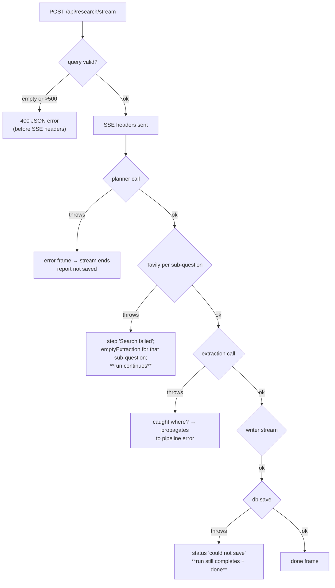

Three tiers of failure handling, each deliberate:

1. **Per-search failure is survivable.** `webSearch` is wrapped in `try/catch`; a failed
   search logs a step and falls through to `emptyExtraction`, which records an honest gap
   instead of aborting the run. One flaky search should not lose four good ones.
2. **Save failure is non-fatal.** If persistence throws, the pipeline emits a `status`
   warning and *still* emits `done` with the record in hand. The user gets their report even
   if the database is down — the report was already streamed to them anyway.
3. **Pipeline failure is terminal but clean.** Any other throw is caught in the route,
   emitted as an `error` frame, and the stream is closed. Missing API keys surface here.

**Why 400 errors are sent *before* the SSE headers:** once `writeHead(200, text/event-stream)`
is called you can no longer send a status code. Validation must happen first, which is why
the query checks sit at the top of the handler.

### 18.2 Mock mode as a feature

Mock mode is not an error state — it's a first-class mode (ADR-16). It activates when
`MOCK_MODE=true`, **or** when the LLM is unconfigured, **or** when Tavily is unconfigured.
It streams through the identical SSE pipeline, so the frontend cannot tell the difference
except by the `meta.mock` flag it renders as a badge and a warning banner.

---

## 19. Performance: where the time goes

Measured on a real live run ("How do solid-state batteries compare to lithium-ion in 2026?",
`RESEARCH_DEPTH=deep`, `MAX_SUBQUESTIONS=5`, Gemini 3.5 Flash Lite):

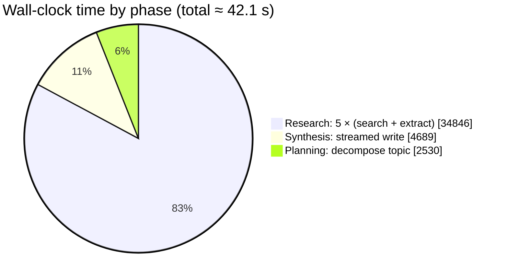

| Phase | Time | Share | Notes |
|---|---|---|---|
| Planning | 2.5 s | 6 % | one `chatJSON` call |
| **Research** | **34.8 s** | **83 %** | 5 sequential sub-questions × (Tavily + extraction) |
| Synthesis | 4.7 s | 11 % | streamed; **first token at 38.3 s** |
| **Total** | **42.1 s** | 100 % | 84 SSE events, 7 LLM calls, 5 searches |

### The latency insight

**83 % of the wall-clock time is the sequential research loop.** The writer is fast and
streamed; the planner is negligible. If latency is ever a problem, this is the only place
worth touching — and the fix is obvious: run the sub-question research **concurrently**.

**Why it wasn't done in v1:** deterministic source numbering ([§7.4](#74-source-indexing--the-backbone-of-citations))
depends on ordering. Parallel research would need a two-pass scheme (gather all results,
then number them) or pre-allocated per-sub-question number ranges. That is a real design
change with real risk to the citation invariant, and it was not worth taking before the
pipeline was proven end-to-end. It is the **first** item in [§20](#20-known-limitations-and-honest-gaps).

### The perceived-latency mitigation

42 seconds is acceptable *because it is streamed*. Using the measured event distribution
([§15.1](#151-end-to-end-live-run)), the user has feedback almost immediately:

- `meta` + first `status` → within ~1 s
- `plan` (the checklist) → at ~2.5 s
- first `sources` → within a few seconds after that
- first report `token` → ~38 s, but by then 5 source cards and 19 trace steps are visible

An equivalent non-streaming implementation would show a spinner for 42 seconds. The
protocol choice ([ADR-04](#adr-04-post-sse-with-hand-parsing)) is what converts a latency
problem into a legible process.

---

## 20. Known limitations and honest gaps

Ordered by how much they'd matter if this became more than a local tool.

| # | Limitation | Impact | Sketch of the fix |
|---|---|---|---|
| 1 | **Research is sequential** | ~35 s of a 42 s run | Bounded-concurrency fan-out with a two-pass numbering scheme |
| 2 | **No authentication** | Cannot be exposed publicly | Add sessions + `ownerId` on records; scope `list`/`get`/`remove` |
| 3 | **File store rewrites the whole file** | O(n) write per save; not multi-process safe | That's what `STORAGE=mongo` is for |
| 4 | **Prompt injection from web content** | A hostile page could skew a report | Source allow-listing, injection classifiers, output review — all partial |
| 5 | **Mongo driver never runtime-verified** | Unknown-unknowns in the adapter | Point `MONGODB_URI` at a cluster and run the same script |
| 6 | **`list()` capped at 100 in Mongo** | Silent truncation (file store has no cap) | Add pagination; make the cap explicit in the UI |
| 7 | **Mock mode could be mistaken for research** | Badge + banner + `[mock]` titles | Already mitigated; could add a watermark to exports |
| 8 | **No reconnecting SSE** | A dropped connection ends the run | Persist partial progress and offer `GET /api/research/:id` resume |
| 9 | **Search quality unseen** | A run with no results still "succeeds" | Surface `gaps` prominently in the UI; warn when `gaps` is non-empty |
| 10 | **No automated test suite** | Regressions caught only by manual runs | A mock-mode integration test is nearly free — the pipeline already runs deterministically in mock |
| 11 | **Report diagrams are LLM-authored** | A malformed ```` ```mermaid ```` block shows the "could not render" fallback instead of a diagram | The fallback and the prompt constraints already contain it; a server-side `mermaid.parse` guard could reject bad blocks before persisting |

---

## 21. Glossary

| Term | Meaning here |
|---|---|
| **Agent** | An LLM call with a fixed role, a system prompt, and an expected output shape. We have three. |
| **Sub-question** | One searchable facet of the topic, produced by the planner. |
| **Source** | A web result, deduped by URL and assigned a permanent citation number. |
| **Finding** | A single factual claim with a list of source numbers it came from. |
| **Extraction** | The researcher's full output for one sub-question: summary + findings + gaps. |
| **SSE** | Server-Sent Events — a one-way `text/event-stream` HTTP response. |
| **Frame** | One `data: …\n\n` unit in the SSE stream. |
| **Mock mode** | The real pipeline running on canned data, when the LLM or search is unconfigured. |
| **Neutral env var** | An `LLM_*` variable, as opposed to the legacy `OPENAI_*` fallbacks. |
| **Live mode** | Both an LLM provider and Tavily are configured. |

---

## Appendix A — File map

```
backend/
  .env.example                     every setting, documented, with provider examples
  package.json                     6 dependencies, ESM, node --watch dev
  src/
    index.js                       bootstrap: storage init, listen, startup banner
    app.js                         Express app factory (CORS, routes, health, errors)
    config.js                      env resolution, mock detection, derived flags
    llm.js                         OpenAI-SDK transport: chatJSON / chatStream / chat
    agents/
      orchestrator.js              the pipeline; emits all 9 SSE event types
      planner.js                   topic → sub-questions + title
      researcher.js                sub-question + sources → cited findings
      writer.js                    everything → streamed Markdown (incl. Mermaid)
      prompts.js                   all prompt text; zero logic
      mock.js                      canned plan / extractions / report for mock mode
    services/
      search.js                    Tavily + normalisation + mock search
    routes/
      research.js                  POST /stream (SSE), history CRUD
    db/
      index.js                     storage facade (picks driver)
      fileStore.js                 JSON file (default)
      mongoStore.js                Mongoose adapter (optional)
frontend/
  vite.config.js                   react + @tailwindcss/vite plugins
  src/
    api.js                         SSE POST-stream parser + REST helpers
    index.css                      Tailwind import, theme tokens, .markdown styles
    hooks/useResearch.js           run lifecycle state machine
    App.jsx                        composition, health + history + tabs
    lib/
      cn.js                        class-name join helper
      export.js                    .md download + print-to-PDF
      format.js                    hostOf / timeAgo / slugify / wordCount
    components/
      ui/                          Button, Panel (+PanelHead), Badge
      QueryForm.jsx                input, examples, run/stop
      AgentTrace.jsx               status line, plan checklist, step trace
      ReportView.jsx               meta, toolbar (copy/.md/PDF), mock banner
      SourcesPanel.jsx             numbered source cards (#source-n anchors)
      HistoryPanel.jsx             saved reports, open/delete
      Markdown.jsx                 GFM rendering + citation chips + mermaid hook
      Mermaid.jsx                  lazy SVG renderer with source fallback
```

## Appendix B — Quick reference

```bash
# backend
cd backend && cp .env.example .env    # then fill LLM_* and TAVILY_API_KEY
npm install && npm run dev            # http://localhost:5000

# frontend
cd frontend && npm install && npm run dev   # http://localhost:5173
```

```bash
curl -s localhost:5000/api/health | jq
curl -sN -X POST localhost:5000/api/research/stream \
  -H 'Content-Type: application/json' \
  -d '{"query":"your topic"}' | head -40
```

---

*Every measured figure in this document came from live runs against a real LLM endpoint and
the real Tavily API. Claims that could not be verified in this environment are listed as such
in [§15.4](#154-what-could-not-be-verified). If you change a decision in
[§16](#16-the-decision-log), update the entry rather than deleting it — the reasoning is the
asset.*
