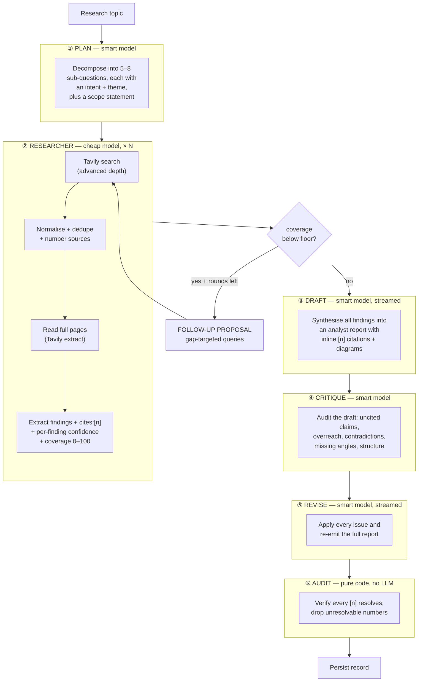
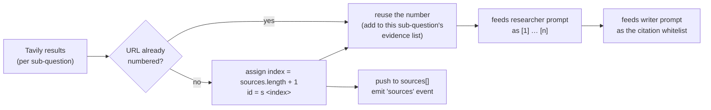

# MAD Researcher — Agent orchestration

> Part of the [architecture record](ARCHITECTURE.md). Section numbers are the
> originals from the single-file version, so existing references still resolve.

---

## 7. The agent pipeline

### 7.1 The pipeline, in six phases

A run is not "plan → research → write". It is a six-phase pipeline with a gap-filling loop
and a mandatory revision pass:



| Phase | Model tier | Calls per run | Input | Output (JSON shape) |
|---|---|---|---|---|
| **① Plan** | `LLM_MODEL_SMART` | 1 | topic + max count | `{ title, scope, subQuestions: [{question, intent, theme}] }` |
| **② Research** | `LLM_MODEL` | N (≈5) + F follow-ups | one sub-question + numbered sources (+ full page text) | `{ summary, coverage: 0–100, findings: [{point, cites[], confidence}], gaps[] }` |
| **③ Draft** | `LLM_MODEL_SMART` | 1 (streamed) | topic + plan + all findings + source list | Markdown (analyst report + Mermaid) |
| **④ Critique** | `LLM_MODEL_SMART` | 1 | the draft + the citation whitelist | `{ verdict, issues[], citationProblems[], recommendations[] }` |
| **⑤ Revise** | `LLM_MODEL_SMART` | 1 (streamed) | the draft + the critique | revised Markdown |
| **⑥ Audit** | *none* | 0 | final report + sources | `{ references, coverage, invalid[], uncited[], invalidRemoved }` |

**Total external calls per deep run:** `1 + N` to `1 + N + F` searches and `3 + N + F` to
`5 + N + F` LLM calls. With defaults (`MAX_SUBQUESTIONS=5`, `RESEARCH_MAX_ROUNDS=2`) that is
**up to 13 searches and 17 LLM calls**. The measured run in
[§15.1](verification.md#151-end-to-end-live-run) used 13 searches and 13 LLM calls for a 1,491-word report.

The phases are not merely a diagram: they are emitted as `phase` events with measured
durations, so the UI can show which stage is running and the record carries a phase
timeline ([§9.3](backend.md#93-event-taxonomy), [§19](verification.md#19-performance-where-the-time-goes)).

### 7.2 Why the model tiers are split

The researcher runs *N* times; the planner and writer run once each. Putting the expensive
model where it runs 5× would multiply cost for minimal quality gain — extraction is a
narrow "read these sources, output claims" task. The planner and writer do the reasoning
that benefits from a stronger model.

**Defence of the fallback:** `LLM_MODEL_SMART` defaults to `LLM_MODEL` when unset
(`config.js`, `smartModel`). This means a provider with only one good model still works
with a single setting — the tiering is an *optimisation*, never a *requirement*.

### 7.3 Why research runs in a bounded pool

All sub-questions are processed through
`mapConcurrent(subQuestions, RESEARCH_CONCURRENCY)` (`util/concurrency.js`). The research
phase is almost entirely network wait — Tavily searches, page extracts, and one extraction
call per sub-question — and the sub-questions are independent, so the pool overlaps that
wait instead of adding it up. This replaced an earlier fully sequential `for … of` loop.

| Consideration | Bounded pool (chosen) | Fully sequential (previous) |
|---|---|---|
| Source numbering | Unchanged — `SourceIndex` assigns each number synchronously as a result is folded in, so two workers cannot race or interleave a numbering decision | Trivial, but not actually the constraint it appeared to be |
| Rate limits | Bounded by `RESEARCH_CONCURRENCY` (default `3`); the whole run is also capped by `RUN_TIMEOUT_MS` | One request at a time |
| Gap filling | Each sub-question still owns its own `alreadyAsked` set and round loop — the pool parallelises *sub-questions*, never rounds | Each round extends its own history |
| Order | `mapConcurrent` preserves input order, so the writer still receives the plan's order | Same |
| Trace | Interleaved: several sub-questions visibly progress at once | Reads top-to-bottom |
| **Latency** | **Overlaps the wait** | **Adds it up** |

**Why the risk was lower than it looked.** The citation invariant never depended on *which*
sub-question ran first — only on the order results are *folded in*, and folding is a
synchronous operation in a single-threaded runtime. Moving numbering into one small, tested
class (`SourceIndex`, `test/sources.test.js`) made that explicit rather than implicit in a
loop body. What concurrency does change is the trace: it is no longer a top-to-bottom
narrative of one sub-question at a time, which is the visible price of the wall-clock win.

### 7.4 Source indexing — the backbone of citations



**The invariant:** a source's number is assigned **once**, at the moment it is first seen,
and never changes. That number is what appears in researcher output, in the writer's
citation whitelist, and in the UI's source cards. Deduplication by URL happens *before*
numbering, so the same page found for two sub-questions cannot occupy two slots.

**A URL seen twice is reused, not discarded.** The earlier implementation dropped a repeat
outright, which meant a sub-question whose search re-ranked a page that an *earlier*
sub-question had already found was handed a strictly smaller evidence set than Tavily
returned — its best result silently withheld, and the source later reported as "available
but never cited" by the audit. `SourceIndex.add()` returns the existing source instead
(`{ source, isNew }`), so the researcher sees it while only genuinely new URLs are emitted
to the client (`test/sources.test.js` covers both halves).

**Why this matters:** without a stable index there is no way to make `[2]` in the final
report reliably point at source card 2. Every downstream guarantee rests on this one rule.

### 7.5 The gap-filling loop (iterative depth)

One search per sub-question is a *breadth-first* strategy: it never goes back to a facet it
under-served. The researcher is therefore asked to output an honest `coverage` estimate
(0–100) alongside its findings, and the orchestrator compares that number to a floor:

```
round = 0
while round < 1 + RESEARCH_MAX_ROUNDS:
    extract(...)
    if coverage >= COVERAGE_FLOOR: break
    queries = proposeQueries(subQuestion, alreadyAsked, gaps)   # skip if empty
    if queries.empty: break
    alreadyAsked += queries
    search(queries) + extract(them)
    round += 1
```

Four deliberate properties of this loop:

1. **The model estimates its own coverage, and `coverage: 0` is the fallback for an empty
   result** — so a failed search and a genuinely thin topic both look like "gaps", which is
   what they are.
2. **Follow-up queries are deduplicated against everything already asked**
   (`alreadyAsked`), so round two cannot re-run round one's searches.
3. **An empty follow-up list is a legal answer.** The prompt explicitly permits `[]`, and
   the loop breaks on it. Iteration is bounded by evidence, not by a turn counter.
4. **The bound is `1 + RESEARCH_MAX_ROUNDS`** — `RESEARCH_MAX_ROUNDS=0` disables the loop
   entirely, giving back the original single-pass behaviour with one env var.

In the measured live run the gap loop fired **4 times** across 5 sub-questions and added 8
follow-up searches ([§15.1](verification.md#151-end-to-end-live-run)) — that is where most of the run's
~113 s research phase went.

### 7.6 Deep fetch — reading pages, not just snippets

A Tavily search result is a ~800-character snippet. That is enough to *find* a source and
occasionally enough to cite it, but it is a poor basis for a dense analyst report. When
`DEEP_FETCH=true`, the orchestrator takes the top `DEEP_FETCH_SOURCES` URLs for a
sub-question and calls Tavily's `extract` endpoint, which returns the **full page text** as
markdown:

```js
const pages = await fetchPages(urls)   // Map<url, text>, failures dropped
```

Two rules keep this from blowing up the prompt (and the bill):

| Rule | Reason |
|---|---|
| **Cap the count** (`DEEP_FETCH_SOURCES`, 0–8, default 3) | Full pages are an order of magnitude larger than snippets; reading 6 URLs per sub-question × 6 sub-questions would be enormous |
| **Cap each page** (`MAX_PAGE_CHARS = 6000`) | One 300 KB spec sheet must not crowd out every other source |

**Page text is run-scoped and never persisted.** It lives in a `Map` inside the orchestrator,
is used only to build researcher prompts, and dies with the run. This matters for two
reasons: the stored record stays small and safe to send to the client, and the raw page text
of arbitrary websites never becomes part of a durable document.

### 7.7 Critique and the always-on revision

The draft is written by the same model family that would have to notice its own mistakes, so
the pipeline inserts a **separate** critique call with a hostile-auditor prompt, then a
**revision** call that applies it. Three choices here are worth defending:

- **The critique is structural, not stylistic.** It is asked for a typed JSON list —
  `uncited`, `miscitation`, `overreach`, `contradiction`, `missing-angle`, `structure` —
  each with a severity, the offending claim, the problem, and the fix. A review that returns
  prose cannot be acted on reliably; a review that returns typed issues can.
- **Revision runs whenever `RESEARCH_CRITIQUE=true`, regardless of the verdict.** This was
  originally gated on the critic's own `verdict` field and that was a **bug**: in the first
  measured run the critic returned `verdict: "solid"` *while also reporting two issues*, and
  the gate skipped the revision pass entirely. A model's summary judgement about its own
  review is the least reliable part of the review. The verdict is now recorded as information
  for the reader; it is not a control-flow switch. ([ADR-21](decisions.md#adr-21-the-critique-is-advisory-the-revision-is-unconditional))
- **The revision is guarded and has a fallback.** If the revision call throws or produces an
  implausibly short document (`wordCount < 120`), the pipeline keeps the draft and records
  `revised: false` rather than shipping a truncated report. The revision is an improvement
  step, and an improvement step must never be able to make the output worse than not running
  it.

The UI surfaces all of this honestly: the report carries the critique verdict and an
"audited" block, and the issues themselves are available in a disclosure panel. A report
that says "a critic reviewed this and here is what it found" is more trustworthy than one
that implies no flaws exist.

### 7.8 The citation audit

After revision, one **pure** function checks the report against the sources:

```js
const audit = auditCitations(report, sources)
// → { references, citedSourceCount, sourceCount, coverage,
//     invalid[], uncited[], invalidRemoved }
```

`invalid[]` is every `[n]` in the report that does not resolve to a real source. Rather than
only *reporting* these, the pipeline **sanitises** them: `sanitizeCitations` strips any
unresolvable number (while preserving legitimate comma-lists like `[1, 4]`) and then
re-audits, recording the count in `invalidRemoved`. The reason is a simple UX judgement — a
citation chip that points nowhere is worse than no chip at all, because it looks like
evidence. ([ADR-22](decisions.md#adr-22-sanitise-citations-instead-of-only-reporting-them))

Unlike the critique, this step involves no model and cannot be argued with: it is a regex
pass over the final text plus a set lookup. It costs ~2 ms and removes an entire class of
silently-broken output. `coverage` (cited ÷ total sources) and `uncited[]` are reported as
is — a run that read 48 sources and cited 23 is a *fact* the reader should see, not
a number worth gaming.

---

## 8. Prompt design

Every system prompt lives in `agents/prompts.js` — a single file with no logic and no
imports. There are six: planner, researcher, follow-up proposal, writer, critic and reviser,
plus the per-format structure blocks they are composed with (see
[ADR-25](decisions.md#adr-25-six-selectable-report-formats)).

### 8.1 The planner prompt

- **"smallest set of independent, non-overlapping sub-questions"** — prevents the model
  from producing five variations of the same question, which would waste searches and
  produce a repetitive report.
- **"Aim for a number of sub-questions close to the stated maximum … never exceed the
  maximum, and do not pad the plan to reach it"** — the maximum is injected per-request from
  `MAX_SUBQUESTIONS`. The prompt used to ask for "5 to 8" while the code clamped the list to
  `MAX_SUBQUESTIONS` (default 6), so a plan of 6 was truncated and a topic that only needed 4
  questions was pushed to invent a fifth. The instruction is now stated relative to the
  injected maximum, which is the only number the model is actually given.
- **`intent` and `theme` per sub-question** — `intent` says what the investigation is trying
  to establish; `theme` groups sub-questions so the writer can build thematic sections
  instead of a flat list. Both are for the *writer*, not the searcher.
- **A `scope` statement** — one sentence, carried into the report's `## Scope & method`
  section. It is what makes exclusions ("legacy lead-acid chemistry is out of scope")
  explicit instead of silent, which is the difference between a report and a dump.
- **Breadth-then-depth guidance** — encodes a research methodology (background → current
  state → trade-offs → risks → outlook) rather than hoping the model invents one.
- **"Do not write an answer. Only plan the investigation."** — stops the planner from
  answering the question itself and then having the researcher merely confirm it.

### 8.2 The researcher prompt

- **"Never invent facts, numbers, names, or quotes that are not present"** — this is the
  anti-hallucination instruction, and it is why the API accepts `includeAnswer: false`
  from Tavily: we want *raw sources*, not a pre-digested answer the model can copy.
- **"Every finding must cite the source numbers"** — makes grounding *structural* rather
  than stylistic. Findings without citations are visibly malformed.
- **A `confidence` label per finding** (`high` / `medium` / `low`) — the researcher sees the
  sources and is the only party that can say how strongly one supports a claim. The value is
  whitelisted in `researcher.js`, so a model that invents a fourth level cannot leak it
  downstream.
- **An honest `coverage` estimate (0–100)** — this is not decoration: it is the input to the
  gap-filling loop in [§7.5](#75-the-gap-filling-loop-iterative-depth). Asking the model to
  rate its own completeness is what lets the pipeline decide whether a second round is
  warranted.
- **"Prefer quantified findings — numbers, dates, named entities, magnitudes"** — a claim
  with a number in it is checkable; a claim without one is an opinion with a citation glued
  on.
- **"If the sources are thin or contradictory, say so honestly in `gaps`"** — a dedicated
  output field for uncertainty. This is what surfaces the "no sources found" case honestly.
- **When full page text is available it is passed through (`s.content`) instead of the
  snippet** — prefixed `Search snippet:` only in the fallback case, so the model can tell
  which it is looking at ([§7.6](#76-deep-fetch--reading-pages-not-just-snippets)).

### 8.3 The writer prompt and the format spec

`writer.js` and `critic.js`'s reviser step are both composed from the *same* format spec for a
given run, so the revision is guaranteed to target the structure the draft was built against.
The default format is a **long-form analyst** specification, not a summary. Each of the six
formats supplies its own section list; the analyst one is:

1. `# ` title — the report's own headline, not the raw query.
2. `## Scope & method` — what was investigated, what was deliberately excluded, how many
   sources were consulted.
3. `## Executive summary` — 4–7 bullets, each carrying citations.
4. **4–8 thematic `##` sections** with `###` sub-sections, dense prose, and **GFM tables**
   for any comparison. The single most important integrity rule here is:
   **"write \"not established\" where a source does not say"** — an explicit, honest
   placeholder instead of a plausible-looking invented cell.
5. `## Where the evidence conflicts` — contradictions between sources are presented as
   disagreements, not averaged away.
6. `## Confidence & evidence quality` — per-theme confidence ratings grounded in the
   researcher's labels.
7. `## Limitations & open questions` — what the sources could not establish. This is
   mandatory rather than optional, because a report that claims completeness is
   *misleading*, and its absence is one of the things the critic checks for.

Plus two cross-cutting rule blocks, shared by every format:

- **Citation rules (critical)** — only cite provided numbers, never invent one, and **do not
  add a reference list**. That last rule is what lets the UI own reference rendering
  entirely — see [ADR-13](decisions.md#adr-13-citations-inline-no-reference-list).
- **Diagram rules (Mermaid)** — asks for one or two fenced ```` ```mermaid ```` blocks
  *where a process, comparison, cause-and-effect chain, timeline, or hierarchy is easier to
  grasp visually than in prose*. The constraints are all about **renderability**, because a
  diagram is only useful if it draws: prefer `flowchart`/`timeline`/`sequenceDiagram`, keep
  node labels short, and **quote any label containing `()`, `:`, `;` or `,`** — unquoted
  punctuation is the single most common cause of a Mermaid parse error. The measured result
  (valid diagrams in a 1,491-word report) is in
  [§15.4](verification.md#154-what-could-not-be-verified).
- **Why "where it helps" rather than "include a diagram"**: an unconditional instruction
  produces a diagram on every report, including ones where it is filler. Tying it to the
  shape of the content keeps the feature honest.

**Factoring the structure out is itself a decision:** it exists once, as a string, and both
the draft and the revision are built from it. If the two prompts each carried their own copy
of the skeleton, the revision could silently "improve" the report into a different shape than
the critic audited. The shared detail/citation/diagram rules live in a separate
`SHARED_RULES` block that every format appends, so no format can lose the citation rules.
See [ADR-25](decisions.md#adr-25-six-selectable-report-formats).

The writer-specific design notes:

- **Explicit Markdown structure** (the skeleton above) — a fixed structure produces
  consistent, exportable documents regardless of provider.
- **"group and reorder the sub-questions as needed rather than listing them mechanically"**
  — prevents the classic "five headings, one per search" artifact. The reader gets a report,
  not a transcript.
- **"Where sources disagree, present the tension explicitly"** — a deliberate push against
  the averaging/hedging behaviour models default to.

### 8.4 The follow-up prompt

Used only by the gap-filling loop. Its whole job is to convert a *known deficiency* into
*new, non-repeating queries*:

- **It receives the gaps and the `alreadyAsked` list, and "never repeat a query already
  asked"** — the deduplication is enforced at the prompt level *and* re-enforced in code
  (`followups.js` filters the returned list), because prompt-only constraints are advisory.
- **An empty list is explicitly permitted** — otherwise a model asked for queries twice will
  invent filler to look useful, and the loop would run to its bound on noise.
- **The step is counted in token usage** and reported as a `usage` delta, so the cost of
  iterating is attributable rather than invisible.

### 8.5 The critic prompt

The critic is the pipeline's adversarial reviewer, and the prompt is written to make an
*empty* review the exception rather than the default:

- **It is told outright that "an empty critique is the exception, not the norm."** Models
  default to approval when asked "is this any good?"; the prompt pre-empts that by framing
  the task as *finding* problems and by listing the categories to look for.
- **Typed output** — `uncited`, `miscitation`, `overreach`, `contradiction`, `missing-angle`,
  `structure` — each with `severity`, `claim`, `problem`, `fix`. Typed issues can be applied
  mechanically by the reviser; prose review cannot.
- **It is given the citation whitelist**, so "this citation is out of range" is a check the
  model can actually perform rather than hallucinate.
- **It is given the requested format's structure specification** — the same spec the writer
  was given — so the `structure` check audits the deliverable the user asked for instead of
  judging every report as an analyst report.
- **It reads the same evidence the researcher did.** The sources the draft cites are expanded
  to their full page text (capped by `CRITIC_FULL_TEXT_SOURCES`), because auditing a draft
  against 800-character snippets produces both error types at once: an honest figure gets
  flagged as `overreach` (the snippet never contained it) and a real `miscitation` slips
  through (its support is in the article body).
- **It may conclude that a criticism is unfounded.** In the measured run the critic raised
  two issues and explicitly noted on the second that "no change needed" — because the prompt
  asks for an honest audit, not a quota of complaints. That nuance is preserved in the stored
  critique, not filtered out.

### 8.6 The reviser prompt

- **It receives the draft and every issue, and is told to apply the fixes** while keeping
  the same format structure.
- **It is told not to discuss the critique.** The revision is a replacement document, not an
  appendix — "the criticism said X, so I changed Y" is exactly the meta-commentary that would
  make the report unreadable.

The `writer.js` module owns both streamed calls (`writeDraft`, `reviseReport`); they resolve
the run's report format, share the `findingsBlock` helper and the format spec, so a revision
cannot drift structurally from the draft it is revising.

---
