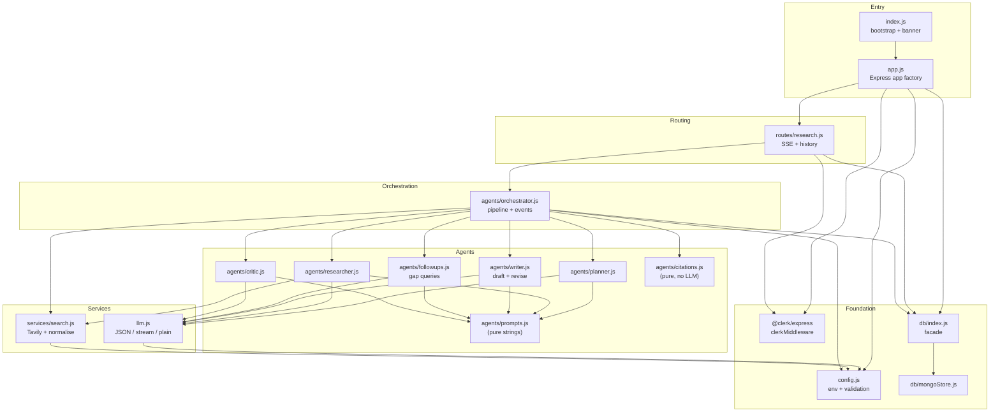
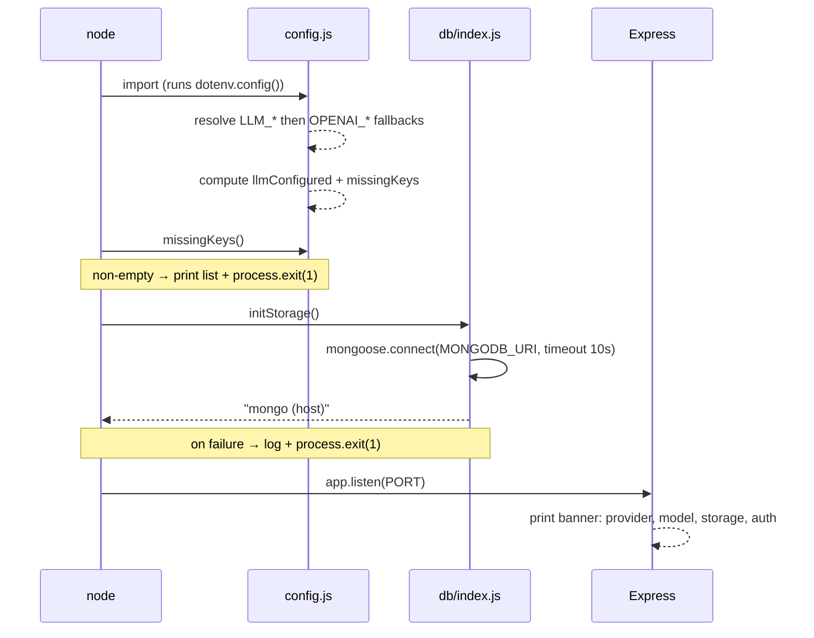
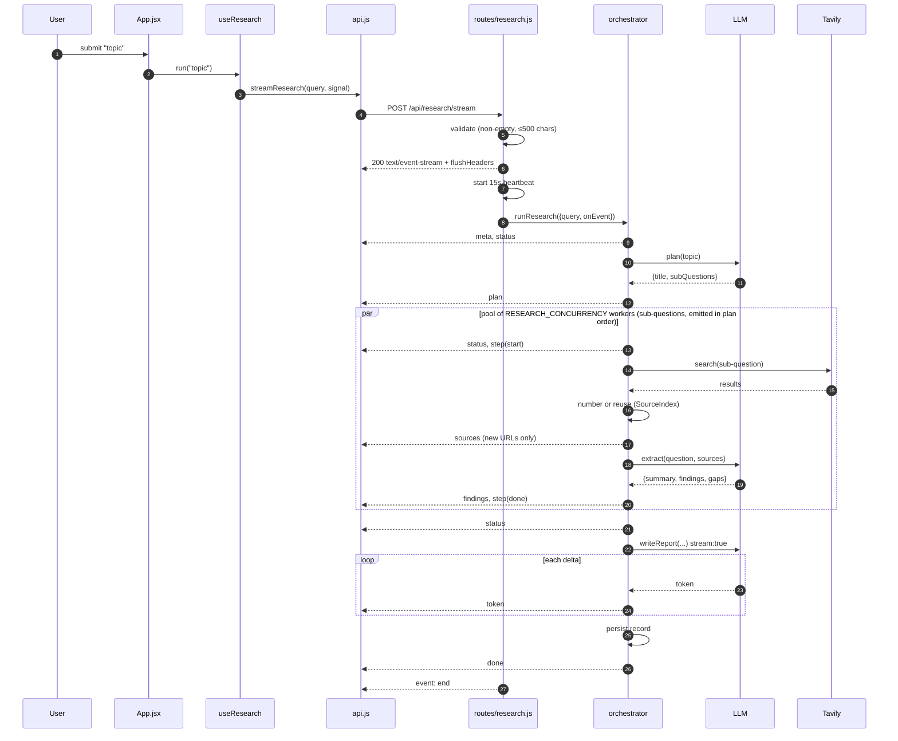
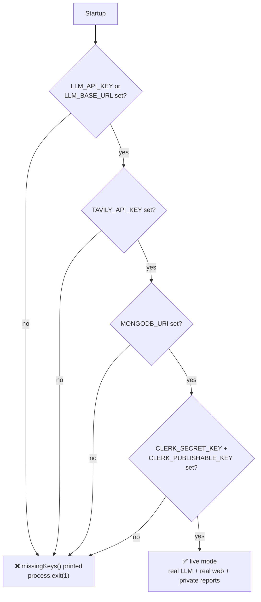
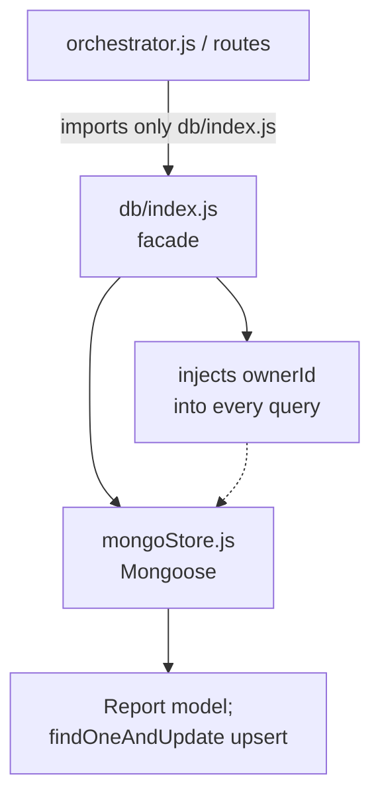
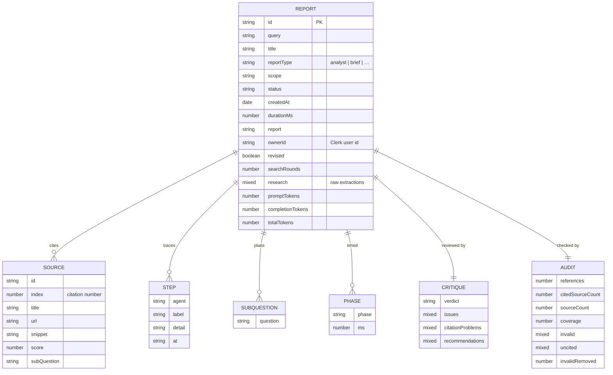
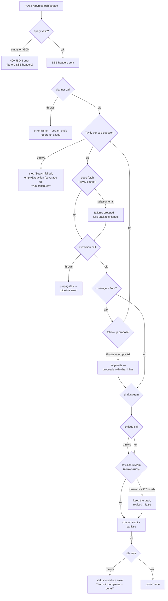

# MAD Researcher — Backend

> Part of the [architecture record](ARCHITECTURE.md). Section numbers are the
> originals from the single-file version, so existing references still resolve.

---

## 6. Backend architecture

### 6.1 Module graph

Layers point downward; nothing lower imports anything higher.



**The rules this diagram encodes:**

1. `prompts.js` contains *only strings* — no logic, no imports. The entire behavioural
   surface of the AI (the part most likely to be tuned) is one file with no side effects.
2. `index.js` is a **bootstrap, not an app** — it initialises storage and listens. The
   Express app itself is built by `app.js`'s `createApp()`, so the app can be imported and
   exercised without binding a port. See [ADR-20](decisions.md#adr-20-app-factory-separate-from-bootstrap).
3. `routes/research.js` is the **only** place that reads auth state. It resolves the Clerk
   `userId` once and passes it down as `ownerId`; ownership is then enforced inside the
   storage query, so no pipeline stage can forget to scope a read.
4. `citations.js` is **pure**: it takes a report string and the source list and returns an
   audit object. It touches no network, no LLM, and no storage — which is what makes the
   citation guarantee testable (and why the audit phase costs ~2 ms, see [§7.8](agents.md#78-the-citation-audit)).

### 6.2 Why `agents/` and `services/` are separate directories

- `agents/` — components that talk to the **LLM**. They own prompts and response shapes.
- `services/` — components that talk to **other external systems** (search).

This is not cosmetic. It means "swap Tavily for Brave" is a `services/` change and
"change how findings are extracted" is an `agents/` change; they cannot accidentally
entangle. (See [ADR-03](decisions.md#adr-03-layer-by-systems-touched-not-by-feature).)

### 6.3 Startup sequence



**Note the fail-fast behaviour:** if storage cannot initialise, the process **exits**
rather than silently degrading. See [ADR-10](decisions.md#adr-10-fail-fast-on-storage-init-failure).

### 6.4 Why `config.js` is a single resolved object

`config.js` reads the environment **once**, at import time, and exports a frozen-shaped
object. Every other module imports `config` rather than touching `process.env`.

Consequences, all intentional:

1. **One place to audit** for every setting (there are 15).
2. **No scattered `process.env.X || 'default'`** fallbacks drifting apart.
3. **Derived values are resolved once:** `llmConfigured` and the required-key list are
   computed from a single pass over the environment, so a request can never see a
   half-configured state.
4. **Fail-fast:** `index.js` calls `missingKeys()` before doing anything else and exits
   with the list if it is non-empty — a missing key is a startup error, never a silent
   downgrade to canned data.

---

## 9. The streaming protocol (SSE)

This is the heart of the "live" experience, and every decision here was made against an
alternative.

### 9.1 Transport choice

| Option | Verdict | Reasoning |
|---|---|---|
| **SSE over POST** | ✅ **chosen** | Server→client only (exactly our need); plain HTTP; no handshake; trivially proxied; auto-close semantics. |
| `EventSource` over GET | ❌ | Cannot send a request body. The topic would have to go in a query string — ugly, length-limited, and it lands in server logs. |
| WebSockets | ❌ | Bidirectional, stateful, needs a separate server/upgrade path, and we already have HTTP. **Overkill for a one-way progress feed.** |
| Long-polling | ❌ | Repeated requests, duplicated latency, no natural ordering guarantees. |
| Plain JSON response | ❌ | Defeats goal **G2** — the whole product is the trace. A 42-second silent request is unacceptable UX. |

**The cost we accepted:** because we use `POST` + `fetch` instead of `EventSource`, the
browser will not auto-reconnect on drop, and we must **parse the SSE frames by hand**
(`frontend/src/api.js`). That is ~30 lines of buffer-splitting code, and it buys us a JSON
body and full `AbortController` cancellation. Judged worth it — see [ADR-04](decisions.md#adr-04-post-sse-with-hand-parsing).

### 9.2 Frame format — and the `event: end` subtlety

Every progress frame is **data-only**:

```
data: {"type":"status","message":"Researching: …"}\n\n
```

The **only** frame that uses a named SSE event is the terminator:

```
event: end
data: {}
```

**Why:** our client dispatches purely on `data.type`. Adding an `event:` name to every
frame would mean two sources of truth for the same information. The `event: end` line
exists solely so a generic SSE client (curl, a test harness, a future `EventSource`
consumer) has an unambiguous, non-JSON way to detect completion.

> ⚠️ **Common misreading:** grepping a captured stream for `^event:` returns *only* `end`.
> That is not a bug — it is the design above. This exact confusion has already been hit
> once; it is documented here so it isn't hit again.

### 9.3 Event taxonomy

| Event | Emitted when | Payload highlights | UI effect |
|---|---|---|---|
| `meta` | run starts | `model`, `smartModel`, `depth`, `critique`, `deepFetch`, `maxRounds`, `reportType`, `query` | records run metadata |
| `phase` | entering a pipeline phase | `phase` (`plan`/`research`/`draft`/`critique`/`revision`/`audit`) | phase badge + phase timeline |
| `status` | phase changes | `message` | status line |
| `plan` | planner done | `title`, `scope`, `subQuestions` | plan checklist + scope note |
| `step` | agent starts/finishes | `{agent, label, detail, status}` | trace row |
| `sources` | after each search | `sources[]` (new only), `total` | appends source cards |
| `findings` | after each extraction | `extraction` | findings fed to report |
| `token` | draft or revision streaming | `text` delta | appends to report |
| `critique` | critic done | the critique object | integrity badge + disclosure panel |
| `report-reset` | revision starts | — | **clears the report** before the revision streams |
| `audit` | final citation audit | `{references, citedSourceCount, sourceCount, coverage, invalid[], uncited[], invalidRemoved}` | integrity strip + uncited dimming |
| `done` | after persist | full `record` | finalises, enables export |
| `error` | pipeline throws | `message` | error banner |

**Thirteen event types**, up from nine. The four additions are the phases that did not exist
in v1 — and one of them, `report-reset`, exists purely because the report is now written
twice:

**Why `report-reset` instead of a "replace" flag on `token`:** the client is a dumb appender
(that is deliberate, see below). Streaming a second document into a buffer that already holds
the first would corrupt it unless the client knew to clear. Rather than teach the client to
handle replacement mid-stream, the server says exactly once "drop what you have" and then
streams normally. It is a one-field event that keeps the client's `token` handling unchanged
and makes the revision boundary explicit in the trace. The measured run delivered the report
in **2 streams** with this event in between ([§15.1](verification.md#151-end-to-end-live-run)).

**Why `phase` carries a duration only on exit:** the event fires when a phase *starts* (so
the UI can label it) and again when it ends, carrying `ms`. The orchestrator accumulates
`phases: [{phase, ms}]` onto the record, which is what produces the timings in
[§19](verification.md#19-performance-where-the-time-goes) — the performance table is generated from the
same data the user sees, not from a separate benchmark harness.

**Why `sources` sends only *new* sources:** the orchestration emits `fresh` (deduped) rather
than the running array, so the client appends without re-rendering or de-duplicating.
`total` is carried for display. This keeps the client dumb and the server authoritative.

### 9.4 Full request lifecycle



### 9.5 Heartbeat and dead-socket handling

```js
const heartbeat = setInterval(() => { if (!closed) res.write(': ping\n\n') }, 15_000)
res.on('close', () => { closed = true; clearInterval(heartbeat) })
```

Two problems are solved by four lines:

1. **Idle connections get killed.** A measured run takes **42 seconds**, with gaps of many
   seconds between frames while a model thinks. Reverse proxies, load balancers, and some
   corporate networks drop connections idle for ~30–60 s. A `: ping` comment frame (legal
   SSE, ignored by our parser) keeps the socket warm.
2. **Writing to a dead socket.** If the user closes the tab, `res.write` on a closed socket
   would throw. The `closed` flag is checked in both the heartbeat and `send()`, so a
   disconnected client simply stops the run's output rather than crashing the server.

Also set: `X-Accel-Buffering: no` (defeats nginx response buffering, which would otherwise
collapse the entire stream into one lump delivered at the end) and
`Cache-Control: no-cache, no-transform`.

---

## 10. The provider abstraction

**This is the decision the user cared about most, so it gets the most detail.**

### 10.1 The rule

> The OpenAI SDK is a **transport**, not a vendor. We use it to speak the
> `/v1/chat/completions` protocol to *whatever endpoint you point it at*. No OpenAI account,
> key, or model is required or assumed.

### 10.2 How the environment resolves

`config.js` line by line:

```js
const env = (neutral, legacy) => process.env[neutral] ?? process.env[legacy] ?? ''
```

Every setting is looked up **neutral-name-first, legacy-name-second**:

| Neutral (preferred) | Legacy fallback | Effective rule |
|---|---|---|
| `LLM_API_KEY` | `OPENAI_API_KEY` | neutral wins if set |
| `LLM_BASE_URL` | `OPENAI_BASE_URL` | neutral wins if set |
| `LLM_MODEL` | `OPENAI_MODEL` | neutral wins if set |
| `LLM_MODEL_SMART` | `OPENAI_MODEL_SMART` | neutral wins if set |
| `LLM_JSON_MODE` | `OPENAI_JSON_MODE` | `LLM_*` read first with `??` |

**Why keep the legacy names at all:** an existing `.env` written before the rename keeps
working, and a user copying an OpenAI-compatible snippet from any provider's docs doesn't
have to translate it. **Why `??` and not `||`:** `??` only falls through on `null`/`undefined`.
This matters because an explicitly empty `OPENAI_MODEL=` would otherwise defeat a set
`LLM_MODEL` — with `??`, the neutral value is honoured correctly. The only place `||` is
used is where an empty string should genuinely mean "apply the default" (the model names).

### 10.3 Configuration matrix



`llmConfigured = Boolean(apiKey || baseUrl)` — **either** is enough. This is what makes
local servers (Ollama, LM Studio, vLLM) work: they need no key, only a base URL.

### 10.4 The two call styles

`llm.js` exposes exactly two functions, matching the two shapes of work:

| Function | `stream` | `response_format` | Temperature | Used by |
|---|---|---|---|---|
| `chatJSON` | false | `json_object` (if `jsonMode`) | 0.1–0.4 | planner, researcher, followups, critic |
| `chatStream` | **true** | none | 0.35–0.5 | writer (draft + revision) |

**Why `chatStream` never asks for JSON mode:** the writer produces Markdown prose, and
`json_object` would force it to wrap the report in a JSON string — destroying the
incremental token stream that the UI depends on.

### 10.5 JSON mode: defended with a fallback

```js
...(config.llm.jsonMode ? { response_format: { type: 'json_object' } } : {}),
```

| If we always sent `json_object` | If we never sent it |
|---|---|
| Some providers/local models return **400/500** and the run dies | Models occasionally wrap JSON in prose or a ```json fence |

The chosen approach: **send it when enabled (the default, because it works on the
overwhelming majority), and recover when it isn't.** If JSON parsing fails,
`chatJSON` salvages the first balanced `{…}` block via regex before giving up:

```js
const match = text.match(/\{[\s\S]*\}/)
if (!match) throw new Error('Model did not return valid JSON')
return { data: JSON.parse(match[0]), usage }
```

**Verified live:** the Gemini endpoint was probed with
`response_format: {type:"json_object"}` and returned clean JSON, confirming
`LLM_JSON_MODE=true` is safe there (see [§15.3](verification.md#153-provider-json-mode-verification)).

### 10.6 Provider matrix (all speak the same protocol)

| Provider | `LLM_BASE_URL` | Example model |
|---|---|---|
| **Google Gemini** | `https://generativelanguage.googleapis.com/v1beta/openai/` | `gemini-3.5-flash-lite` |
| Groq | `https://api.groq.com/openai/v1` | `llama-3.3-70b-versatile` |
| OpenRouter | `https://openrouter.ai/api/v1` | `anthropic/claude-3.5-sonnet` |
| Together | `https://api.together.xyz/v1` | `meta-llama/Llama-3.3-70B-Instruct-Turbo` |
| DeepSeek | `https://api.deepseek.com/v1` | `deepseek-chat` |
| Mistral | `https://api.mistral.ai/v1` | `mistral-large-latest` |
| Ollama (local) | `http://localhost:11434/v1` | `llama3.1` |
| LM Studio (local) | `http://localhost:1234/v1` | your loaded model |
| vLLM (local) | `http://localhost:8000/v1` | your served model |
| OpenAI (optional) | `https://api.openai.com/v1` | `gpt-4o-mini` |

> **Model names are the provider's, not ours.** There is no allow-list, no mapping table,
> no normalisation — the string in `LLM_MODEL` is passed through verbatim. This is
> intentional: any mapping layer would go stale the moment a provider renames a model, and
> would silently hide typos. The trade-off is that a typo surfaces as a 404 from the
> provider rather than a friendly startup warning — see [§15.2](verification.md#152-the-model-id-incident-the-reason-this-trade-off-gets-a-whole-section).

---

## 11. Search: Tavily and normalisation

### 11.1 Why Tavily

| Requirement | Tavily | Raw SERP scraping | Google CSE | Bing |
|---|---|---|---|---|
| LLM-ready snippets | ✅ cleaned content, ~800 char chunks | ❌ raw HTML | ⚠️ description only | ⚠️ description only |
| Single API call | ✅ | ❌ scrape + parse | ✅ | ✅ |
| Search depth control | ✅ `basic`/`advanced` | — | ❌ | ❌ |
| Relevance scores | ✅ per result | ❌ | ❌ | ❌ |
| **Full-page extraction** | ✅ `extract()` → markdown | ❌ scrape yourself | ❌ | ❌ |
| Purpose-built for RAG | ✅ | ❌ | ❌ | ❌ |

Tavily is designed for exactly this use case and returns `content` that is already the
right granularity to paste into an LLM prompt — and, uniquely among these, it also offers a
second call that returns **whole pages as markdown** ([§7.6](agents.md#76-deep-fetch--reading-pages-not-just-snippets)).

### 11.2 The normalisation layer

```js
return (res.results || []).map((r) => ({
  title:   r.title || 'Untitled source',
  url:     r.url,
  snippet: (r.content || '').replace(/\s+/g, ' ').slice(0, 800),
  score:   r.score ?? null,
}))
```

**Why normalise at all** — three concrete protections:

1. **`|| 'Untitled source'`** — a missing title would otherwise render an empty, unclickable card.
2. **`.replace(/\s+/g, ' ')`** — collapses newlines/tabs, so snippets occupy predictable
   vertical space in the UI and don't blow up the prompt token count.
3. **`.slice(0, 800)`** — hard cap. Without it, one verbose page could dominate the
   researcher prompt for that sub-question and crowd out the other four sources.

**The contract this creates:** everything above `webSearch` deals with
`{title, url, snippet, score}` and *nothing else*. Swapping Tavily for Brave is one file,
one function, and the agent layer never notices. (See [ADR-08](decisions.md#adr-08-tavily-behind-a-normalising-wrapper).)

### 11.3 Depth control

```js
searchDepth: config.research.depth === 'deep' ? 'advanced' : 'basic'
```

`RESEARCH_DEPTH` changes two things at once: Tavily's depth **and** the per-search result
count (deep uses `TAVILY_MAX_RESULTS`; quick caps at 3 in `orchestrator.js`). This gives a
single user-facing knob for the cost/quality trade-off rather than two knobs that can be
set into a contradictory state.

### 11.4 The second call: `fetchPages`

Search finds sources; `fetchPages` reads them. It is deliberately a *separate* function
returning a *different* shape, because the two results are used for different things:

```js
// search.js —— one Map, keyed by the URL that was already numbered
fetchPages(urls) → Map<url, text>
```

| Property | Why it is this way |
|---|---|
| **Returns a `Map`, not an array** | Sources are already numbered and identified by URL; the caller looks up text by the URL it already has. No index correlation to get wrong. |
| **Failures are dropped, not thrown** | `extract()` returns `{results, failedResults}`. A paywalled or dead page must degrade to "we only have the snippet", never fail the run ([§18](#18-failure-modes)). |
| **Text is truncated to `MAX_PAGE_CHARS = 6000`** | Mirrors the snippet cap in [§11.2](#112-the-normalisation-layer): one huge page must not crowd out the others. |
| **Never persisted** | The `Map` is run-scoped in the orchestrator. Raw page text does not enter the stored record or the SSE stream. |

---

## 12. Storage: the MongoDB facade

### 12.1 The interface

`db/index.js` is the one place the store is chosen, and it re-exports owner-scoped
wrappers so no caller ever touches the driver directly:

```js
export const save   = (record)         => mongoStore.save(record)
export const list   = (ownerId)        => mongoStore.list(ownerId)
export const get    = (id, ownerId)    => mongoStore.get(id, ownerId)
export const remove = (id, ownerId)    => mongoStore.remove(id, ownerId)
export async function initStorage() { … }
```

**The contract every driver must satisfy:**

| Function | Contract |
|---|---|
| `connect()` | connect to MongoDB; return a human-readable location for the banner |
| `save(record)` | upsert by `record.id`; rejects a record with no `ownerId` |
| `list(ownerId)` | **summaries only** (no `report`, no `steps`), newest first, owner-scoped |
| `get(id, ownerId)` | full record or `null` — only if the owner matches |
| `remove(id, ownerId)` | boolean — whether anything was deleted |

### 12.2 Why a facade at all



Without the facade, `orchestrator.js` and every route would `import mongoStore` directly, and
the `ownerId` filter would have to be remembered at each call site — exactly the kind of
invariant that gets forgotten in a new endpoint. With the facade, scoping happens once and is
impossible to skip ([ADR-11](decisions.md#adr-11-storage-facade)).

### 12.3 Why `list()` projects instead of fetching everything

`mongoStore.list()` runs an **aggregation** that projects exactly the summary fields and computes
the source count server-side (`sourceCount: { $size: { $ifNull: ['$sources', []] } }`), capped at
100. A plain `find` would still have to transfer every source's title, URL and snippet just so the
sidebar could show a number; `$size` keeps that off the wire, and the limit bounds the payload for
a user with a long history.

### 12.4 The stored record



**Why `research`, `critique`, and `audit` are `Mixed` rather than fully modelled:** they are
*display-only* payloads. The history list and the report view render them ("3 uncited
sources", "verdict: solid", "8 issues"), but nothing queries inside them — no filter, no
sort, no join. Giving them full sub-schemas would be schema churn for shape validation the
application never relies on. The fields that *are* modelled — `revised`, `searchRounds`,
`sources.index`, `themes`, `phases` — are the ones the UI branches on.

**Why `searchRounds` is stored even though it is derivable:** it is a research-effort
signal (how many gap rounds fired) that the reader should be able to see without replaying
the step trace, and it is cheap to carry.

**Why `subQuestions` is flattened to `[String]` in the record** while the live `plan` event
carries objects: the persisted shape is what the *history list and report view* need, and
it's what the Mongo schema validates. The `intent` field is useful to the writer at
generation time but not to a reader six months later. Keeping the stored document narrow
means the schema is stable and indexable. [ADR-12](decisions.md#adr-12-flatten-plan-into-subquestions-on-persist)
has the full argument, including the moment this looked like a bug and wasn't.

---

## 14. Configuration and API reference

### 14.1 Every backend setting

| Variable | Default | Purpose | Failure mode if wrong |
|---|---|---|---|
| `PORT` | `5000` | HTTP port | EADDRINUSE at boot |
| `CLIENT_ORIGIN` | `http://localhost:5173` | CORS allow-list | browser blocks all requests |
| `LLM_API_KEY` | — | provider key (placeholder ok for local) | **exit(1)** at boot |
| `LLM_BASE_URL` | *(empty)* | any OpenAI-compatible endpoint | points at api.openai.com |
| `LLM_MODEL` | `gpt-4o-mini` | researcher tier | provider 404 |
| `LLM_MODEL_SMART` | falls back to `LLM_MODEL` | planner + writer tier | provider 404 |
| `LLM_JSON_MODE` | `true` | send `response_format=json_object` | 400s on strict local models |
| `LLM_TIMEOUT_MS` | `120000` | hard ceiling on one model request, **clamped 5 s–10 min** | too low truncates slow models; the SDK default (10 min) is what let a stall look like a hang |
| `LLM_MAX_RETRIES` | `2` | retries after a timeout/5xx, **clamped 0–3** | worst case ≈ `(retries + 1) × LLM_TIMEOUT_MS` |
| `LLM_STREAM_IDLE_TIMEOUT_MS` | `60000` | how long a streamed answer may send nothing before it is cut off, **clamped 5 s–10 min** | a slow *thinking* model can trip this; raise it for one |
| `TAVILY_API_KEY` | — | required for search + full-page extraction | **exit(1)** at boot |
| `TAVILY_MAX_RESULTS` | `6` | sources per sub-question, **clamped 1–12** | out-of-range silently clamped |
| `MAX_SUBQUESTIONS` | `6` | planner breadth, **clamped 1–8** | out-of-range silently clamped |
| `RESEARCH_DEPTH` | `deep` | `deep`=advanced+more · `quick`=basic+≤3 | unknown values fall back to `deep` |
| `RESEARCH_MAX_ROUNDS` | `2` | extra gap-filling rounds per sub-question, **clamped 0–3** (0 disables the loop) | 0 = shallow single pass |
| `COVERAGE_FLOOR` | `60` | self-rated coverage (%) below which a gap round fires, **clamped 0–100** | 100 = iterate on nearly every question (slow) |
| `MAX_FOLLOWUP_QUERIES` | `2` | new queries a gap round may add, **clamped 0–4** | 0 = gap rounds fire but search nothing |
| `DEEP_FETCH` | `true` | read full pages via Tavily `extract` | snippets only = thinner report |
| `DEEP_FETCH_SOURCES` | `3` | pages read per sub-question, **clamped 0–8** | higher = much larger prompts and slower |
| `RESEARCH_CRITIQUE` | `true` | run the critic + revision phases | off = no revision pass, faster |
| `CRITIC_FULL_TEXT_SOURCES` | `8` | cited sources the critic reads in full, **clamped 0–16** | 0 = snippets only, which is what causes both false `overreach` flags and missed miscitations |
| `RESEARCH_CONCURRENCY` | `3` | sub-questions researched in parallel, **clamped 1–6** | high values can trip provider/Tavily rate limits |
| `RUN_TIMEOUT_MS` | `900000` | hard ceiling on one run, **clamped 1 min–1 h** | the aborted run is reported, not silently truncated |
| `MONGODB_URI` | — | MongoDB Atlas connection string (**required**) | **exit(1)** at boot |
| `CLERK_SECRET_KEY` | — | Clerk secret key; verifies sessions (**required**, server-only) | **exit(1)** at boot |
| `CLERK_PUBLISHABLE_KEY` | — | Clerk publishable key (**required**) | **exit(1)** at boot |

**Frontend:** `VITE_API_URL` (default `http://localhost:5000`) and
`VITE_CLERK_PUBLISHABLE_KEY` (required — the same publishable key as the backend).

### 14.2 HTTP API

| Method | Route | Request | Response |
|---|---|---|---|
| `POST` | `/api/research/stream` | `{ "query": "…", "reportType": "analyst" }` | `text/event-stream` of the 13 event types |
| `GET` | `/api/research/types` | — | `{ types: [{id,label,blurb}…] }` — metadata only, no prompt text |
| `GET` | `/api/research` | — | `{ reports: [summary…] }`, newest first |
| `GET` | `/api/research/:id` | — | full record, or `404` |
| `DELETE` | `/api/research/:id` | — | `{ removed: boolean }`, `404` if absent |
| `GET` | `/api/health` | — | mode, storage, models, provider, `jsonMode`, `missingKeys`, `depth`, `research` |

Every `/api/research*` route requires a Clerk session (`Authorization: Bearer <token>`) and
is scoped to the caller's `userId`; `GET /api/health` is the only public route.

**`/api/health` is the operator's diagnostic** and is what the frontend badge reads:

```json
{
  "ok": true,
  "storage": "mongo",
  "models": { "default": "gemini-3.5-flash-lite", "smart": "gemini-3.5-flash-lite" },
  "llmProvider": "https://generativelanguage.googleapis.com/v1beta/openai/",
  "jsonMode": true,
  "missingKeys": [],
  "depth": "deep",
  "research": {
    "maxSubQuestions": 5,
    "maxRounds": 2,
    "coverageFloor": 60,
    "deepFetch": true,
    "critique": true
  }
}
```

The nested `research` block exposes the **depth knobs actually in effect** — the same ones
that decide whether a gap round fires, whether pages are read in full, and whether the
revision pass runs. Before it existed, "why did this run take four minutes?" required
reading the orchestrator source; now the answer is one `curl`.

**This endpoint exists so that "which model am I actually talking to?" never requires
guessing.** It was added after the incident in [§15.2](verification.md#152-the-model-id-incident-the-reason-this-trade-off-gets-a-whole-section).

---

## 17. Security & robustness

| Concern | Mitigation | Where |
|---|---|---|
| **XSS from model/web content** | `react-markdown` element rendering; never `innerHTML` | `Markdown.jsx` (ADR-14) |
| **Unauthenticated access** | `clerkMiddleware()` verifies every request; `/api/research*` returns `401` without a session | `app.js`, `routes/research.js` (ADR-23) |
| **Cross-user data access** | Every storage query filters on `ownerId`; another user's report id returns `404` | `db/index.js`, `mongoStore.js` (ADR-23) |
| **API key leakage** | Keys live only in the backend process; the browser never receives them | architecture ([§3](ARCHITECTURE.md#3-system-context)) |
| **CORS** | Explicit `CLIENT_ORIGIN` allow-list, not `*` | `index.js` |
| **Oversized request bodies** | `express.json({ limit: '1mb' })` | `index.js` |
| **Prompt abuse / cost run-away** | Query capped at 500 chars; sub-questions, rounds, results, follow-ups, and deep-fetch counts all clamped in `config.js`; snippets truncated to 800 chars and full pages to 6,000 chars; follow-up loops bounded by `RESEARCH_MAX_ROUNDS` | `routes/research.js`, `config.js`, `search.js` |
| **Prompt injection from web pages** | Partial only: the researcher is instructed to extract, not obey, the writer only sees structured findings, and the critic audits for overreach. **Not a hard guarantee.** | `prompts.js`, `critic.js` |
| **Raw page text leaking into storage or the client** | Full page text lives in a run-scoped `Map` and is never persisted, never put on the SSE stream | `orchestrator.js` |
| **Unresolvable citations surviving into an export** | The audit removes them before the report is persisted, not merely flags them | `citations.js` (ADR-22) |
| **Open API** | None — acceptable for local use only (ADR-15) | [§20](verification.md#20-known-limitations-and-honest-gaps) |
| **Broken stream on client disconnect** | `closed` flag + `AbortController` propagation | `routes/research.js` |

**On prompt injection:** this is the honest weak spot of any web-reading agent. A malicious
page could contain text like "ignore your instructions". Our mitigations are (a) the
researcher's system prompt fixes its task to extraction with citations, (b) the writer never
sees raw page text — only the researcher's structured findings, and (c) the final output is
rendered as safe Markdown, so an injection cannot execute code. It *could* still skew a
report's content. This is flagged as a real limitation, not a solved problem.

---

## 18. Failure modes

### 18.1 What happens when each layer fails



Four tiers of failure handling, each deliberate:

1. **Per-search failure is survivable.** `webSearch` is wrapped in `try/catch`; a failed
   search logs a step and falls through to `emptyExtraction`, which records an honest gap
   instead of aborting the run. One flaky search should not lose four good ones.
2. **Save failure is non-fatal.** If persistence throws, the pipeline emits a `status`
   warning and *still* emits `done` with the record in hand. The user gets their report even
   if the database is down — the report was already streamed to them anyway.
3. **Every *added* phase is individually survivable.** Deep-fetch failures drop to snippets;
   an empty or failed follow-up proposal ends the gap loop instead of the run; a failed
   critique skips straight to revision; a failed or degenerate revision keeps the draft. Each
   guard exists because the phase is an *enhancement* — the pipeline must still produce a
   cited report if any of them misbehave.
4. **Pipeline failure is terminal but clean.** Any other throw is caught in the route,
   emitted as an `error` frame, and the stream is closed. Missing API keys surface here.

**Why 400 errors are sent *before* the SSE headers:** once `writeHead(200, text/event-stream)`
is called you can no longer send a status code. Validation must happen first, which is why
the query checks sit at the top of the handler.

### 18.2 Configuration is validated at startup, not per request

There is no mock mode any more ([ADR-24](decisions.md#adr-24-delete-mock-mode-and-the-file-store)). Before
`initStorage()` runs, `index.js` calls `missingKeys()`; if anything required is absent it
prints the list and exits `1`. This is deliberately the *first* thing that happens, so a
misconfigured deployment fails in milliseconds with an actionable message rather than at the
first model call, half a minute into a research run, in front of a user.

---
