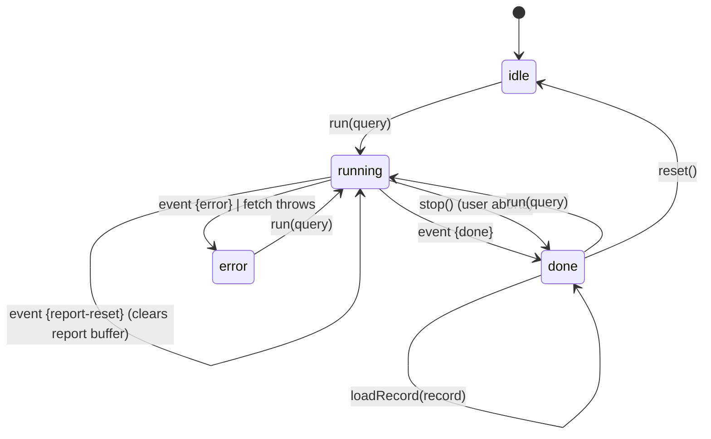
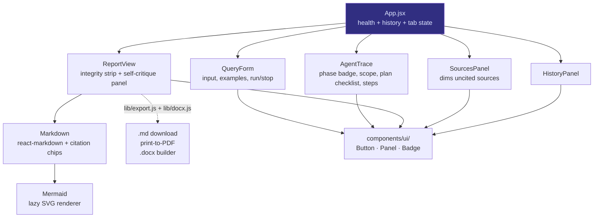
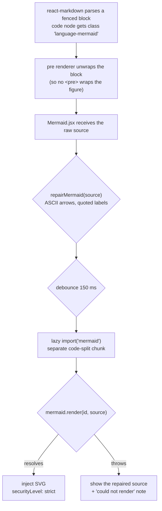
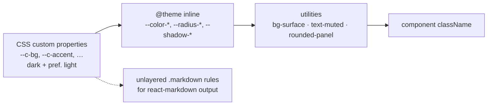

# MAD Researcher — Frontend

> Part of the [architecture record](ARCHITECTURE.md). Section numbers are the
> originals from the single-file version, so existing references still resolve.

---

## 13. Frontend architecture

### 13.1 State machine

All run state lives in one hook, `useResearch.js`. It is an explicit four-state machine:



- **`idle`** — nothing yet.
- **`running`** — request in flight; `AbortController` held in a ref.
- **`done`** — either the `done` event arrived, or the user aborted. A stopped run keeps the
  partial report *and* sets `stopped`, so the view labels it a partial draft (the critique and
  the citation audit never ran) instead of presenting it as finished.
- **`error`** — fetch threw or an `error` event arrived.

**Why one reducer-style `apply(event)` and not per-event handlers:** every event is folded
through a single `switch` in a `setState` updater (`useResearch.js`). This makes the event
vocabulary of the backend and the state transitions of the frontend visibly 1:1 — to add an
event type you add one `case`. It also means React can't tear state across events, because
functional updates are serialised.

**Why `AbortController` and not a "cancel" flag:** aborting propagates down to the `fetch`,
which closes the TCP connection, which fires `res.on('close')` in the route, which aborts the
pipeline's own `AbortController` — so the model and search calls in flight are cancelled
instead of completing for a client that has gone away, and the next checkpoint
(`throwIfAborted`) stops the run. One mechanism, both ends. See
[§9.5](backend.md#95-heartbeat-and-dead-socket-handling).

### 13.2 Component tree



**Why no state library:** the entire shared state is one hook instance in `App.jsx` plus
two `useState` values (`health`, `history`). Redux/Zustand would add a dependency to manage
*a single object*. If the app grew a second view or optimistic multi-run support, that
calculus would change.

### 13.3 The SSE parser (and why we wrote it)

`api.js` reads `res.body` with a `ReadableStream` reader and splits on `\n\n`:

```js
const frames = buffer.split('\n\n')
buffer = frames.pop() ?? ''   // keep the trailing partial frame
```

**The subtle part is `buffer.pop()`.** TCP/HTTP chunks do not respect SSE frame boundaries —
a single `read()` can deliver half a frame, or three frames at once. Keeping the trailing
partial in `buffer` (and prepending it to the next chunk) is what makes the parser correct
under arbitrary chunking. Getting this wrong produces the classic "occasionally a token or a
source goes missing" bug that only reproduces on slow networks.

**Malformed frames are swallowed, not fatal:**
```js
try { onEvent?.(JSON.parse(raw)) } catch { /* ignore malformed frames */ }
```
One bad frame must not kill a 42-second research run. This is a deliberate resilience choice.

### 13.4 Citation chips — the interesting trick

The writer emits `[2]` in Markdown. We want that to be a clickable chip that scrolls to
source 2. Three ways to do it, and the reasoning:

| Approach | Cost | Chosen? |
|---|---|---|
| Write a `remark` plugin to reparse text nodes into elements | Correct but heavy; API surface, plugin ordering, edge cases | ❌ |
| Replace `[2]` with raw HTML `<button>` | Breaks if `react-markdown` sanitises it; mixes concerns | ❌ |
| **Rewrite `[2]` → `[2](#source-2)` and intercept the anchor in a custom `a` component** | ~20 lines, uses the Markdown parser we already have | ✅ |

```js
text.replace(/\[(\d+(?:\s*,\s*\d+)*)\](?!\()/g, (m, g) =>
  g.split(',').map((n) => `[${n}](#source-${n})`).join(''))
```

The negative lookahead `(?!\()` is what prevents mangling an existing Markdown link
`[text](url)`. The `> 6 citations` guard prevents turning a genuinely long bracket list into
a wall of buttons. The custom `a` renderer only hijacks hrefs matching `^#source-(\d+)$` —
every other link is rendered normally with `target="_blank" rel="noreferrer"`.

The pattern and the guard live in `lib/citations.js` rather than in the renderer, because the
exporters need the same answer to "what does this report cite?" — see [§13.5](#135-export).

Then `scrollToSource` does `scrollIntoView({block:'center'})` and adds a `flash` class for
1200 ms so the user can see *which* card was targeted. The whole interaction is defensive:
if the element isn't found, it silently does nothing rather than throwing.

### 13.5 Export

| Format | How | Why |
|---|---|---|
| **Copy** | `navigator.clipboard.writeText` | Silent failure if blocked (insecure context) — no crash |
| **`.md`** | `Blob` + object URL + synthetic anchor click | Pure client-side, no server round-trip, filename slugged from the title |
| **PDF** | Open a new window, write styled HTML, `win.print()` | Uses the browser's native print-to-PDF — no jsPDF/html2canvas dependency, real selectable text, no extra 100 kB |
| **`.docx`** | `docx` (lazy) + a Markdown→OOXML converter, `Packer.toBlob` | Real Word styles and tables, and diagrams rasterised to PNG so they survive into Word |

The PDF path **inline-styles the print document** rather than reusing app CSS, because the
app's dark theme and layout would print badly. It's a small, isolated duplication in exchange
for a print output that looks like a document, not a screenshot of a dashboard.

**Citations in exports.** A citation used to render as a `<button onClick>` with no `href`,
and the print window never included the sources list — so `[n]` in a saved PDF pointed at
nothing. Citations are now real `<a href="#source-n">` elements (the click is still
intercepted in-app so it scrolls the source panel instead of jumping), and both the print
document and the DOCX append a **Sources** appendix carrying the same `#source-n` ids. Source
titles and URLs are untrusted web text and are HTML-escaped before being interpolated into the
print window, which shares this origin.

**The appendix lists cited sources only.** A run discovers more sources than it ends up
citing, and the in-app panel keeps showing all of them (dimmed) because there they answer
"what was searched". In a document someone saves, an entry no `[n]` points at is noise, so
exports are built from `citedSources(sources, report)` — the report's own citation markers
decide the list, using the same pattern that renders the chips ([ADR-13](decisions.md#adr-13-citations-inline-no-reference-list)).
Numbers are not renumbered: the report says `[7]`, so the appendix keeps calling that source 7,
gaps and all. A `.md` download carries no appendix (the report body is the report), and the
diagram blocks in it are repaired on the way out (see below).

The `docx` builder is deliberately a small hand-written converter over the subset the writer
actually emits (headings, paragraphs, lists, GFM tables, blockquotes, fenced code, Mermaid)
rather than a general Markdown engine — a general one would pull far more code than this
report format can produce. `docx` is imported lazily, so its ~456 kB lands in its own chunk
and is never fetched unless someone exports.

### 13.6 Mermaid diagrams in the report

The writer agent is instructed ([§8.3](agents.md#83-the-writer-prompt-and-the-format-spec)) to emit one or two
```` ```mermaid ```` blocks. Rendering them is the interesting part, because the report is
**streamed token by token** — at any given moment the Markdown is a partial document.



Four decisions, each with a reason:

| Decision | Alternative | Why this one |
|---|---|---|
| **Detect the fence in the `code`/`pre` renderers** | A `remark` plugin, or `rehype-mermaid` | Zero new parser plumbing; the class name is already there. `rehype-mermaid` would also pull in a headless browser at build time. |
| **Render client-side in an effect** | Server-side render to SVG at write time and store the SVG | The write path is *already* well over a minute ([§19](verification.md#19-performance-where-the-time-goes)); adding a rendering step and a large Mermaid install to the backend makes the critical path longer and couples the server to a charting library it otherwise doesn't need. |
| **Debounce 150 ms** | Render on every token | An unclosed fence is still a valid code block to CommonMark, so without debouncing we'd kick off a `mermaid.render` for nearly every streamed token, each one failing until the fence closes. The debounce collapses that to one attempt per quiet period. |
| **`securityLevel: 'strict'`** | Default/`loose` | Mermaid's strict mode sanitises labels and disables click handlers and HTML labels. The diagram text is indirectly model-authored from scraped pages, so it sits on the same untrusted boundary as [ADR-14](decisions.md#adr-14-react-markdown-instead-of-innerhtml). |

**The model writes diagrams Mermaid rejects, so the source is repaired before it is parsed.**
Two independent faults were captured from a real report: a Unicode arrow (`⟶`) used as an edge
operator — a *lexical* error — and `(2020-2022)` left unquoted inside a node label, where
parentheses are syntax rather than text, a *parse* error. Either one alone stops the diagram
rendering. `lib/mermaid.js` fixes the shapes the parser was measured to reject, and each rule
carries the error it exists to fix:

| Fault | Repair |
|---|---|
| Unicode arrows (`⟶ ⟹ ➔ ➜ ↦ → ⇒`), em/en-dash arrows (`—>`, `–>`) | rewritten to the diagram family's ASCII arrow (`-->`, `->>` for sequence diagrams) |
| A single-dash `->` in a flowchart | rewritten to `-->` — `-->`, `-->>` and `-.->` are left alone |
| `(`/`)`, `"`, `[`/`]` inside an unquoted label, in any node shape (`[ ]`, `( )`, `{ }`, `(( ))`, `([ ])`) | the label is quoted; an inner `"` becomes `#quot;` and a trailing backslash is doubled |
| The same in an edge label (`-->|Costs (2020)|`) or a `subgraph` title | quoted the same way |
| A sentence of prose inside the fence, a nested fence, an `end` with no open `subgraph` | dropped |

The repair is deliberately narrow: `%`, `>`, `,`, `:`, `;` and `&` are all accepted unquoted
by Mermaid 12, and quoting "just in case" would edit diagrams that already render — a quoted
label ending in a backslash, for instance, is *worse* than the unquoted one. Only the
flowchart grammar has been verified this way, so sequence diagrams get arrow repair only and
timeline/class/state diagrams are passed through untouched rather than guessed at. It is
idempotent, so repairing at render time and again on export changes nothing the second time.

`frontend/test/mermaid.test.js` asserts every one of these cases against the **real Mermaid 12
parser**, plus that the repaired report diagram parses, that both of its faults are real
(fixing only one still fails), that diagrams which already parse come back byte-identical, and
that repair is idempotent. `npm test` in `frontend/` runs it.

**The fallback is still the point, but it is now the rare path.** A diagram the repair cannot
rescue does not blank the report or throw a React error — the repaired source is shown with a
small note, so the report degrades to "here's the definition" rather than breaking. Every
diagram in the live verification report was parsed with the real Mermaid v12 parser
([§15.4](verification.md#154-what-could-not-be-verified)).

**Bundle cost, measured:** `mermaid` is reached only via a dynamic `import()`, so it lands in
its own chunks (plus one per diagram type). Adding it grew the main app bundle by only
~10 kB (389.7 kB → 399.7 kB, 123.9 kB gzip at the time); the whole app bundle is ~548 kB
(164 kB gzip) at the time of writing, and the diagram chunks are fetched only when a report
contains one.

### 13.7 Styling: Tailwind v4

The UI moved from ~700 lines of hand-written CSS (`index.css` + `App.css`) to Tailwind v4
utilities, with the theme expressed as tokens rather than duplicated values:



- **No `tailwind.config.js` and no PostCSS config.** v4's Vite plugin scans sources and reads
the `@theme` block directly, so configuration is one `@import 'tailwindcss'` plus a token map.
- **Tokens stay in `:root` as `--c-*` custom properties**, and `@theme inline` maps them to
`--color-*`. `inline` means the generated utility references `var(--c-accent)` rather than a
copied literal, which is what makes the `prefers-color-scheme: light` palette work with no
`dark:` variants anywhere in the markup.
- **The rendered report keeps a small stylesheet.** `react-markdown` output cannot carry
utility classes on every element, so `.markdown` rules remain — but they are written with
`@apply`, live in one block, and are the only place that styles Markdown.
- **One real gotcha, found by reading the emitted CSS:** the `.source-card.flash` highlight
was first written inside `@layer components`, where Tailwind's utilities layer always wins —
the flash would silently never appear. It is now intentionally **unlayered**, which is what
lets it override the card's `border-line-soft` / `bg-inset` utilities. Verified by grepping
the built CSS for the emitted rule.
- **The interface identity lives in the tokens, not the components.** The theme is a warm
"reading room": ink on paper, a single teal accent, amber for annotations; `Fraunces` for
headings, `Newsreader` for report prose, `Public Sans` for UI. Because components only ever name
tokens, changing the palette and type was a change to `index.css` plus one `<link>` in
`index.html` — no component was rewritten to restyle it. Three more unlayered rules carry the
identity: `.btn-primary` (its hover mixes toward the ink colour, so the label stays legible
whether the accent is light or dark), and `.marker` / `.sketch-rule`, the hand-drawn annotation
motif.
- **Motion is two systems, deliberately split.** The signed-in app animates with CSS keyframes
only — `.rise` when a report arrives, `.enter` for rows that stream in (a new source card, a trace
step, a history entry), the status pulse, the step-pill shimmer. The
**signed-out landing** is the one place that uses a library: `motion`, via `m` + `LazyMotion`
(`domAnimation`) with the feature set dynamically imported, wrapped by `Reveal`. It is scoped that
way on purpose, so the library's blast radius is the marketing page and a `prefers-reduced-motion`
user gets a static page from both systems ([ADR-27](decisions.md#adr-27-motion-for-the-landing-animations)).
Every interactive element carries a visible `:focus-visible` ring.
- **Nothing important just disappears.** The two long streams — the agent trace and the finished
report — each end in a `FadeBox`: the block is clipped, its lower edge is blurred and faded into
the panel, and a pill inside that band expands it. The open state is *derived*
(`expandedByUser ?? running`) rather than synced to `running` in an effect, so the reader can fold
either one up mid-run and there is no second source of truth to keep in step. Collapsed content is
marked `inert`, keeping its links and citation chips out of the tab order. Expand and collapse
**animate**: `max-height` is driven to the measured content height (never `auto`, which cannot
transition) and the veil fades with it. While the content is still streaming, `animate={!running}`
switches the transition off, so the box tracks new tokens instead of chasing them a half-second
behind.
- **A run says what it is doing.** `StatusPill` names the step the agents are on — the last trace
step ("Researcher · Searching the web"), not the raw progress line — with a pulsing dot, a slow
shimmer and a cross-fade when the step changes. It is a `role="status"` live region.

### 13.8 Honesty in the UI: the integrity strip and the self-critique panel

The pipeline produces evidence about its *own* quality — citation coverage, uncited sources,
a critique verdict, and a list of issues. The frontend's job is to show that evidence rather
than hide it behind a confident-looking document:

| Signal | Where it appears | Why it is surfaced |
|---|---|---|
| Phase badge | `AgentTrace` header | makes "still reading sources" legible instead of looking hung |
| Citation count, cited/total sources | `ReportView` integrity strip | a report citing 23 of 48 sources is a *fact*; burying it would overstate the work |
| Broke-citation count removed | `ReportView` integrity strip | shows the audit did something, or that it found nothing to fix |
| Critique verdict + issue list | `ReportView` `<details>` disclosure | the reviewer's findings are available on demand, not presented as a badge of shame |
| Uncited sources dimmed | `SourcesPanel` | shows *which* sources went unused, which is where a reader would look for the missing angle |
| Phase-aware placeholder | `ReportView` before first token | the draft phase is slow; a placeholder that names the phase is honest about what's happening |

**The design rule:** every integrity number the backend computes is rendered somewhere the
user can see, and nothing is styled as an error when it is merely a *limitation*. A report
that admits "the evidence conflicts here, and these sources went unused" is more useful than
one that presents false completeness — and the earlier the UI makes that visible, the harder
it is for the pipeline to quietly regress.

---
