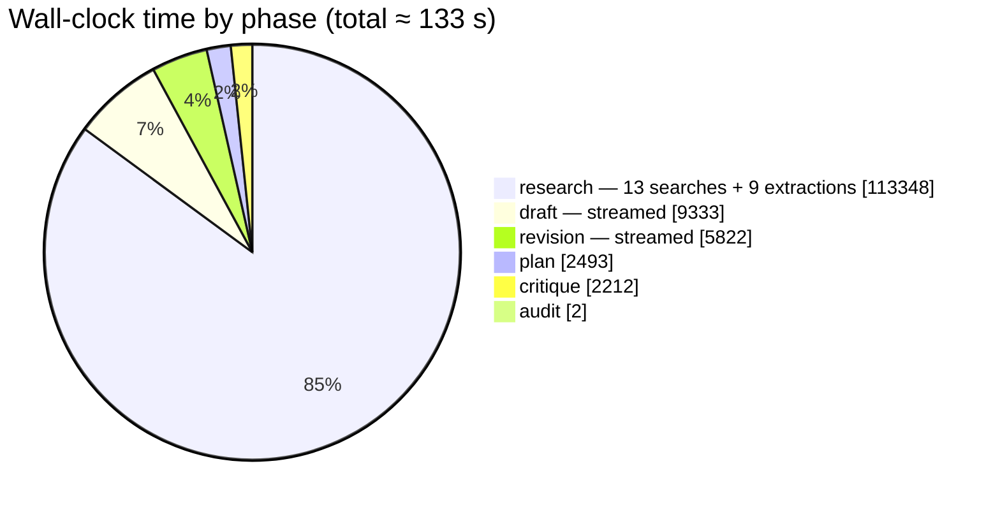
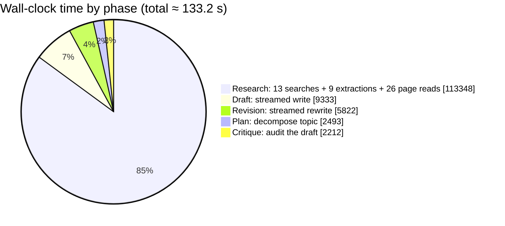

# MAD Researcher — Verification, performance and limitations

> Part of the [architecture record](ARCHITECTURE.md). Section numbers are the
> originals from the single-file version, so existing references still resolve.

---

## 15. Verification: measured, not asserted

Everything below was executed against the real Gemini endpoint and the real Tavily API, using
the storage driver that existed at the time. No part of this section is inferred — with one
labelled exception, [§15.5](#155-the-stall-watchdog-measured), which measures *timing* against a
local server speaking the same SSE protocol. What is under measurement there is a clock, not a
provider, and the section says what it therefore does not establish.

> **Note:** these measurements predate the auth / MongoDB-only / mock-removal change. The
> pipeline phases, timings and token counts are unaffected by it, but a line naming the
> JSON file store or mock mode describes the code as it was when the run was captured —
> both were deleted afterwards ([ADR-24](decisions.md#adr-24-delete-mock-mode-and-the-file-store)).

### 15.1 End-to-end live run

Health after boot confirmed **live** mode with no missing keys (the JSON above). A real query
(`"How do solid-state batteries compare to lithium-ion in 2026?"`) was streamed through
`POST /api/research/stream` against the real Gemini endpoint and the real Tavily API, with the
then-current file store. **All six phases ran, all thirteen event types fired, and there were
zero `error` frames.**



| Claim | Evidence |
|---|---|
| **All six phases execute, in order** | `phases: [plan, research, draft, critique, revision, audit]` with per-phase `ms` on the record |
| **The revision actually ran** | `revised: true`, and the report arrived in **2 streams** with a `report-reset` frame between them |
| **The critic found real problems and they were fixed** | verdict `solid` **with 2 issues**; one was an uncited fast-charging claim in a comparison table, and the shipped table carries `Not established in sources` for that cell — the revision applied it |
| **Gap-filling fires** | 5 base searches + **8 follow-up searches**, **4 gap rounds**, **9 extractions** for 5 sub-questions |
| **Full pages are read, not just snippets** | **26 pages** fetched in full across the run (`Full pages read` steps) |
| **The report is a long-form analyst document** | 1,491 words, 11 `##` sections, 2 `###`, a comparison table, and all five required sections present (`missingSections: []`) — measured *before* the per-format length ranges were added; see [§20](#20-known-limitations-and-honest-gaps) row 18 |
| **Diagrams still render** | 1 ```` ```mermaid ```` block, parsed clean with the real **Mermaid v12** parser |
| **Citations are inline and audited** | 72 references, 23 of 48 sources cited (coverage 48 %), `invalid: []`, `invalidRemoved: 0` |
| Streaming works on Gemini | 205 `token` deltas across the draft and the revision |
| JSON mode works on Gemini | planner, 9 researcher, follow-up, and critic calls all returned parseable JSON |
| Real web search works | 48 deduped source URLs |
| Persistence works | record written to `backend/data/reports.json`, newest-first — the **then-current file store**; the same record shape now goes to MongoDB ([§12](backend.md#12-storage-the-mongodb-facade)) |
| No silent failures | zero `"type":"error"` frames in the captured stream |

**The cost of depth, measured:** 133 s wall-clock and 105,937 tokens (100,434 prompt /
5,503 completion) versus the ~42 s / ~7-call v1 pipeline. The user explicitly accepted this
trade — see [§19](#19-performance-where-the-time-goes). Note that **prompt tokens dominate
by ~18:1**: the depth comes overwhelmingly from *reading more source text*, not from asking
the model to think longer, which is the cheaper and more grounded way to buy quality.

### 15.2 The model-id incident (the reason this trade-off gets a whole section)

The provider matrix in [§10.6](backend.md#106-provider-matrix-all-speak-the-same-protocol) says model
names are passed through verbatim with no validation. Here is the real cost of that choice.

The operator's `.env` contained:

```env
LLM_MODEL=google__gemini_3_5_flash_lite
```

That is an **aggregator-style slug**, not a Google model id. Directly querying the endpoint's
own catalogue settled it:

```bash
curl -H "Authorization: Bearer $KEY" \
  https://generativelanguage.googleapis.com/v1beta/openai/models
```

The real id is **`gemini-3.5-flash-lite`**. The bogus slug produced:

```json
[{"error":{"code":404,"message":"models/google__gemini_3_5_flash_lite is not found for
 API version v1main … Call ModelService.ListModels to see the list of available models."}}]
```

**The verdict on the trade-off:** passing names through verbatim is still correct — but it
means a typo fails at *request* time with a provider 404, not at *boot* time. That is why
`/api/health` reports the resolved `models` and `llmProvider`, and why the startup banner
prints them. **We kept the pass-through design and added observability instead of adding a
validation layer** that would go stale. See [ADR-06](decisions.md#adr-06-pass-model-names-through-unvalidated).

### 15.3 Provider JSON-mode verification

Two direct probes against the OpenAI-compatible endpoint, independently of the app:

| Probe | Result |
|---|---|
| Plain message | HTTP 200, `choices[0].message.content == "OK"` |
| `response_format: {type:"json_object"}` | HTTP 200, valid JSON: `{"title":"Exploring the Moon","subQuestions":[…]} ` |

**Conclusion:** `LLM_JSON_MODE=true` is safe on this endpoint. This is what converts the
"JSON mode might break things" risk from speculation into a tested fact.

### 15.4 What could **not** be verified

Stated plainly rather than glossed. First, what *was* verified **without a browser** when the
diagram and styling work was added:

| Check | Method | Result |
|---|---|---|
| **The full six-phase pipeline runs live** | Live SSE run against the real provider: all 6 phases, 13 event types, 0 `error` frames | ✅ |
| **The revision path executes live** | `revised: true`, 2 `token` streams separated by a `report-reset` frame | ✅ |
| **Every required report section is emitted** | Parsed the live report for the five mandated `##` sections — `missingSections: []` | ✅ |
| The report really contains diagrams | The writer emitted a ```` ```mermaid ```` block in the live 1,491-word report | ✅ |
| Those diagrams are valid Mermaid | Every block extracted from the live report parsed with the real **Mermaid v12** parser under jsdom (`mermaid.parse`) | ✅ 1/1 |
| **Mock mode is gone** | `grep -ri mock backend/src frontend/src` finds no code (only explanatory comments); `agents/mock.js` and `db/fileStore.js` deleted | ✅ |
| **Missing config fails fast** | `node src/index.js` with no `MONGODB_URI`/`CLERK_*`: printed the three missing keys and exited `1` | ✅ |
| **Unauthenticated requests are rejected** | `createApp()` imported directly (no Mongo needed, format-valid placeholder Clerk keys): `GET /api/health` → `200`, `GET /api/research` → `401`, `POST /api/research/stream` → `401` | ✅ |
| **PDF citations resolve** | Built the print document into a stub window and asserted the citation `href="#source-1"` and a matching `id="source-1"` target both land in it, the report H1 is deduped, and hostile source titles/URLs come out escaped | ✅ 11/11 |
| **DOCX is a real Word file** | Built a document and read `word/document.xml` back out of the produced OOXML zip: title, headings, table header/body cells, list items, blockquote, code, citations (`[2, 3]`) and the sources appendix all present | ✅ 21/21 |
| **The chosen format changes the deliverable** | Live run with `reportType=brief`: 561 words (vs ~1,491 for the analyst format), H2 sections exactly `Bottom line · Key findings · What to watch · Limitations`, no analyst methodology section, and `reportType` present on both the `meta` event and the stored record | ✅ |
| Markdown → Mermaid wiring | SSR smoke render of `Markdown.jsx` asserting the fence becomes `Mermaid`, the source does **not** leak into markup, citations become chips, code fences survive, GFM tables render | ✅ 8/8 |
| **Diagrams the model gets wrong are repaired** | `frontend/test/mermaid.test.js`, 18 broken shapes (Unicode, dash and single-dash arrows; unquoted parentheses in rectangle, decision, circle and stadium labels; brackets and quotes in labels; subgraph titles; edge labels; a prose sentence inside the fence; a stray `end`; a nested fence) each handed to the **real Mermaid 12 parser** before and after repair. A real report's flowchart fails as written, *still* fails when only one of its two faults is fixed, and parses after the repair; the 12 diagrams that already parse come back byte-identical; repair is idempotent | ✅ 7/7 |
| **The PDF and `.docx` list cited sources only** | `frontend/test/citations.test.js` (what counts as a citation, what the appendix keeps) and `frontend/test/export.test.js`, which builds the *real* artifacts — the HTML the print window receives, and the OOXML package read back out of the Blob through the zip central directory. Both artifacts carry the cited sources, neither contains an uncited one, a report with no citations gets no appendix, and hostile source titles come out escaped | ✅ 12/12 |
| Tailwind tokens actually emitted | Grepped the built CSS for `rounded-panel`, `rounded-control`, `shadow-panel`, `bg-inset`, `text-muted`, `text-planner`, `bg-researcher`, `text-critic`, and the unlayered `.source-card.flash` rule | ✅ |
| Lint + build | `eslint` clean (exit 0), `vite build` successful (exit 0), with `pipefail` + explicit status capture | ✅ |
| Backend syntax | `node --check` on all 14 changed/created backend modules | ✅ |

And what still cannot be verified here:

| Not verified | Why | Risk |
|---|---|---|
| UI rendering, layout, HMR | **No browser available in this environment** | Visual regressions undetected by automated checks |
| Mermaid **pixels** | Needs a browser | Parser-valid is not the same as legible; a diagram can parse and still lay out awkwardly. The repair in `lib/mermaid.js` is therefore verified at the parser level — what could not be checked is what it *looks* like |
| Citation-chip scroll & flash | Needs a browser | Interaction could be subtly wrong — the CSS layer-precedence bug found by reading the built CSS is exactly this class of risk |
| Tailwind's visual result | Needs a browser | Layout/spacing regressions are invisible to `lint` and `build` |
| **The integrity strip, phase badge, self-critique `<details>` panel** | Needs a browser | The data is verified to be present on the wire (`critique` + `audit` frames captured); only its *presentation* is unproven |
| Export buttons (copy/.md/PDF/DOCX) and the landing page | Needs a browser | Untested |
| MongoDB driver at runtime | No `MONGODB_URI` provided ("still no db") | `mongoStore.js` is written and type-consistent but never executed |
| Multiple providers simultaneously | Only Gemini was available | Other base URLs unproven in practice |

**Since this table was written, three of those rows have moved** — recorded here rather than
quietly rewritten above, because the table is a record of *that* session:

- the app now runs against a real Atlas cluster: reports save, list and reopen across reloads, so
  the Mongo adapter is exercised rather than merely type-consistent;
- the UI has been driven in a real (headless) browser across both themes and a 390 px viewport,
  which covers the rows that were waiting on one — rendering and layout, the integrity strip and
  the self-critique panel, citation-chip scroll and flash, and the export buttons (`.md`, `.docx`
  and the PDF print document were each produced and inspected);
- the `.md` export now carries a Sources appendix, which it did not at the time.

**What has not changed:** none of that is an *automated* browser test. Every one of those checks
was manual, so a visual or interaction regression would still go uncaught by `npm test`.

The frontend was checked by `eslint`, `vite build`, `node --test` (`npm test` — the diagram
repair against the real Mermaid parser, and the citation parsing the exports depend on), an SSR
render of the Markdown path, and a parser pass over the generated diagrams — **but none of that
is the same as a person looking at the page, and this record does not claim otherwise.**

### 15.5 The stall watchdog, measured

Row 10 of [§20](#20-known-limitations-and-honest-gaps) used to say the watchdog's *timing* was
unverified — only its signal merging had tests. That is now measured, for a reason: the failure
it exists to prevent was observed in a real run (a revision stream cut off at 60 s on a
reasoning model whose prompt held the whole draft, reported as "the model stopped sending
output"), and a claim about a *timeout* is worth nothing without a clock behind it.

**Method.** `chatStream` driven against a local HTTP server that speaks the OpenAI SSE protocol
(`text/event-stream`, `data: {...}` frames, `[DONE]`), so the server decides exactly when each
frame lands, and the scenarios run against both the one-budget code at `c306f2d` and the
split-budget code. Both knobs floor at 5 s (`config.js`), so the budgets under test are 5 s and
20 s rather than anything tighter:

| Scenario | One budget | Two budgets |
|---|---|---|
| 7 s before the first token, 5 s idle budget | **threw at 5.4 s** — a model that was thinking, reported as unavailable | **answered at 7.4 s**, the wait charged to `LLM_TIMEOUT_MS` |
| Empty keepalive frames at 3 s and 6 s, 5 s budget | threw at 5.5 s | answered at 6.6 s — any frame re-arms the watchdog |
| Output, then silence past the budget | **returned `"Hello"` as a complete answer** | threw the stall message |
| Headers, then nothing at all | — | the first-token message, naming the model that was called |

The third row is why this section exists. Aborting a stream does **not** reliably arrive as an
error: the body is closed and the SDK's iterator simply completes, so the `if (stalled)` in the
`catch` never ran and the partial text was returned as a finished answer — the difference
between a truncated report persisted as complete and a failure the run has to face. The return
time tracked the budget exactly (5.3 s under a 5 s budget, 8.5 s under 8 s) on the old code as
well, so it was pre-existing rather than a regression from the split.

**What this does not establish.** Nothing here speaks to a real provider: whether 180 s of
silence is enough for a given reasoning model is a property of that model and its endpoint, not
of this code — the harness shows only that a long first token is no longer charged to the
inter-token budget. The harness was a throwaway script rather than a committed test, so this
section records a measurement, not a regression guard; row 10 stands in that respect.

---

## 19. Performance: where the time goes

Measured on a real live run ("How do solid-state batteries compare to lithium-ion in 2026?",
`RESEARCH_DEPTH=deep`, `MAX_SUBQUESTIONS=5`, the rest of the depth knobs at their
defaults, Gemini 3.5 Flash Lite):



| Phase | Time | Share | Notes |
|---|---|---|---|
| Plan | 2.5 s | 2 % | one `chatJSON` call |
| **Research** | **113.3 s** | **85 %** | 13 searches, 9 extractions, 26 full pages, 4 gap rounds |
| Draft | 9.3 s | 7 % | streamed; **first token at 117 s** |
| Critique | 2.2 s | 2 % | one `chatJSON` call |
| Revision | 5.8 s | 4 % | streamed; **first token at 128.6 s** |
| Audit | 0.002 s | 0 % | pure regex + set lookup, no model |
| **Total** | **133.2 s** | 100 % | ~314 SSE events, 13 LLM calls, 13 searches, 105,937 tokens |

### Where the time and money actually go

**Research is still ~85 % of the run — and that is now the *point*.** The v1 pipeline spent
~35 s on 5 searches and 5 extractions. This one spends ~113 s on 13 searches, 9 extractions,
and **26 full pages read**. The extra ~78 s buys: gap-targeted rounds on the sub-questions
the researcher rated least complete, and whole-page text instead of ~800-character snippets.

**The token split is the interesting number: 100,434 prompt vs 5,503 completion (~18:1).**
That ratio says the depth is bought almost entirely with *input context* — reading more of the
actual sources — rather than with longer reasoning or longer output. For a research task that
is the right way round: more evidence in, same-shaped answer out.

### The latency fix: bounded concurrency in the research phase

**Research was the only phase worth optimising**, and it now runs as a bounded pool
([§7.3](agents.md#73-why-research-runs-in-a-bounded-pool)) instead of a sequential loop. Measured on
a later live run ("Grid-scale battery storage costs and deployment trends",
`RESEARCH_CONCURRENCY=3`, `MAX_SUBQUESTIONS=4`, `RESEARCH_MAX_ROUNDS=1`,
`DEEP_FETCH_SOURCES=2`, Gemini 3.5 Flash / Flash Lite):

| Phase | Time | Share | Notes |
|---|---|---|---|
| Plan | 2.7 s | 5 % | one `chatJSON` call |
| **Research** | **24.8 s** | **49 %** | **4 sub-questions in parallel**, 6 search rounds, 38 sources, 8 full pages |
| Draft | 6.8 s | 13 % | streamed |
| Critique | 1.5 s | 3 % | one `chatJSON` call |
| Revision | 4.6 s | 9 % | streamed |
| Audit | 0.004 s | 0 % | pure regex + set lookup, no model |
| **Total** | **50.5 s** | 100 % | 38 sources, 47 references, 13 cited, `invalid: []`, 1,165-word risk assessment |

The research phase alone was ~113 s while sequential (measured above, but with *different*
knobs — 5 sub-questions, `RESEARCH_MAX_ROUNDS=2`, `DEEP_FETCH_SOURCES=3` — so the two runs are
not a like-for-like speed-up claim; the point is that the phase now overlaps its own network
wait instead of accumulating it). Across the concurrent runs observed while making this
change, research landed between **16 s and 25 s** for 4 sub-questions, and it remains the
dominant phase at roughly half the run.

**What is still not fixed:** the pool width is a constant. It cannot back off when a provider
rate-limits the run, and it does not adapt to how many sub-questions the planner produced.
That is [limitation #1](#20-known-limitations-and-honest-gaps).

**The explicit trade accepted here:** the user was asked how to spend the budget and chose
*"don't care about latency — prefer maximum depth and verification, even 3–5 minutes."* That
is why the depth knobs default to values that produce a ~2–3 minute run rather than a ~40 s
one. The dial exists (`RESEARCH_MAX_ROUNDS=0`, `DEEP_FETCH=false`, `RESEARCH_CRITIQUE=false`
returns roughly v1 behaviour) but it is deliberately turned up.

### The perceived-latency mitigation

Two minutes — or fifty seconds with the concurrent research phase — is acceptable *because it
is streamed and legible*. Using the measured phase timings
([§15.1](#151-end-to-end-live-run)), the user has feedback almost immediately:

- `meta` + first `status` → within ~1 s
- `plan` (the checklist, with scope and themes) → at ~2.5 s
- first `sources` → within a few seconds after that
- 48 source cards and 57 trace rows → accumulate continuously for ~115 s
- first draft `token` → ~117 s; first revision `token` → ~129 s

An equivalent non-streaming implementation would show a spinner for 133 seconds. This is
exactly why the **`phase` event was added**: during a two-minute research phase the old UI
could only say "researching…", which is indistinguishable from "hung". Now the badge names
the phase and the trace shows each search, page read, and gap round as it happens. The
protocol choice ([ADR-04](decisions.md#adr-04-post-sse-with-hand-parsing)) is what converts a latency
problem into a legible process — and the longer the pipeline gets, the more load-bearing
that choice becomes.

---

## 20. Known limitations and honest gaps

Ordered by how much they'd matter if this became more than a local tool.

| # | Limitation | Impact | Sketch of the fix |
|---|---|---|---|
| 1 | **The research pool width is fixed** (`RESEARCH_CONCURRENCY`) | It cannot adapt to a provider's rate limits, and a value that is too high trips them instead of going faster | Scale the width to the remaining sub-questions and back off on a `429`/`retry-after` |
| 2 | **Auth is login-only** | No roles, sharing, teams or org scoping | Clerk Organizations + an `orgId` alongside `ownerId` |
| 3 | **No local/offline mode** | A missing key means the server will not boot | Deliberate ([ADR-24](decisions.md#adr-24-delete-mock-mode-and-the-file-store)); a documented demo mode could return behind an explicit flag |
| 4 | **Prompt injection from web content** | A hostile page could skew a report | Source allow-listing, injection classifiers, output review — all partial |
| 5 | ~~Mongo driver never runtime-verified~~ **Now in live use** — the app runs against Atlas and reports persist across reloads | The adapter has no test, so *edge cases* are unproven: a dropped connection mid-save, or a record written by an older schema | A connection-loss test around `save()`, and a read of a record written by an earlier schema |
| 6 | **`list()` capped at 100** | Silent truncation for a user with a long history | Add pagination; make the cap explicit in the UI |
| 7 | **Session tokens are the only auth signal** | A leaked token is valid until it expires | Short token lifetime is Clerk's default; add audience/org claims if this API is ever shared |
| 8 | **No reconnecting SSE** | A dropped connection ends the run | Persist partial progress and offer `GET /api/research/:id` resume |
| 9 | **Search quality unseen** | A run with no results still "succeeds" | Surface `gaps` prominently in the UI; warn when `gaps` is non-empty |
| 10 | **Tests cover the pure logic, not the pipeline** | `npm test` (41 tests in six files) covers the citation audit and sanitiser, the source index, finding validation, the concurrency pool, critique normalisation and the stall watchdog's *signal merging*. The watchdog's timing was measured against a fake provider ([§15.5](#155-the-stall-watchdog-measured)) but is not a committed test, and every network path is still exercised only by a live run | Commit the fake-provider harness as a test behind a seam in `llm.js`, and stub `services/search.js` to drive `runResearch` against it |
| 11 | **Report diagrams are LLM-authored** | A malformed ```` ```mermaid ```` block shows the "could not render" fallback instead of a diagram | The fallback and the prompt constraints already contain it; a server-side `mermaid.parse` guard could reject bad blocks before persisting |
| 12 | **The critic is the same model family as the writer** | A shared blind spot can survive an adversarial review | The critique is one prompt in one file; pointing it at a *different* provider is a small, high-value change |
| 13 | **Deep fetch reads only the top-N ranked URLs** | A lower-ranked source with the best primary data is never read in full | Make `DEEP_FETCH_SOURCES` adaptive (e.g. read more when coverage is low) or rank by something other than Tavily's score |
| 14 | **The revision is unconditional, so it always costs ~6 s + tokens** | Slightly wasteful on an already-clean draft | ADR-21 explains why this was accepted; a cheap gate would need a trustworthy signal, which the `verdict` field demonstrably was not |
| 15 | **The critic's full-text expansion is capped** (`CRITIC_FULL_TEXT_SOURCES`, default 8) | Beyond the cap it reviews snippets, so a miscitation whose support lives in the body of an uncapped source can still pass | Raise the cap, or expand exactly the sources behind the claims flagged as `overreach` in a second pass |
| 16 | **A stopped run is not persisted** | Stop a run and the partial draft is on screen but absent from history; the work is unrecoverable | Persist a `status: "cancelled"` record with the partial report and mark it in the library |
| 17 | **One retry is the whole JSON-repair strategy** | A provider that consistently answers in prose (rather than JSON) fails the run twice and gives up | Prompt-level enforcement is already the primary defence; a stricter repair turn or a schema validator would catch the rest |
| 18 | **The length ranges are prompt-level and unverified live** | Each format's word range is a string in `prompts.js` — the only mechanism, and one a model can ignore. The lengths measured in [§15.1](#151-end-to-end-live-run) (1,491 words analyst, 1,165 risk, 561 brief) predate the ranges, so nothing in this record shows a run that hit one | A live run against a real provider with the new prompts; if the number keeps being ignored, enforce it in code (count the words, then one expansion pass) rather than in prose |
| 19 | **The PDF inherits the browser's print header and footer** | A saved PDF shows the page title and the page URL at the top of the sheet. Both are emitted by the browser's own print dialog: the PDF path writes the document and calls `win.print()` ([§13.5](frontend.md#135-export)), so no change to the export code removes them | Deselect "Headers and footers" in the print dialog — a per-machine setting; making it disappear unconditionally means generating the PDF in code rather than printing |
| 20 | **The revision is never re-critiqued** | The critique runs once, against the draft ([§7.7](agents.md#77-critique-and-the-always-on-revision)); the revised report is then checked only by `auditCitations`, which sees citation *numbers* and cannot notice a new uncited claim, a fresh overreach, or an issue the revision silently failed to fix. The rewrite is trusted more than the draft was | Re-run the critique against the revision and keep the better of the two, or diff the two passes and re-audit only what changed |
| 21 | **A stalled draft loses the run** | A watchdog cut-off on the draft stream is terminal ([§18.1](backend.md#181-what-happens-when-each-layer-fails)): the route emits an `error` frame and nothing is persisted, so minutes of search and extraction die with the draft. Accepting the truncated text instead was worse — it was saved as a complete report ([§15.5](#155-the-stall-watchdog-measured)) — but neither outcome is good | Retry the draft stream once (a stall is often a provider hiccup, not a dead model), or persist what arrived with `status: "truncated"` and say so in the library |

---
